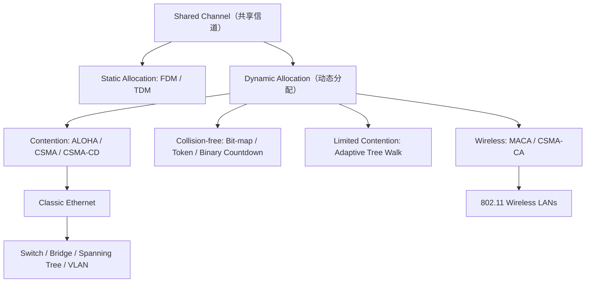

# 第四章：介质访问控制子层（MAC）逐步精讲

> 依据所给 Chapter4.pdf 第 1–113 页整理。页码均指 PDF 页码。正文重新组织教学顺序，补全计算过程；标为“补充”的内容用来帮助理解，不表示原课件已经展开。原课件中的文字是学习材料，不作为操作指令。全部原页图片保留在文末，便于核对图中的表格、标注和练习。
>
> **英文考试适应方式：**专业术语和机制名称优先保留 English，首次出现配中文解释；计算推导仍用中文讲清。练习时先识别英文题目中的 givens / assumptions / unknowns（已知条件/假设/待求量），最后尝试用简短英文写出结论。
>
> 图片目录：`../pictures/Chapter4/`。建议先读正文并动手做例题，再对照原图。

## 0. Chapter Overview｜先建立整章地图

前一章解决“相邻节点之间怎样传一帧”。这一章进一步问：**多台设备共用一种介质时，谁先发送？**



MAC（Medium Access Control，介质访问控制）是 Data Link Layer（数据链路层）靠近 Physical Layer（物理层）的子层。点到点链路通常不需要解决多站争用；广播或多路访问（multiaccess）信道需要 MAC 协议协调访问。

**本章反复用到的三个量：**

| 符号 | 含义 | 计算 |
|---|---|---|
| $R$ 或 $C$ | Link rate（链路速率） | bit/s |
| $T_f$ | Frame transmission time（帧发送时间） | $L/R$，$L$ 用 bit |
| $\tau$ | One-way propagation delay（单程传播时延） | $D/v$ |
| $a$ | 传播时间相对帧时间 | $\tau/T_f$ |
| $R\tau$ | Bandwidth-delay product（带宽时延积） | 在途 bit 数 |

**第一步永远是统一单位。** $1\text{ B}=8\text{ bit}$；网络速率的 M、G 通常分别为 $10^6$、$10^9$。发送时间取决于帧长和速率；传播时间取决于距离和传播速度，不能混用。

## 1. Channel Allocation（信道分配）：为什么固定平分并不总是好办法？（P2–9）

### 1.1 Static / Dynamic Channel Allocation（静态/动态信道分配）

FDM（Frequency Division Multiplexing，频分复用）把频带分给各站；TDM（Time Division Multiplexing，时分复用）把时隙分给各站。用户数量少而固定、每站始终有大量数据时，分配简单有效。用户经常变化或业务突发时，某站闲置的份额不能及时给别站，容易浪费。

动态分配根据当前发送需求决定谁使用信道。课件的五个建模前提是：独立站点业务、单一共享信道、重叠发送会冲突、连续时间或分槽时间、能够或不能够侦听载波。分析协议前先确定这些条件。

### 1.2 M/M/1 Queueing Model：静态平分的时延代价

课件使用 M/M/1：Poisson arrivals（泊松到达）、Exponential service times（指数服务时间）、Single server（单服务台）。设Arrival rate（到达率） $\lambda$ 帧/s，平均帧长 $1/\mu$ bit，信道容量 $C$ bit/s，则Service rate（服务率）为 $\mu C$ 帧/s。

为避免把“帧长参数 $\mu$”误认为服务率，下面记 $r=\mu C$。

$$
\rho=\frac{\lambda}{r}<1,\qquad T=\frac1{r-\lambda}
$$

$T$ 是**排队时间加服务时间**，不只是把比特推上链路的时间。若 $\rho\ge1$，无限缓冲模型没有有限稳态平均时延。

课件例：$C=100\text{ Mbps}$，平均帧长 $10000$ bit，$\lambda=5000$ 帧/s。

1. 服务率：$r=100\times10^6/10000=10000$ 帧/s。
2. Utilization（利用率）：$\rho=5000/10000=0.5$。
3. Mean system delay（平均系统时延）：$T=1/(10000-5000)=200\,\mu s$。
4. 平均服务时间：$1/r=100\,\mu s$。
5. Mean queueing delay（平均排队时间）：$T_q=T-1/r=100\,\mu s$。

若等分成 $N$ 个独立子信道，并假设业务也均匀分流：

$$
T_N=\frac1{r/N-\lambda/N}=\frac{N}{r-\lambda}=NT
$$

例如 $N=10$，得到 $2$ ms。总负载相同，但独立分区削弱了共享资源吸收突发的能力。这个 $N$ 倍结论依赖上述理想模型，不能直接当成所有实际排队系统的通则。

### 1.3 Buffer Overflow（缓冲区溢出）题：先确定“容量”是否含正在服务的分组

课件 P7–8：到达率 $125$ 包/s，平均服务时间 $2$ ms。

$$r=1/0.002=500\text{ 包/s},\quad \rho=0.25$$

无限容量 M/M/1 的稳态分布与尾概率：

$$P\{N=n\}=(1-\rho)\rho^n,\qquad P\{N\ge n\}=\rho^n$$

按课件用尾概率估计溢出的口径：

$$P\{N\ge13\}=0.25^{13}\approx1.49\times10^{-8}$$

要使尾概率小于 $10^{-6}$：

$$0.25^n<10^{-6}\Rightarrow n>\frac{\ln10^{-6}}{\ln0.25}\approx9.966\Rightarrow n_{\min}=10$$

**补充：别把近似模型和有限队列混为一谈。** 对总容量为 $K$（含服务中分组）的 M/M/1/K，到达分组被阻塞的精确概率是：

$$P_{\rm block}=\frac{(1-\rho)\rho^K}{1-\rho^{K+1}}$$

若“13 个缓冲位”专指等待区，则总系统容量应为 $14$。考试先说明采用课件的尾概率口径，还是有限容量模型。这里“百万分之一”按概率/长期平均丢包率理解，不是保证每一百万包最多丢一个。

## 2. ALOHA：不听就发，怎样算成功率？（P10–18）

### 2.1 Pure ALOHA / Slotted ALOHA（纯/时隙 ALOHA）

纯 ALOHA：有帧立即发送；重叠导致冲突；失败后随机等待再发。时隙 ALOHA：时间按一帧长划分，只能在时隙起点发送，因此需要时间同步。


### 2.2 Vulnerable Period（脆弱期）：先画区间，再写指数

设目标帧在 $t_0$ 开始、在 $t_0+T_f$ 结束。

```text
时间 →
             t0-Tf          t0             t0+Tf
                |------------|---------------|
目标帧                       [===============]
危险的其他帧起点 (---------------------------)
```

另一帧只要在 $(t_0-T_f,t_0+T_f)$ 内开始，就会与目标帧重叠，因此纯 ALOHA 的脆弱期为 $2T_f$。时隙 ALOHA 只有同一时隙的其他发送会造成冲突，脆弱期为 $T_f$。


### 2.3 Throughput and Offered Load：从泊松分布推导吞吐量

定义 $G$ 为每帧时间内的平均**发送尝试次数**，包含新帧和重传；$S$ 为每帧时间内成功发送的平均帧数。课件中的新帧负载与 $G$ 不同：低负载时近似相等，重传多时 $G$ 更大。

泊松分布：均值为 $x$ 的区间中，其他尝试数为零的概率 $P_0=e^{-x}$。

| 协议 | 脆弱期内其他尝试均值 | 成功概率 | Normalized throughput（归一化吞吐量） |
|---|---|---|---|
| 纯 ALOHA | $2G$ | $e^{-2G}$ | $S=Ge^{-2G}$ |
| 时隙 ALOHA | $G$ | $e^{-G}$ | $S=Ge^{-G}$ |

纯 ALOHA 求最大值：

$$\frac{dS}{dG}=e^{-2G}(1-2G)=0\Rightarrow G=\tfrac12$$
$$S_{\max}=\frac1{2e}\approx0.18394$$

时隙 ALOHA：

$$\frac{dS}{dG}=e^{-G}(1-G)=0\Rightarrow G=1,\quad S_{\max}=1/e\approx0.36788$$


**手画曲线：**横轴 $G$、纵轴 $S$，两曲线从原点出发，纯 ALOHA 标峰值 $(0.5,0.184)$，时隙 ALOHA 标峰值 $(1,0.368)$，之后均随负载上升而下降。不要画成持续增加后水平饱和：重传会进一步放大冲突。

例：$R=1$ Mbps、$L=1000$ bit、$G=0.5$。先算 $T_f=1$ ms；纯 ALOHA 的 $S=0.5e^{-1}=0.18394$，成功帧率为 $S/T_f=183.94$ 帧/s，成功比特率为 $SR=183.94$ kbps。这里将整帧都视为有效信息；若含首部，还要乘有效载荷比例。

### 2.4 低负载不代表时隙 ALOHA 一定延迟更小

低负载时冲突极少，纯 ALOHA 可以立即发送；时隙 ALOHA 仍需等下一时隙。若就绪时刻均匀分布，额外等待平均为 $T_f/2$。吞吐量更高与低负载时延更低是不同指标。

时隙 ALOHA 的思想也用于共享上行信道和 RFID 识别。课件借这些例子强调：一个协议是否有用取决于应用条件，而不只取决于是否曾流行。

## 3. CSMA：先听再说，以及为什么仍会撞车（P19–30）

### 3.1 1-persistent / Nonpersistent / p-persistent CSMA

CSMA = Carrier Sense Multiple Access（载波侦听多路访问）。题干中的 persistent 描述站点发现 busy / idle channel（忙/空闲信道）后的坚持策略。

| 方式 | 发现空闲 | 发现忙 | 主要取舍 |
|---|---|---|---|
| 1-persistent（1-坚持） | 立即发送 | 持续监听，空闲立即发 | 低负载时延小，多站等待结束后容易一起发 |
| Nonpersistent（非坚持） | 立即发送 | 随机等待后重新侦听 | 减少同步争抢，但可能空闲时仍在等待 |
| p-persistent（p-坚持） | 以概率 $p$ 发，以 $1-p$ 推迟一槽 | 等待/继续按槽侦听 | 用概率控制争用强度，适用于分槽信道 |

碰撞后都还需要相应的随机重试机制。$p$-坚持不能理解为“掷一次硬币失败就丢弃”。


### 3.2 听到空闲，为什么不保证安全？

A 开始发送时，信号还没有传到 B；B 此时听到空闲也开始发送，两者仍然冲突。**侦听只能反映本地已经到达的信号。**

比较碰撞影响时，应看 $a=\tau/T_f$：传播延迟相对帧长越大，侦听信息越滞后。只说带宽时延积大就一定冲突多并不充分，还要说明帧长和流量等条件。

### 3.3 p-persistent CSMA：Expected Deferral Delay（平均推迟时间）：从几何分布推出来（P27）

设信道一直空闲，每个判断时刻以概率 $p$ 发送，时隙长为 $t$。令 $K$ 为发送前推迟的槽数，$q=1-p$。

$$P(K=k)=q^kp,\quad k=0,1,2,\ldots$$
$$E[K]=\frac qp,\qquad E[W]=\frac{1-p}{p}t$$

例：$p=0.25,t=20\,\mu s$，平均先推迟 $3$ 槽，即 $60\,\mu s$。

如果题目把“首次尝试所占的一个时隙”也计入，则得到 $t/p=80\,\mu s$；如果还问完成一帧的时间，还需加 $T_f$。写清从哪个时刻开始计时。

**补充：多站如何选 $p$？** 若 $n$ 个就绪站独立地以概率 $p$ 尝试，同一槽恰好一个发送的概率为：

$$P_{\rm success}=np(1-p)^{n-1}$$

求导可得最优 $p=1/n$。例如 $n=4$，$p=1/4$ 时成功概率 $4(1/4)(3/4)^3=0.421875$。这是独立槽争用模型，不等于完整 CSMA 系统的实际吞吐量。

### 3.4 CSMA/CD：边发边听，发现冲突立即停

CD 是 Collision Detection。发送站检测到碰撞后中止发送并进行冲突强化/退避，避免把整帧都浪费在已知的碰撞上。信道可分为空闲期、竞争期和成功传输期。


无线发送信号相对本机接收的远端信号很强，再加上隐藏终端，无法直接照搬经典有线以太网的碰撞检测方式，所以后面会使用 CA。

## 4. Collision-free Protocols（无冲突协议）：先决定顺序，再发送（P31–41）

### 4.1 Bit-map Protocol（位图协议）

设共有 $N$ 站，预留阶段含 $N$ 个一位时隙，站 $i$ 只能在自己的槽中声明。预留结束后，声明的站按编号顺序发送，不存在不同站争抢同一个预留位的问题。

```text
站号：      0 1 2 3 4 5 6 7
预留位：    0 1 0 1 0 0 1 0
随后数据：  [站1的帧][站3的帧][站6的帧]
```

课件以一位发送时间为单位，数据帧长为 $d$ bit：

$$\eta_{低负载}=\frac d{N+d},\qquad
\eta_{高负载}=\frac{Nd}{N+Nd}=\frac d{d+1}$$

低负载时常常一轮只服务一帧，单帧承担整轮 $N$ 位预留开销；高负载时 $N$ 帧共享预留开销，每帧只摊一位。

课件的轻载等待分析：低编号站约 $1.5N$ 位时间，高编号站约 $0.5N$，全体平均约 $N$。这是孤立到达的近似分析，原因是帧就绪时可能已经错过本站本轮的预留位。

例：$N=64,d=1024$，轻载效率 $1024/1088=94.12\%$；重载效率 $1024/1025=99.90\%$。


### 4.2 Token Passing（令牌传递）

令牌代表发送许可。站点收到令牌，有帧就按规则发送，再交给下一站；无帧则立即传递。可在物理环上传递，也可在总线上建立逻辑环。

令牌环各位置在循环中对等，没有固定低编号优先的问题；但轻载时仍可能等待令牌绕行。实际系统还需要管理令牌丢失、重复令牌和站点故障。

课件举例：802.5、FDDI、802.17 RPR，属于历史技术背景。


### 4.3 Binary Countdown（二进制倒计数）

前提：信道支持逐位“1 压过 0”的仲裁效果。所有候选站用等长地址，从最高位开始发送：本站发 0 却听到 1，就立即退出；留下的站继续比较。最终**最大二进制地址**获胜。

不要把所有地址一次性按位或后直接当成胜者：退出的站不能继续贡献后续位。

课件例为 `0010、0100、1001、1010`：

| 位次 | 仍在竞争的发送 | 总线值 | 谁退出 |
|---|---|---|---|
| 最高位 | 0、0、1、1 | 1 | 0010、0100 |
| 第二位 | 0、0 | 0 | 无 |
| 第三位 | 0、1 | 1 | 1001 |
| 第四位 | 1010 的末位 0 | 0 | 最终胜者 1010 |


地址需要 $b=\lceil\log_2N\rceil$ 位（假设编号空间紧凑），则每帧仲裁开销约 $b$ 位：

$$\eta=\frac d{d+b}$$

比轻载位图的 $d/(d+N)$ 节省开销，但固定编号会造成高编号优先，可能需要轮换优先级。课件的 $\log N$ 应按二进制地址取 $\log_2N$。

## 5. Limited-Contention Protocols / Adaptive Tree Walk（有限竞争与自适应树搜索）（P42–45）

竞争协议轻载时延小、重载冲突多；无冲突协议重载效率高、轻载预留开销明显。有限竞争让**轻载时较多站共享一个争用槽，重载时每槽只让较少站参与**。

### 5.1 怎样画搜索树

1. 将站点依编号放在满二叉树叶子上。
2. 根节点代表全体站；内部节点代表一段连续编号。
3. 访问一个节点就让其子树中所有就绪站竞争一次。
4. 无人发送：空闲，结束该子树；一人发送：成功，结束该子树；多人发送：冲突，继续先左后右搜索。
5. 只在冲突节点下继续分裂，不能把所有叶子都无条件访问一次。

```text
                 [1..8]
              /          \
           [1..4]       [5..8]
           /    \       /    \
        [1..2] [3..4] [5..6] [7..8]
         / \    / \    / \    / \
        1   2  3   4  5   6  7   8
```

### 5.2 从哪一层开始？

课件 P45 的图像公式是 $i=\log_2q$，$q$ 是估计的就绪站数。按**根深度为 0**的常用记法，深度 $i$ 有 $2^i$ 个组，平均每组 $q/2^i$ 个就绪站；令其接近 1，得到 $i\approx\log_2q$，再取适当整数并限制在树高内。

课件同时出现“lowest level=0”的文字，与这种深度记法容易混淆：做题直接先写明根为 0、叶深为 $\log_2N$。这里追求每组约一站，不是站点数越多越从根开始。

完整 16 站题的逐槽演算见第 12 节第 3 题。

## 6. 无线 MACA：先看接收端会不会受干扰（P46–48）

### 6.1 Hidden / Exposed Station Problem：隐藏与暴露终端怎么画？

**隐藏终端：** A 和 C 互相听不到，但都能到达 B。A→B 时 C 因为听不到 A 而发送，碰撞发生在 B。

```text
A  ------>  B  <------  C
 \_____ A 与 C 不可互听 _____/
```

**暴露终端：** B→A，C 听到 B 因而不敢给 D 发。但若 C→D 不干扰 A 接收，B 也不干扰 D，本来可以并发。

```text
A  <------  B  ···可互听···  C  ------>  D
       需另外确认 C 不干扰 A、B 不干扰 D
```

**画题目的无线拓扑时：**画节点→画每个发射者的覆盖圆→记录“谁能听到谁”→标发送方向→检查接收端，而不是仅凭节点在纸上的远近判断。

### 6.2 RTS / CTS 如何协商

MACA（Multiple Access with Collision Avoidance）先交换短控制帧：

1. A→B：RTS（Request To Send），告知预约长度。
2. B→A：CTS（Clear To Send）。
3. A→B：DATA。

听见 CTS 的其他站暂停，保护 B 的接收。只听见 RTS 的站先避让 CTS 响应阶段；若未听到 CTS，在课件的 MACA 模型下可再尝试适当的并发发送。听见两者也要避让。


RTS 仍可能冲突；握手只是减少长数据帧冲突的代价，不保证“永远不冲突”。两条无线传输能否并发，要分别验证两个接收端均不受另一发射者干扰，还要满足控制帧交换的时序。

## 7. Classic Ethernet（经典以太网）：编码、帧格式、碰撞与退避（P49–66）

### 7.1 从总线到交换机

课件回顾 ALOHA、Metcalfe、Xerox PARC、DIX（DEC / Intel / Xerox）及 IEEE 802.3。这些历史说明以太网由共享介质系统发展而来。

经典介质有 10BASE5 粗同轴、10BASE2 细同轴、10BASE-T 双绞线。`10` 表示 10 Mbps，BASE 表示基带；10BASE-T 的 T 表示双绞线。使用集线器的星形布线，在共享访问性质上仍然属于同一碰撞域。


### 7.2 Manchester / Differential Manchester Encoding：按半比特画

简单电平编码难以从长串相同 bit 中恢复时钟。曼彻斯特每个 bit **中间必有跳变**，用中间跳变方向表示数据。

按本课件约定：$0=$低→高，$1=$高→低。有的材料采用相反约定，做题以题目为准。

例：画 `10010`，先把每个 bit 拆成两半：

| bit | 1 | 0 | 0 | 1 | 0 |
|---|---|---|---|---|---|
| 前半/后半电平 | H L | L H | L H | H L | L H |

**画图步骤：**标 bit 边界和中点→填入上述半 bit 电平→连接相邻水平段→在电平变化处画竖线。中点一定跳变，边界是否跳变由相邻两半的电平决定。

差分曼彻斯特：中点同样必跳；bit 起点有跳变代表 0，无跳变代表 1。先声明起始电平，逐 bit 决定边界，再在中点翻转。

例：起始为 H，数据 `10010` 的半 bit 电平依次是 `HL | HL | HL | LH | LH`。差分方式的信息在“是否变化”，而不依赖绝对高低电平。


补充：曼彻斯特一个数据 bit 有两个半 bit 信号区间。画图的半 bit 率为数据率两倍；频谱带宽的精确定义还取决于所用带宽口径。

### 7.3 Ethernet Frame Format（以太网帧格式）：算长度必须先画框

```text
线上同步部分        从目的地址开始计算 MAC 帧长
前导码7 | SFD1 || DA6 | SA6 | 类型/长度2 | 数据+填充46..1500 | FCS4
                 <--------------- 64..1518 字节 ---------------->
```

课件图把前导码和Start Frame Delimiter（起始定界符）合写为 8 字节；严格区分时是Preamble（前导码）7 字节、SFD 1 字节。Interpacket gap（帧间隙）不属于 MAC 帧。FCS 是 32 bit CRC，检测差错，不是加密或纠错。


DA、SA 各 6 字节，即 48 bit MAC 地址；单播针对单个目的，多播针对一组，广播地址为 `FF:FF:FF:FF:FF:FF`。补充：组播标志看首个地址字节的最低有效位，不能误看地址文本最左侧的最高位。

类型/长度字段要修正课件 P55 的边界表述：

- $0\le x\le1500$：长度解释。
- $x\ge1536=\texttt{0x0600}$：EtherType 解释。
- 1501–1535：不是普通有效长度范围，不应直接当作长度。

DIX 使用类型；原始 IEEE 802.3 长度格式配合 LLC 等上层识别。数据不足最小长度就添加 padding；应用有效数据与填充不能混算。

例：网络层交来 30 B，补到 46 B，Padding（填充）$16$ B；MAC 帧长 $6+6+2+46+4=64$ B。若计入同步和帧间隙对应的链路时间，占用量相当于 $64+8+12=84$ B，10 Mbps 下为 $67.2\,\mu s$，而 MAC 帧自身的发送时间是 $51.2\,\mu s$。

### 7.4 Collision Detection Time / Minimum Frame Size：为什么检测最坏需要 $2\tau$？


按步骤画两条时间轴：A 在左、B 在右，时间向下。

1. A 在 $0$ 时刻开始发，画信号向 B 传播的斜线。
2. 在 A 的信号到达 B 之前一瞬间，B 也开始发送。
3. 碰撞信息还需从远端传回 A，画返程斜线。
4. A 最晚约在 $2\tau$ 才能确定出现碰撞，因此此刻仍需处在发送状态。

$$T_f\ge2\tau\Rightarrow L_{\min}\ge2\tau R$$

题目要求字节数时：

$$L_{\min,\text{B}}=\left\lceil\frac{2\tau R}{8}\right\rceil$$

反过来给出最小帧长，可估计允许的最大端到端距离：

$$D_{\max}\le\frac{L_{\min}v}{2R}$$

这是忽略其他设备延迟的理想上界，有中继器等设备还要扣除相应延迟预算。

课件 P58 用约 $50\,\mu s$ 算得约 500 bit，用来说明量级；不能直接把 500 bit 等同于标准 512 bit。经典 10 Mbps 以太网标准 Slot time（槽时间）为 $51.2\,\mu s$，对应 $512$ bit，即 $64$ B；扣除 DA、SA、类型和 FCS 的 $18$ B，数据加填充至少 $46$ B。

**课件例题：1 Gbps、1 km、传播速度 200000 km/s。**

$$\tau=1/200000\text{ s}=5\,\mu s$$
$$2\tau=10\,\mu s$$
$$L_{\min}=10^{-5}\times10^9=10000\text{ bit}=1250\text{ B}$$

这是题设理想共享 CSMA/CD 网络的要求，不是说标准以太网的最小帧被定义为 1250 B，也不适用于全双工交换链路。

### 7.5 Binary Exponential Backoff（二进制指数退避）：先确定碰撞次数，再抽随机整数

第 $i$ 次碰撞后：

$$k=\min(i,10),\quad r\in\{0,1,\ldots,2^k-1\},\quad W=rT_{slot}$$

课件的经典 10 Mbps 槽时间 $T_{slot}=51.2\,\mu s$。窗口是按槽计数，不能把所有速率和双工模式的时间常数一概写成 $51.2\,\mu s$。

| 碰撞次数 | 随机槽数范围 | 期望槽数 |
|---|---|---|
| 1 | 0–1 | 0.5 |
| 2 | 0–3 | 1.5 |
| 3 | 0–7 | 3.5 |
| 10 及以后 | 0–1023 | 511.5 |

例如第三次碰撞后平均退避 $3.5\times51.2=179.2\,\mu s$。两站均独立均匀从大小为 $M$ 的相同窗口选择时，再选同一值的概率是 $1/M$。达到课件给出的 16 次失败限制后报告失败。

### 7.6 性能曲线、交换以太网与速率演进

课件 P61 表明，在所画竞争模型下，长帧能摊薄竞争开销；站数多时竞争代价更明显。比较效率应注明负载、帧长和拓扑条件。


**补充近似式：**一些教学模型用 $\eta\approx1/(1+5a)$ 描述共享以太网效率趋势；系数取决于竞争假设，不能作为所有以太网的精确公式。记住 $a=\tau/T_f$ 越小通常越有利更重要。

交换机内部通过背板连接端口。1→2 与 3→4 可以同时进行；1→2 与 3→2 则竞争同一出口，需要缓存，出口过载可能丢帧。

**全双工点到点交换以太网不运行 CSMA/CD。** “每端口一个碰撞域”是传统分段分析用语，不表示全双工端口实际上会发生碰撞。


课件的速率演进是 Fast Ethernet 100 Mbps、Gigabit Ethernet 1 Gbps、10 Gigabit Ethernet 10 Gbps。下图保留各历史介质、距离和特点，不把这些旧表当作完整的现行产品能力表。


课件表格可按以下方式复习，以下长度是原表的教学取值：

| 名称 | 介质 | 原表最大段长 | 原表特点 |
|---|---|---|---|
| 100BASE-T4 | 双绞线 | 100 m | 可使用三类 UTP |
| 100BASE-TX | 双绞线 | 100 m | 100 Mbps 全双工 |
| 100BASE-FX | 光纤 | 2000 m | 100 Mbps 全双工、长距离 |
| 1000BASE-SX | 多模光纤 | 550 m | 50/62.5 μm 多模纤芯 |
| 1000BASE-LX | 单模或多模光纤 | 5000 m | 实际距离需区分光纤类型 |
| 1000BASE-CX | 两对屏蔽双绞线 | 25 m | STP |
| 1000BASE-T | 四对非屏蔽双绞线 | 100 m | 原表列五类 UTP |

多模/单模及线缆品质会影响允许长度，不能把表中某模式的最大距离套给所有介质配置。

802.3 简单、灵活、成本低、安装维护方便，轻载时延低；共享半双工模式的缺点是非确定访问和碰撞。802.4 令牌总线强调确定性、优先级与实时性，但工程复杂；802.5 令牌环重载效率好、支持优先级，但轻载令牌等待、监控机制等带来代价。这是课件的历史比较。

## 8. IEEE 802.11 Wireless LANs（无线局域网）（P67–78）

### 8.1 Architecture and Protocol Stack（架构与协议栈）

基础设施模式通过 AP 接入分布系统；Ad-hoc 模式由站点直接组织通信。802.11 的 MAC 可以配合不同物理层，不能把某一种调制方式等同于全部 Wi-Fi。


课件列出的历史物理层：

| 版本 | 课件对应技术 | 频段或速率要点 |
|---|---|---|
| 初始 802.11 | FHSS、红外等 | 课件“2.4Mbps”表述混杂；应区分 2.4 GHz 频段与初始约 1/2 Mbps 速率 |
| 802.11a | OFDM | 5 GHz，最高 54 Mbps |
| 802.11b | HR-DSSS | 最高 11 Mbps |
| 802.11g | OFDM | 2.4 GHz，最高 54 Mbps |
| 802.11n | MIMO-OFDM | 特定配置下理论最高 600 Mbps |

FHSS 是跳频扩频，DSSS 是直接序列扩频，OFDM 是正交频分复用，MIMO 利用多天线。标称 PHY 速率不等于用户净吞吐量。

### 8.2 DCF 与 PCF

DCF（Distributed Coordination Function，分布协调功能）以 CSMA/CA 为基础：站点竞争访问，用退避、确认和必要的预约降低碰撞损失。PCF（Point Coordination Function，点协调功能）由 AP 轮询协调，课件作为实际较少使用的机制介绍。

### 8.3 CSMA/CA 的基本发送过程

1. 检查物理载波和虚拟载波状态。
2. 按规则等待 DIFS，并执行随机退避。
3. 只有空闲时隙才递减退避计数；信道忙时冻结，之后再恢复。
4. 计数到 0 才发送数据；必要时先 RTS/CTS。
5. 接收方正确收到单播数据后，等待 SIFS 回 ACK。
6. 未收到预期响应，发送方推断本次失败，调整竞争窗口并重试。

失败可能来自碰撞，也可能来自信道差错。CA = Collision Avoidance（冲突避免），CD = Collision Detection（冲突检测）。CA 与 CD 的处理方式不同：发送方通常依据缺少 CTS/ACK 等反馈处理失败。


### 8.4 画 RTS/CTS/DATA/ACK 时序图

```text
时间向右 →
A：  RTS ──SIFS──             DATA ──SIFS──
B：             CTS ──SIFS──               ACK
旁站：   <---------- 根据预约信息设置 NAV ---------->
```

精确画图时，四个帧块按真实顺序排列：RTS→SIFS→CTS→SIFS→DATA→SIFS→ACK；控制帧要画在对应发送者的时间轴上。

NAV（Network Allocation Vector）是虚拟载波侦听的预约计时器，不是实际发射的忙信号。听到预约帧的站按照持续时间设置 NAV，倒计时期间不争抢。


课件强调：802.11 比所讲 MACA 更保守，听到 RTS 的站也按 NAV 避让，因此不能直接沿用 MACA 的“只听到 RTS 就可并发”的结论。

### 8.5 Interframe Spacing（帧间隔）：为什么 ACK 可以抢在别人前面？

$$\mathrm{SIFS}<\mathrm{PIFS}<\mathrm{DIFS}<\mathrm{EIFS}$$

- SIFS 最短，供 ACK、CTS、分片连续交换等响应使用。
- PIFS 用于点协调访问，优先于普通 DCF。
- DIFS 用于普通分布式竞争。
- EIFS 用于接收到无法正确解码的帧后的较保守等待，保护可能存在的后续响应。

补充常见关系：$PIFS=SIFS+\sigma$、$DIFS=SIFS+2\sigma$，$\sigma$ 为槽时间；具体微秒值依物理层而定。


### 8.6 无线时间计算：所有开销逐项相加

以下为**补充理想例题**，忽略 PHY 前导、传播和速率切换：RTS=20 B，CTS=14 B，ACK=14 B，DATA=1000 B，所有帧都按 2 Mbps 发，SIFS=10 μs，DIFS=50 μs，退避=3 槽，每槽 20 μs。

$$T_{RTS}=80\,\mu s,\quad T_{CTS}=T_{ACK}=56\,\mu s,\quad T_{DATA}=4000\,\mu s$$
$$T=50+60+80+10+56+10+4000+10+56=4432\,\mu s$$

若 1000 B 全是有效数据，净吞吐量 $8000/0.004432\approx1.805$ Mbps。真实题目若控制帧、数据帧速率不同，要分别除以各自速率；每帧的 PHY 首部开销也要分别计。

从 RTS 末尾起算，其 Duration 可预约 $3SIFS+T_{CTS}+T_{DATA}+T_{ACK}=4142\,\mu s$；从 CTS 末尾起算则为 $2SIFS+T_{DATA}+T_{ACK}=4076\,\mu s$。两者相差一个 SIFS 加 CTS，即 $66\,\mu s$。明确预约的起止位置，不能重复算已经发送的 RTS。

### 8.7 Fragmentation / Fragment Burst（分片与分片突发）

高误码环境中，长帧更容易因一个错误而整体重传；分片允许分别确认、分别重传，但增加首部与 ACK 开销。分片突发中用短帧间隔及预约保护后续交换，其他普通 DCF 站需要等待更长间隔。


补充独立比特差错模型：$L$ bit 帧无错概率 $(1-p_b)^L$，可用它解释长帧的重传风险；不代表越短越好，因为开销比例同时升高。

### 8.8 Frame Structure and Services（帧结构与服务）

三大类帧：管理、控制、数据。课件数据帧图包括帧控制、Duration、地址 1/2/3、序号、可选地址 4、数据和 FCS。帧控制图还包括版本、类型、子类型、To DS、From DS、更多分片、重试、省电、更多数据、保护及顺序等标志。


**为什么最多四个地址？** 无线当前一跳的发送/接收者不一定是端到端源/目的；AP 转发时需要区分这些角色。

| To DS | From DS | 地址 1 | 地址 2 | 地址 3 | 地址 4 |
|---|---|---|---|---|---|
| 0 | 0 | 目的/接收者 | 源/发送者 | BSSID | 无 |
| 1 | 0 | AP/BSSID（接收者） | 源（发送者） | 最终目的 | 无 |
| 0 | 1 | 目的（接收者） | AP/BSSID（发送者） | 原始源 | 无 |
| 1 | 1 | 接收者 RA | 发送者 TA | 最终目的 DA | 原始源 SA |

上表是帮助读图的传统数据帧映射；不要机械地把“地址1”都当成最终目的地址。

课件九项服务：小区内的Authentication（认证）、Deauthentication（去认证）、Privacy（隐私保护）、Data Delivery（数据交付）；跨小区相关的Association（关联）、Disassociation（解关联）、Reassociation（重关联）、Distribution（分布）、Integration（集成）。认证回答“是否允许接入”，关联建立站点与 AP 的关系；重关联支持迁移，分布系统转送数据，集成连接其他类型网络。

## 9. Data Link Layer Switching（数据链路层交换）：收到一帧后到底做什么？（P79–86、96–105）

### 9.1 为什么连接多个 LAN？

不同组织/地点需要互通；分散布线可能比单一集中设备更合适；多网段与骨干能够分担负载。网桥在链路层依据 MAC 地址处理帧；交换机本质上是多端口网桥。


### 9.2 Learning Bridges / Backward Learning（学习桥与反向学习）

设帧从端口 $p$ 进入，源为 S，目的为 D：

1. **Learn the source（先学源）：**更新 `S → p` 及时间信息。
2. **Look up the destination（查目的）：**查 D 对应的端口。
3. D 已知且端口等于 $p$：过滤，不再从其他口转发。
4. D 已知且端口不同：仅从该口转发；D 未知：向同 VLAN 内除入端口外的所有可转发端口Flooding（泛洪）。广播通常也按此范围泛洪。

“反向学习”是从源地址学习返回路径。未知目的可以触发泛洪，但不能凭目的地址推断它的位置。表项老化允许适应迁移，具体老化时间由设备配置决定。


### 9.3 画转发表题：一帧一行，不跳步骤

三端口例：p1 接 A，p2 接 B，p3 接共享网段上的 C、D，初始表空。

| 帧 | 入端口 | 新学到 | 查目的后的动作 | 出端口 |
|---|---|---|---|---|
| A→B | p1 | A→p1 | B 未知，泛洪 | p2、p3 |
| B→A | p2 | B→p2 | A 已知 | p1 |
| C→A | p3 | C→p3 | A 已知 | p1 |
| D→C | p3 | D→p3 | C 与入端口相同，过滤 | 无 |

最后一行不表示 C 收不到帧：C 已经在共享网段上直接听到了它；网桥只是不重复转发。

### 9.4 设备的层次与区别

| 设备 | 主要层次 | 根据什么处理 | 核心影响 |
|---|---|---|---|
| 中继器 Repeater | 物理层 | 信号/比特 | 延伸介质，不看 MAC/IP |
| 集线器 Hub | 物理层 | 向其他端口重复信号 | 接入者共享碰撞域 |
| 网桥 Bridge | 数据链路层 | MAC 地址 | 学习、过滤、转发，分隔共享碰撞范围 |
| 二层交换机 Switch | 数据链路层 | MAC 地址，通常结合 VLAN | 多端口桥接，可并行交换 |
| 路由器 Router | 网络层 | IP 等网络层首部 | 在网络间路由，分隔二层广播域 |
| 传输网关 | 传输层语义 | 不同传输协议 | 跨协议转换 |
| 应用网关 | 应用层语义 | 应用消息内容/格式 | 如邮件到短信转换 |

“默认网关”通常指承担下一跳的路由接口，不等于这里只讲的应用协议转换网关。


课件中的简化措辞需要注意：中继器/有源集线器通常涉及再生或重复信号，不能将“Hub 不放大”理解为所有集线器都是无源器件；交换机也并非都采用直通转发。

Store-and-forward switch（存储转发交换机）收完整帧后检查并转发；Cut-through switch（直通交换机）收到足够的目的信息后可尽早转发，降低起始转发延迟，但可能传播坏帧。交换机仍可能因缓存满而丢帧；半双工连接仍需考虑连接段上的碰撞。

## 10. Spanning Tree Bridges（生成树网桥）：冗余链路为什么会导致广播风暴？（P87–90）

### 10.1 先理解环路

两桥之间有两条并行路径，未知目的帧被泛洪后可沿环反复复制。普通二层帧没有像 IP TTL 那样的逐跳寿命限制；可能产生广播风暴、重复帧和 MAC 学习表来回变化。


生成树保留连接性，同时阻塞部分冗余端口，使当前转发拓扑无环。链路仍物理存在；拓扑改变后可以重新选择路径。

### 10.2 如何一步一步做生成树题？

课件用“最小序列号选根、从根构造最短路径树”解释。补充到常见 STP 题型：根由最小 Bridge ID 选出，Bridge ID 包含优先级与 MAC；路径使用 cost，不一定是最少跳数。

1. 标每台桥的 ID、每条链路的 cost。
2. 选最小 ID 的桥为Root bridge（根桥）。
3. 每台非根桥选到根的最优端口为Root port（根端口）。
4. 每个共享网段选一个朝根最优的Designated port（指定端口）。
5. 其他冗余端口不参与普通数据转发，画虚线或叉号。
6. 检查所有节点仍可达，且有效路径没有环。

经典比较顺序可理解为：先比根 ID，再比根路径开销，再比发送桥 ID、发送端口 ID，必要时用本地端口进一步打破平局；不要只凭图的左右位置决定。

例：三角形 B1、B2、B3，ID 依次增大，各链路 cost=1。根为 B1；B2、B3 各自直连 B1 的口为根端口；B2–B3 段两侧到根 cost 相等，B2 的 ID 更小成为指定侧，B3 朝 B2 的端口阻塞。

```text
            B1（根）
           /       \
          /         \
        B2 --------- B3
         指定侧     ×阻塞侧
```


对简单的 $n$ 顶点连通无向图，一棵树有 $n-1$ 条边，可作为自检；若拓扑含共享 LAN，需要把 LAN 也视作图节点或按端口角色分析，不能机械地数交换机间连线。

## 11. VLANs / Collision Domains / Broadcast Domains（P91–95、106–108）

### 11.1 Virtual LAN（虚拟局域网）：成员不必物理相邻

管理员决定 VLAN 数量、名称、成员及端口可访问的 VLAN。一个端口可承载多个 VLAN；跨交换机链路要携带 VLAN 身份。课件用灰/白两种颜色表现逻辑分组。


课件列出按端口、MAC、三层协议或 IP 等分类思路。实际解题以题目给定的配置为准，不把“按端口”当成唯一可能的成员识别方式。

常用接入口（access）面向一个 VLAN 的终端；trunk 可承载多个 VLAN，通常用标签区分。普通跨 VLAN 通信需要三层转发；仅把终端接到同一台二层交换机并不会自动跨 VLAN 互通。

### 11.2 802.1Q 标签如何计算？

在源 MAC 后插入 4 B 标签：2 B TPID 加 2 B TCI。TCI 含 PCP 3 bit、DEI 1 bit、VID 12 bit。

```text
DA6 | SA6 | TPID2 | PCP3bit + DEI1bit + VID12bit | 原类型/长度2 | 数据 | FCS4
```


$$2^{12}=4096\text{ 种 VID 编码}$$

常用可分配 VLAN ID 为 1–4094；VID 0、4095 有特殊/保留用途。因此“12 位”不等于“4096 个普通 VLAN”。

补充编码例：PCP=5、DEI=0、VID=100。

$$TCI=(5\ll13)+(0\ll12)+100=41060=\texttt{0xA064}$$

标准 TPID 为 `0x8100` 时，四字节标签写成 `81 00 A0 64`。原来最大 1518 B 的普通无标签帧插入一层标签后变为 1522 B，FCS 需对应更新。最小长度和填充处理应看题目明确的帧格式，不能从“插入 4 B”推断所有帧都必须重新填充至同一值。


图中阴影设备能够理解 VLAN；非 VLAN 感知终端通常由边缘设备完成标签添加/移除。标签用于识别成员身份，本身不提供加密。

### 11.3 Counting Collision / Broadcast Domains：碰撞域和广播域怎么数？

**碰撞域**：共享介质上可能互相碰撞的范围。Hub 不分隔它；网桥/交换机端口分隔共享冲突范围。**广播域**：Layer-2 broadcast（二层广播）能够到达的逻辑范围。普通桥接可以扩大覆盖范围但不会自动分成多个广播域；VLAN 和路由边界则分隔广播域。


手算步骤：

1. 用同一种颜色圈出每个 Hub 及其连接站和上联口，它们合为一个共享碰撞段。
2. 传统题型中，把交换机其余独立连接分别看作一个段；全双工段注明无实际碰撞。
3. 不跨路由器二层接口边界，把同 VLAN 的可达桥接部分圈为一个广播域。
4. 不同 VLAN 用不同颜色，不能仅按交换机台数计算广播域数。

例：S 的 p1 接一个含 4 台 PC 的 Hub，p2/p3 各接一台 PC，p4 接路由器；四口同 VLAN。传统划分为 4 个碰撞段，其中 Hub 下 4 台 PC 不是 4 个独立碰撞域；本交换侧为 1 个广播域。路由器另一接口连接的 LAN 属于另一个二层广播域。

若把 p1/p2 设 VLAN10，p3 设 VLAN20，则这些成员形成 2 个 VLAN 广播域；p4 的配置必须另看题目。每 VLAN 建立 MAC 转发表时，通常需要按 VLAN 与 MAC 联合区分身份。

## 12. Homework — Worked Solutions（9 道作业逐题详解）：逐题推导（P109–113）

### 第 1 题：纯 ALOHA 的最大站数

> **Exam wording（英文题意）：** Determine the maximum number of stations that the pure ALOHA channel can support.

题意：$N$ 站共享 56 kbps 纯 ALOHA，每站平均 100 s 产生一帧，每帧 1000 bit，可缓冲。

1. 平均每站新数据率：$1000/100=10$ bit/s。
2. 理想最大成功吞吐量：$56000/(2e)\approx10300.62$ bit/s。
3. 要承载新业务：$10N\le56000/(2e)$。

$$N\le\frac{5600}{2e}=\frac{2800}{e}\approx1030.062\Rightarrow N_{\max}=1030$$

也可用帧时间 $T_f=1000/56000$ s，令 $N/100\le S_{\max}/T_f$。这是课件理想吞吐模型下的上限；稳定性、退避算法和安全负载余量还需要另行考虑。

### 第 2 题：低负载时谁延迟小？

> **Exam wording（英文题意）：** Compare the delay of pure ALOHA and slotted ALOHA at low load. Explain your answer.

纯 ALOHA 通常更小，因为低负载碰撞罕见，立即发；时隙 ALOHA 平均多等半槽。它最大吞吐量更大不意味着任何负载下延迟都更小。

### 第 3 题：16 站中素数编号同时就绪，树搜索需要几槽？

> **Exam wording（英文题意）：** How many contention slots are needed to resolve the contention using adaptive tree walk?

就绪编号为 $\{2,3,5,7,11,13\}$，注意 1 不是素数。采用从根开始、先左后右、冲突就分裂、空闲与成功均占一次访问的算法：

| 槽 | 被访问的组 | 就绪站 | 结果 |
|---|---|---|---|
| 0 | 1–16 | 2,3,5,7,11,13 | 冲突 |
| 1 | 1–8 | 2,3,5,7 | 冲突 |
| 2 | 1–4 | 2,3 | 冲突 |
| 3 | 1–2 | 2 | 成功 |
| 4 | 3–4 | 3 | 成功 |
| 5 | 5–8 | 5,7 | 冲突 |
| 6 | 5–6 | 5 | 成功 |
| 7 | 7–8 | 7 | 成功 |
| 8 | 9–16 | 11,13 | 冲突 |
| 9 | 9–12 | 11 | 成功 |
| 10 | 13–16 | 13 | 成功 |

**共 11 个争用槽**，槽编号是 0–10，不能因为最后编号是 10 就答 10 槽。这里计竞争/识别所需槽，不把每次随后成功的数据帧发送时间折算成一位槽。

画图自检：访问了 5 个冲突内部节点和 6 个成功终止节点，所以 $5+6=11$；成功组中没有多个就绪站，因此不必继续分到单叶。

### 第 4 题：MACA 中能否有两条同时传输？

> **Exam wording（英文题意）：** Can two transmissions take place simultaneously under MACA? State the required conditions.

可以，前提是两个接收端分别不被另一发射者干扰，并且 RTS/CTS 协商允许并发。例如 A→B 与 E→F 两对相互足够隔离，可以同时传输。若只知道“有 A–F 六个站”却没有指定拓扑，不能断言任意两对都能同时发。

参照 P47–48：只听见 RTS 而听不到 CTS 的邻站在原 MACA 模型下可能再发送；听到 CTS 的站需要保护该接收者。

### 第 5 题：1 Gbps 的最小帧长

> **Exam wording（英文题意）：** Calculate the minimum frame size required for collision detection.

$$\tau=\frac{1\text{ km}}{200000\text{ km/s}}=5\,\mu s$$
$$L_{\min}=2\tau R=10000\text{ bit}=1250\text{ B}$$

答题顺序固定：先单程传播→再往返→乘速率→转字节；不要漏掉 2，也不要将 1 Gbps 误写为 $10^6$ bit/s。

### 第 6 题：协议差异

> **Exam wording（英文题意）：** Compare Ethernet CSMA/CD with IEEE 802.11 CSMA/CA, and compare MACA with IEEE 802.11.

| 维度 | 经典以太网 CSMA/CD | 802.11 CSMA/CA |
|---|---|---|
| 主要场景 | 共享半双工有线 | 无线 |
| 冲突处理 | 发送中检测，发现即中止 | 预约/退避降低冲突，用响应缺失判断失败 |
| ACK | MAC 层通常不逐帧确认 | 普通单播有 ACK；不能泛化到所有帧 |
| RTS/CTS 与 NAV | 无此基本机制 | 可使用 |
| 信道忙后退避 | 采用以太网的重试过程 | 倒计时冻结、空闲后继续 |
| 隐藏终端 | 非主要设计问题 | 必须考虑 |

MACA 与课件所讲 802.11 的关键区别：两者都有 RTS/CTS 思想，但 802.11 有明确的 NAV、帧间隔、ACK 和 DCF 竞争窗口规则；尤其课件中的 802.11 连听到 RTS 的邻站也避让，比原 MACA 允许的空间复用更保守。不能简单说二者完全相同。

### 第 7 题：作弊退避站 A 与正常站 B，恰好三次冲突后谁先发？

> **Exam wording（英文题意）：** Given exactly three collisions before a successful transmission, what is the probability that B transmits before A?

A 每次都从 $\{0,1\}$ 均匀选择。给定已经连续发生三次冲突，接下来 A 仍取 0–1，B 按第三次碰撞窗口取 0–7。假设抽取相互独立且均匀，共 $2\times8=16$ 个等可能组合。

- B 先发需要 $r_B<r_A$，只有 $(r_A,r_B)=(1,0)$，概率 $1/16$。
- 再冲突需要相等：$(0,0),(1,1)$，概率 $2/16$。
- A 先发共有 $13/16$。

题干是**恰好三次冲突后已有一方成功**，因此要排除第四次冲突并条件化：

$$P(B\text{ 先}\mid\text{本轮分出胜负})=
\frac{1/16}{1-2/16}=\frac1{14}\approx7.14\%$$

B 对 A 的胜出赔率为 $1:13$。若问题只问“第三次冲突后下一轮无条件 B 先发的概率”，才是 $1/16$。不要把概率与 odds（赔率）混成一个数。

### 第 8 题：给定覆盖圆，A 与 C 都要向 B 发，MACA 有帮助吗？

> **Exam wording（英文题意）：** Identify the hidden or exposed station problem from the transmission ranges. Does MACA help?


**此题不能直接套“A→B←C 一定隐藏”的结论。** 根据原图，左圆是 A 和 B 的发射范围：C 位于左圆内，说明 C 能听到 A；右圆是 C 的范围：B 在其中，A 不在其中，说明 A 听不到 C，存在**非对称可听关系**。

因此，问题是朝同一接收端 B 的潜在冲突，具有单向隐藏关系，而不是两个无关接收端的暴露终端情形：

1. 若 A 已发、C 后就绪，C 能听见 A，载波侦听可让 C 避让。
2. 若 C 已发、A 后就绪，A 听不见 C，单靠载波侦听可能仍向 B 发，干扰 B。
3. MACA 中 C 先向 B 发 RTS，B 返回 CTS；A 能听到 B，因此知道接收端 B 已被预约并避让。A 先预约时，C 也能听到 B 的 CTS。

故 RTS/CTS 对这种情况有帮助，但两个 RTS 若几乎同时发送仍可能在 B 处碰撞。结论来自原图的覆盖关系，不是假设所有无线链路对称。

### 第 9 题：B1/B2 两桥的逐帧学习与转发

> **Exam wording（英文题意）：** Starting with empty forwarding tables, list the output ports for each transmission and update the learned entries.

题目引用 Fig.4-41(b)，对应课件 P83(b)，P85、86 也重复该拓扑。先把端口认准：

```text
A ─ B1:p1                 B2:p1 ─ D
B ─ B1:p2                 B2:p2 ─ Hub ─ E、F
C ─ B1:p3                 B2:p3 ─ G
      B1:p4 ───────── B2:p4
```

初始两表均空；每行延续上一行的表状态，假设没有老化、无 VLAN 分隔。Hub 会把信号重复到其他连接，因此“B2 过滤 E→F”不妨碍 F 已在 Hub 段上收到。

| 次序 | 数据 | B1 动作 | B2 动作 |
|---|---|---|---|
| a | A→C | 从 p1 入，学 A→1；C 未知，出 p2、p3、p4 | 从 p4 入，学 A→4；C 未知，出 p1、p2、p3 |
| b | E→F | 从 p4 入，学 E→4；F 未知，出 p1、p2、p3 | 从 p2 入，学 E→2；F 未知，出 p1、p3、p4 |
| c | F→E | 不收到本帧，表不变 | 从 p2 入，学 F→2；E→2 与入端口相同，过滤，无出口 |
| d | G→E | 不收到本帧，表不变 | 从 p3 入，学 G→3；E 已知，出 p2 |
| e | D→A | 从 p4 入，学 D→4；A 已知，出 p1 | 从 p1 入，学 D→1；A 已知，出 p4 |
| f | B→F | 从 p2 入，学 B→2；F 未知，出 p1、p3、p4 | 从 p4 入，学 B→4；F 已知，出 p2 |

最终表：

- B1：A→1，E→4，D→4，B→2。
- B2：A→4，E→2，F→2，G→3，D→1，B→4。

关键：B1 从未收到 F 作为源发出的那一帧，所以最后 B→F 到达 B1 时，B1 仍然必须泛洪。不能把两桥的知识自动共享。

## 13. Calculation and Diagram Checklist（计算与画图速查）

| 题型 | 先做什么 | 核心结果 | 常见错误 |
|---|---|---|---|
| 队列时延 | 由平均帧长求服务率 | $T=1/(r-\lambda)$ | 忘记稳定条件或把 $T$ 当纯排队时间 |
| 缓冲区 | 明确是否含服务位 | $P(N\ge n)=\rho^n$ | 将无限队列尾概率当有限队列精确丢包率 |
| ALOHA | 画脆弱期 | $Ge^{-2G}$ 或 $Ge^{-G}$ | 用新帧负载代替含重传的 $G$ |
| $p$-坚持 | 定义首次判断时刻 | $E[W]=(1-p)t/p$ | 把等待与尝试所在槽混算 |
| 最小帧长 | 画最坏往返传播 | $L\ge2\tau R$ | 漏 2、bit/B 混用 |
| 指数退避 | 标第几次碰撞 | $r\in[0,2^{\min(i,10)}-1]$ | 忘记窗口截断或概率条件化 |
| 位图 | 数预留位和数据位 | 轻载 $d/(N+d)$，重载 $d/(d+1)$ | 重载仍让每帧独担 $N$ 位 |
| 二进制倒计数 | 从高位逐位淘汰 | $d/(d+\lceil\log_2N\rceil)$ | 退出者仍参与后续按位或 |
| 树搜索 | 标就绪叶、按访问顺序编号 | 只展开冲突节点 | 把槽0漏掉或无条件搜全树 |
| 编码波形 | 分半 bit、声明初始电平 | 中点必跳变 | 曼彻斯特/差分规则混淆 |
| 无线时序 | 列帧、间隔、退避、PHY 开销 | 每项时间分别相加 | 漏 ACK、速率不同仍统一相除 |
| 网桥学习 | 先学源再查目的 | 同口过滤、异口单播、未知泛洪 | 自动学习目的、向入端口泛洪 |
| 生成树 | 先定根、再算路径 cost | 根口/指定口转发，冗余口阻塞 | 把最少跳数当所有题的最小开销 |
| VLAN | 画标签位宽和边界 | VID 12 bit，标签 4 B | 4096 当成普通 VLAN 个数 |

### 自测：盖住答案再做

1. 纯 ALOHA $G=1$ 时的 $S$？答：$e^{-2}\approx0.1353$，已超过最优负载点，吞吐量反而低于峰值。
2. $p=0.2$，槽长 $10\,\mu s$，一直空闲，首次立即判断，平均等待？答：$40\,\mu s$。
3. 100 Mbps，最远单程传播 $3\,\mu s$，理想最小帧长？答：600 bit，即向上取整 75 B。
4. 第 4 次碰撞后窗口？答：0–15，平均 7.5 槽。
5. $N=128,d=1000$，倒计数仲裁效率？答：$1000/1007\approx99.305\%$。
6. 某帧从 p2 来，表中源未知、目的也在 p2，先后做什么？答：先记源→p2，再过滤，不从其他口转发。
7. 两台交换机 trunk 上承载 VLAN10 和 VLAN20，是一个广播域吗？答：两种 VLAN 对应不同广播域，不能按一条物理链路合并。

## 14. 原课件覆盖索引与阅读边界

| 原页 | 正文位置 | 覆盖内容 |
|---|---|---|
| 1–9 | 0–1 | 章节导图、静态/动态分配、M/M/1、缓冲区 |
| 10–18 | 2 | ALOHA、脆弱期、吞吐曲线、应用与方法论 |
| 19–30 | 3、7 | 三种 CSMA、概率等待、CD 与往返时间 |
| 31–41 | 4 | 位图、令牌、二进制倒计数 |
| 42–45 | 5 | 有限竞争与树搜索 |
| 46–48 | 6 | 隐藏/暴露终端、MACA、时序 |
| 49–66 | 7 | 经典以太网、编码、帧、最小帧、退避、性能、交换与演进 |
| 67–78 | 8 | 802.11 架构、PHY、DCF/PCF、NAV、分片、间隔、帧、服务 |
| 79–86 | 9 | 桥接用途、层次图、反向学习、转发/过滤 |
| 87–90 | 10 | 环路与生成树 |
| 91–95 | 11 | VLAN 配置、802.1Q、部分 VLAN 感知网络 |
| 96–105 | 9 | 中继器、Hub、桥、交换机、路由器、网关 |
| 106–108 | 11 | 碰撞域和广播域 |
| 109–113 | 12 | 9 道作业及逐步解答 |

P1/P49 中带星号的 Bluetooth（802.15）、宽带无线（802.16）、RFID 只是目录项，本 PDF 没有给出对应独立教学章节。RFID 在 ALOHA 应用中有提及；这里不把未展开的目录标题虚构成课件内容。

需特别记住的原课件修正：P5–8 说明排队模型与缓冲口径；P45 说明树层编号；P55 修正长度/类型边界；P56 区分前导码与 SFD；P58 区分约 500 bit 推算与标准 512 bit；P70 区分 GHz 与 Mbps；P98/100 避免把集线器和直通交换的简化说法泛化；P112 按真实覆盖圆分析非对称可听关系。

## 15. English Exam Toolkit（英文考试适应）

### 15.1 读题先认这些动词与限定条件

| English wording | 中文意思 | 应采取的动作 |
|---|---|---|
| Calculate / Determine / Find | 计算/确定/求出 | 列公式、代入、单位与结论 |
| Derive / Show that | 推导/证明结果 | 说明模型并展示中间步骤 |
| Sketch / Draw / Label | 示意画图/作图/标注 | 标轴、方向、时间点、字段长度等 |
| Explain / Justify | 解释/说明理由 | 用机制说明原因，不能只报数值 |
| Compare / Distinguish | 比较/区分 | 按相同维度逐项对照 |
| On average / Expected | 平均/期望 | 求期望，不是最大值或任一抽样值 |
| At least / At most | 至少/至多 | 确定不等号方向及取整方式 |
| Neglect / Ignore | 忽略 | 明确哪些延迟或开销不计 |
| Assume / Given that | 假设/给定条件 | 写出模型前提；概率题检查是否需条件化 |
| Exactly / Consecutive | 恰好/连续 | 不要读成“至少”；检查重试历史 |
| Offered load / Throughput | 尝试负载/成功吞吐量 | 区分所有发送尝试和成功发送 |
| Transmission time / Propagation delay | 发送时间/传播时延 | 分别用 $L/R$ 和 $D/v$ |
| Payload / Overhead / Padding | 有效载荷/开销/填充 | 明确长度计数范围 |
| Forward / Filter / Flood | 转发/过滤/泛洪 | 写出实际 output ports（输出端口） |

### 15.2 核心术语回忆表

| English | 中文 | 做题时应联想到 |
|---|---|---|
| Vulnerable period | 脆弱期 | Pure ALOHA 为 $2T_f$，Slotted ALOHA 为 $T_f$ |
| Contention slot | 争用槽 | 树搜索按访问节点计槽，slot 0 也算一个 |
| Carrier sensing | 载波侦听 | 本地空闲不保证远端没有即将到达的信号 |
| Binary exponential backoff | 二进制指数退避 | 第 $i$ 次碰撞后的随机窗口及截断 |
| Hidden station / Hidden terminal | 隐藏站/隐藏终端 | 干扰接收端，但发送者未能互相感知 |
| Exposed station / Exposed terminal | 暴露站/暴露终端 | 不必要的侦听避让限制空间复用 |
| Physical / Virtual carrier sensing | 物理/虚拟载波侦听 | 实际信号检测与 NAV 预约计时 |
| RTS / CTS / ACK | 发送请求/允许发送/确认 | Request To Send / Clear To Send / Acknowledgement |
| SIFS / PIFS / DIFS / EIFS | 四种帧间隔 | Short / PCF / DCF / Extended Interframe Space |
| Infrastructure / Ad-hoc mode | 基础设施/自组织模式 | 有 AP 接入与站点直接组织通信 |
| Forwarding table / Backward learning | 转发表/反向学习 | 从 source MAC 学入端口，按 destination MAC 查表 |
| Broadcast storm / Switching loop | 广播风暴/交换环路 | 重复泛洪、MAC 表不稳定、生成树消环 |
| Root bridge / Root port / Designated port | 根桥/根端口/指定端口 | 先选根，再比较 root path cost |
| Access port / Trunk port | 接入口/干线口 | 单 VLAN 终端接入与多 VLAN 链路 |
| Collision domain / Broadcast domain | 碰撞域/广播域 | 共享介质范围与二层广播范围 |
| Half duplex / Full duplex | 半双工/全双工 | 经典共享 CSMA/CD 与无碰撞的全双工链路 |
| Unicast / Multicast / Broadcast | 单播/多播/广播 | 一个目的、一组目的、广播域内所有成员 |
| Frame Check Sequence (FCS) | 帧校验序列 | 以太网为 32-bit CRC |

### 15.3 简短英文答题句式：理解后再练写

**计算题：**

> The one-way propagation delay is $\tau=D/v$. To detect a worst-case collision, the sender must still be transmitting after $2\tau$. Therefore, $L_{\min}\ge2\tau R=10000$ bits, or 1250 bytes.

中文逻辑：先求单程传播时延→解释为何乘 2→列最小帧长约束→写数值与单位。不要只背最后一个数。

**解释题：**

> At low load, pure ALOHA usually has a smaller delay because a station can transmit immediately. Slotted ALOHA introduces an average slot-alignment wait of $T_f/2$ under uniform arrivals within a slot.

中文逻辑：先给比较结论，再说明低负载假设与时隙对齐的额外等待。

**网桥转发题：**

> The bridge learns the source address on the incoming port. Since the destination is unknown, it floods the frame to all eligible ports in the same VLAN except the incoming port.

中文逻辑：先学源→查目的→说明未知→明确泛洪范围，并排除入端口。

**条件概率题：**

> Conditioning on a successful transmission after exactly three collisions, the probability that B wins is $(1/16)/(14/16)=1/14$.

中文逻辑：题干的 exactly 是条件；先排除继续冲突的组合，再归一化。

**图的标注建议：**时间轴写 Time，速率写 Link rate $R$，帧长写 Frame length $L$；波形标 Bit boundary / Mid-bit transition；无线圆标 Transmission range，箭头标 RTS / CTS / DATA / ACK；树搜索标 Collision / Success / Idle；网桥表列 Source MAC / Incoming port / Destination lookup / Output ports。

## 附录：全部 113 页原图

> 以下为原课件逐页清晰渲染，正文已经讲解知识点。用来核对原始图示、历史介质表、字段标注和题目；在 Obsidian 中可折叠本节。图片均属于本笔记专用的 Chapter4 文件夹。

### 原课件第 1 页


### 原课件第 2 页


### 原课件第 3 页


### 原课件第 4 页


### 原课件第 5 页


### 原课件第 6 页


### 原课件第 7 页


### 原课件第 8 页


### 原课件第 9 页


### 原课件第 10 页


### 原课件第 11 页


### 原课件第 12 页


### 原课件第 13 页


### 原课件第 14 页


### 原课件第 15 页


### 原课件第 16 页


### 原课件第 17 页


### 原课件第 18 页


### 原课件第 19 页


### 原课件第 20 页


### 原课件第 21 页


### 原课件第 22 页


### 原课件第 23 页


### 原课件第 24 页


### 原课件第 25 页


### 原课件第 26 页


### 原课件第 27 页


### 原课件第 28 页


### 原课件第 29 页


### 原课件第 30 页


### 原课件第 31 页


### 原课件第 32 页


### 原课件第 33 页


### 原课件第 34 页


### 原课件第 35 页


### 原课件第 36 页


### 原课件第 37 页


### 原课件第 38 页


### 原课件第 39 页


### 原课件第 40 页


### 原课件第 41 页


### 原课件第 42 页


### 原课件第 43 页


### 原课件第 44 页


### 原课件第 45 页


### 原课件第 46 页


### 原课件第 47 页


### 原课件第 48 页


### 原课件第 49 页


### 原课件第 50 页


### 原课件第 51 页


### 原课件第 52 页


### 原课件第 53 页


### 原课件第 54 页


### 原课件第 55 页


### 原课件第 56 页


### 原课件第 57 页


### 原课件第 58 页


### 原课件第 59 页


### 原课件第 60 页


### 原课件第 61 页


### 原课件第 62 页


### 原课件第 63 页


### 原课件第 64 页


### 原课件第 65 页


### 原课件第 66 页


### 原课件第 67 页


### 原课件第 68 页


### 原课件第 69 页


### 原课件第 70 页


### 原课件第 71 页


### 原课件第 72 页


### 原课件第 73 页


### 原课件第 74 页


### 原课件第 75 页


### 原课件第 76 页


### 原课件第 77 页


### 原课件第 78 页


### 原课件第 79 页


### 原课件第 80 页


### 原课件第 81 页


### 原课件第 82 页


### 原课件第 83 页


### 原课件第 84 页


### 原课件第 85 页


### 原课件第 86 页


### 原课件第 87 页


### 原课件第 88 页


### 原课件第 89 页


### 原课件第 90 页


### 原课件第 91 页


### 原课件第 92 页


### 原课件第 93 页


### 原课件第 94 页


### 原课件第 95 页


### 原课件第 96 页


### 原课件第 97 页


### 原课件第 98 页


### 原课件第 99 页


### 原课件第 100 页


### 原课件第 101 页


### 原课件第 102 页


### 原课件第 103 页


### 原课件第 104 页


### 原课件第 105 页


### 原课件第 106 页


### 原课件第 107 页


### 原课件第 108 页


### 原课件第 109 页


### 原课件第 110 页


### 原课件第 111 页


### 原课件第 112 页


### 原课件第 113 页


