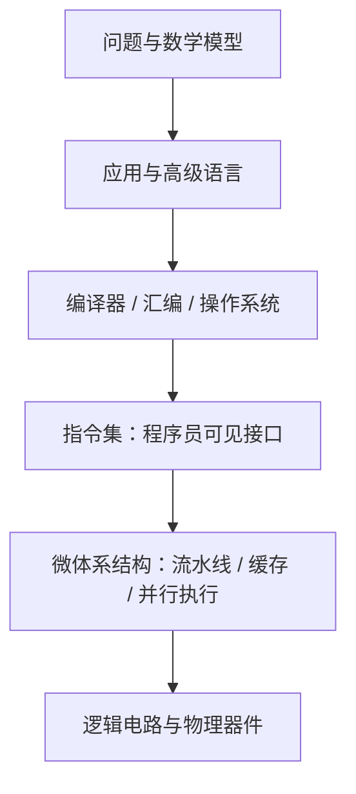
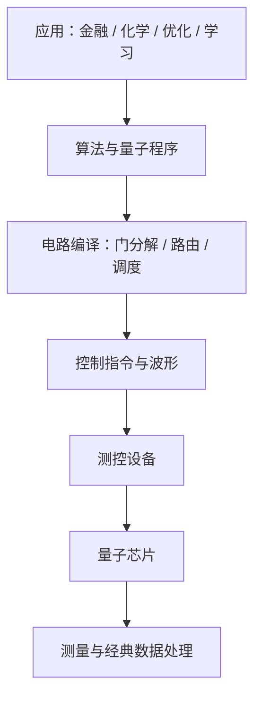

# 00 计算机简史与先进计算

> 这一讲回答三个问题：计算机为什么能计算，传统计算为什么会遇到瓶颈，量子计算改变了哪条基本规则。先用二进制和逻辑门建立直觉，再看体系结构、性能计算与量子计算入口。每个计算例子都给出单位、代入过程与结果解释。

## 先学会用同一组问题看所有计算机

拿“计算 3+5”来说，人用纸笔、算盘和电子计算机得出的数学结果都是 8，但实现方式完全不同。研究计算机时要依次回答：

1. **表示什么？** 把数字变成可保存的符号，例如 3=(0011)_2、5=(0101)_2。
2. **做什么变换？** 按二进制加法规则，把两组输入变成 (1000)_2。
3. **由谁执行？** 用逻辑电路或其他物理过程实现规则。
4. **结果怎样取出？** 把内部编码解释成数字 8。

这四个问题贯穿全部后续内容。量子计算仍然需要输入、运算和输出；它的变化在于中间状态用复振幅表示、基本门服从量子力学，输出时还要经过概率性测量。

### 二进制加法算一遍

从右往左逐位相加：

```text
   0011   （3）
 + 0101   （5）
 -------
   1000   （8）
```

最低位 1+1=10_2，写 0 进 1；下一位 1+0+1=10_2，再写 0 进 1；再下一位 0+1+1=10_2，写 0 进 1；最高位得到 1。**逻辑门可以算的不只是真假：把多组逻辑门连接起来，就能完成带进位的数值计算。**

## 1. 计算的本质：信息、编码、规则、物理实现

广义计算是利用信息解决问题的过程；狭义计算指计数、算术等数值处理。输入和输出是信息，经验、算法及技术是处理方法，完成处理的能力称为算力。计算不局限于电子计算机：结绳、算筹、算盘、人列计算机都将抽象信息编码为物理状态，再按规则改变状态。

| 层次 | 要回答的问题 | 经典计算 | 量子计算 |
| --- | --- | --- | --- |
| 计算理论 | 什么可以计算？ | 经典图灵机 | 量子图灵机、量子电路 |
| 编码 | 怎样表示信息？ | 二进制位 0、1 | 量子态与复振幅 |
| 操作规则 | 如何处理信息？ | 布尔逻辑、算术指令 | 酉变换、测量 |
| 物理实现 | 用什么承载？ | CMOS 电路等 | 超导电路、离子、光子等 |

文字和数字也是编码。算筹以位置和纵横形式表示数位；算盘同时保存中间状态并实现加减规则。《三体》中的人列计算机用旗帜颜色表示二进制，并以人的协作实现逻辑门。三体问题的轨道计算属于经典力学数值求解。

信息既可以是文本，也可以编码在神经网络参数或程序中。讨论信息与物理秩序时要区分：信息熵与热力学熵不是同一个量；局部系统可以在交换能量、物质的条件下有序化，不能由“信息使熵减”推导出违反热力学第二定律。语言模型以参数形式学习数据规律，生成文本的能力与逻辑正确性、事实可靠性需要分别评价。

### 补充：二进制和逻辑计算

十进制数 13 的编码：

$$
13=1\cdot2^3+1\cdot2^2+0\cdot2^1+1\cdot2^0=(1101)_2
$$

模 2 加法就是异或：0⊕0=0、0⊕1=1、1⊕0=1、1⊕1=0。半加器为

$$
s=a\oplus b,\qquad c=a\land b
$$

例如 1+1 的和位为 0，进位为 1，得到二进制 10。画逻辑图时先标输入 a,b，分别连接 XOR 和 AND，最后标和位与进位。

### 用概率理解“信息量”：一次结果能减少多少不确定性？

如果一个问题的答案必定为 0，那么读到 0 没有消除任何原有不确定性；如果 0、1 各占一半，读到一个结果就排除了另一半可能。一个概率为 p 的事件对应的信息量定义为

$$
I(p)=-\log_2 p\quad\mathrm{bit}
$$

例如 p=1/2 时是 1 bit；p=1/8 时是 3 bit。平均信息量称 Shannon 熵：

$$
H=-\sum_x p_x\log_2 p_x
$$

公平二元变量的熵为 $-2(1/2)\log_2(1/2)=1\,\mathrm{bit}$。若 0 概率 3/4、1 概率 1/4，则

$$
H=-\frac34\log_2\frac34-\frac14\log_2\frac14\approx0.8113\quad\mathrm{bit}
$$

更偏向一个答案，不确定性更小，因此熵更低。这里是在衡量**概率分布的不确定性**，并不是直接计算设备消耗多少热量。

## 2. 计算机发展：专用、通用、网络化与异构化

| 阶段 | 代表案例 | 核心变化 |
| --- | --- | --- |
| 早期专用电子计算 | ABC（1939）、ENIAC（1946）、TRADIC（1954） | 线性方程、轨道及科学计算；真空管向晶体管发展 |
| 集成电路 | Kilby（1958） | 元件与互连集成在半导体上 |
| 兼容通用计算 | IBM System/360（1964） | 不同机器实现共享程序员可见的体系结构 |
| 大规模集成电路与 PC | 1970 年代起，随后 PC 普及 | 体积与成本下降，个人计算发展 |
| 互联网与移动互联网 | TCP/IP、移动通信 | 计算设备互联，数据规模增长 |
| 云计算 | 2006 年前后云服务商业化 | 通过网络按需获取共享计算资源 |
| 天计算 | Sky Computing | 跨云资源组合、互操作及统一使用 |
| 边缘与 HPC | 靠近用户处理；高性能系统 | 分别关注实时性和大规模计算能力 |
| 先进计算 | AI、量子、光子、类脑、DNA | 面向任务选择不同硬件与计算范式 |

“第一台计算机”的说法依赖专用、可编程、电子、通用等口径。学习时记住器件集成、兼容指令集和联网如何扩大计算能力，比分辨宣传性的排名更有帮助。晶体管数量增多提供更多硬件资源，但程序速度还取决于架构、数据访问和并行程度。

云计算常见特性：资源池化、虚拟化、按需服务、弹性、高可靠性、较低使用门槛。天计算要解决不同云厂商接口、资源、数据及服务难以互通的问题，并考虑数据所在地的约束。边缘计算在靠近数据源处提供计算、存储和网络服务，减少传输、延迟并改善数据本地性。HPC 依靠并行计算与高带宽互连、内存及存储支持复杂任务。

### 补充：云与边缘延迟例题

上传数据量 D，链路带宽 B，网络往返延迟 L，计算时间 T_c：

$$
T_{\mathrm{cloud}}\approx\frac DB+L+T_c
$$

若 D=80Mb、B=20Mb/s、L=0.05s、T_c=0.2s，则 T=4.25s。边缘处理若耗时 0.4s 且只上传结果，可能明显降低响应时间。计算前统一 bit/byte 和时间单位；1byte=8bit。

### 画图：发展时间线


画法：横轴按年代排列，纵向用不同层次区分器件、机器、网络、计算范式。年代线表示发展脉络，不表示前一种技术消失。

## 3. 体系结构：软件与硬件的约定

体系结构的经典定义是机器语言程序员必须了解的机器概念性结构与功能特性，主要表现为程序员可见的指令集、寄存器、数据表示、寻址及异常行为。**同一指令集可以有不同的微体系结构实现**。冯诺依曼结构包括运算器、控制器、存储器、输入、输出，基本思想是存储程序。

体系结构需要研究九类程序员可见问题：数据表示、寻址方式、寄存器组织、指令系统、存储系统、中断机构、状态机定义与切换、机器级 I/O、信息保护。分层机器从硬联逻辑、微程序、机器语言、操作系统、汇编、高级语言、应用程序到系统分析，各层通过解释或编译与下层连接。



### 从一条指令理解 ISA 与微体系结构

设某台计算机提供 `ADD R3, R1, R2`，含义是把寄存器 R1、R2 中的整数相加，结果写入 R3。程序员需要知道寄存器编号、整数宽度以及溢出规则，这些属于指令集约定。

硬件内部可以用不同加法器、不同流水线来完成同一条指令。只要对程序呈现的结果与规则相同，就可以有相同 ISA、不同微体系结构。因此软件可以在一组兼容机器上运行，而机器速度与能耗不同。

存储程序的执行可画成一个循环：


画冯诺依曼结构时，在中间画存储器，一侧画控制器与运算器，另一侧画输入、输出；连接线标“指令、地址、数据”。理解这种结构的关键是**指令也存储在内存中**，控制器不断读取并解释它们。

### 三堵墙

| 瓶颈 | 原因与表现 | 常见改善方向 |
| --- | --- | --- |
| 计算墙 | 计算需求增长、频率与通用处理能力受限 | 并行、专用加速器、算法优化 |
| 存储墙 | 运算速度与数据访问速度不匹配 | 缓存、数据复用、近存/存内计算 |
| 功耗墙 | 功率、散热约束限制性能增长 | 降低数据搬移、低功耗器件、能效设计 |

### 怎样比较两台机器：时间、吞吐量与能耗

运行一个任务用多久叫延迟；每秒能完成多少任务叫吞吐量。二者不是同一个量：同时运行十个各耗时一秒的任务，吞吐量可达每秒十个，但单个任务延迟仍是一秒。

同一程序的粗略 CPU 时间模型为

$$
T=\frac{\text{指令数}\times\mathrm{CPI}}{\text{时钟频率}}
$$

例如 10⁹ 条指令、CPI=2、频率 2×10⁹ 周期/秒，时间为 1 秒。如果只把频率提高到 4 GHz、其他项不变，时间降到 0.5 秒。真实系统中内存等待可能增加 CPI，不能仅凭 GHz 判断速度。

能量等于功率乘时间。机器 A 用 100 W 跑 10 s，消耗 1000 J；机器 B 用 160 W 跑 5 s，消耗 800 J。B 的瞬时功率更高，却更快且总能量更少。比较体系结构时应写明自己优化的是哪一个指标。

### 补充：Amdahl 定律，算清并行加速上限

可并行部分比例 p，该部分加速 s 倍，原总时间归一化为 1：

$$
T'=1-p+\frac ps,\qquad S=\frac1{1-p+p/s}
$$

例：p=0.9,s=10，S=1/(0.1+0.09)≈5.26。即使 s→∞，总加速比也不超过 1/(1-p)=10。画图时横轴取 s，纵轴取 S，画水平渐近线 10。

### 补充：内存与功率的计算

算术强度 I=F/D（FLOP/byte），峰值算力 P_max，带宽 B：

$$
P\le\min(P_{\max},BI)
$$

例如 P_max=1000GFLOP/s、B=100GB/s、I=2FLOP/byte，则带宽上限只有 200GFLOP/s。增加计算单元未必解决数据供给问题。动态功耗的常用近似是 P_dyn∝CV² f，电压翻倍会带来约四倍动态功耗（其他条件相同）。

体系结构研究也涵盖多核、多处理器、指令/线程/数据并行、推测执行、内存层次、云与数据中心、互连、AI 加速器、安全隐私、虚拟化、非易失存储、近似计算、量子计算、建模仿真和真实系统评估。相关学术交流包括 ISCA、ASPLOS、HPCA、MICRO，以及 DAC、ATC、PPoPP、FAST。理解研究对象比记忆会议时间重要。

## 4. 先进计算范式

| 范式 | 表示与操作 | 适合关注的任务 | 关键限制 |
| --- | --- | --- | --- |
| 量子 | 复振幅、酉演化、测量 | 特定量子模拟、搜索、代数问题 | 噪声、读出、纠错、连接性 |
| 光子 | 光传播、干涉等 | 通信、光学线性运算 | 精度、非线性、光电接口 |
| 类脑 | 神经元状态、脉冲与突触 | 稀疏事件处理等 | 编程、训练与评估方法 |
| DNA | 分子编码与生化操作 | 组合问题与分子信息处理 | 制备、筛选、读出成本 |

这些范式不是“所有任务都更快”。比较时必须把编码、初始化、数据传输、计算、读出及误差处理一起计入。

## 5. 从经典力学到量子力学

量子信息技术可按用途分为通信（传输）、计算（处理）和测量（读出/精密探测）。电影中的 MOSS 和科幻量子计算机用于引入主题，不能作为硬件能力证据。理解实际系统时，需要同时考虑设备复杂度、可用比特、噪声和具体任务。

经典轨道模型常用：

$$
F=ma,\qquad F=G\frac{m_1m_2}{r^2}
$$

已知力与初始位置、速度，可以求解运动方程。量子态则由概率幅描述，演化和测量分别采用不同的规则。

迈克尔逊–莫雷实验与黑体辐射暴露了经典物理解释的局限。量子力学发展脉络：普朗克的能量量子化（1900）、爱因斯坦的光量子（1905）、波尔原子模型（1913）、德布罗意物质波（1924）、海森堡矩阵力学（1925）、薛定谔波动力学（1926）、冯诺依曼数学形式化（1932）。不同诠释是理解理论的背景，不改变本课程的线性代数计算规则。

### 补充：光子能量与物质波

$$
E=hf=\frac{hc}{\lambda},\qquad\lambda_{\mathrm{matter}}=\frac hp
$$

光子波长 λ=500nm，取 h≈6.626×10^(-34)Js、c≈3.00×10⁸ m/s：

$$
E\approx3.98\times10^{-19}\,\mathrm{J}\approx2.48\,\mathrm{eV}
$$

步骤：先把 nm 换成 m，再计算焦耳；用 1eV≈1.602×10^(-19)J 换算。这里 E=hf 是单个光子能量关系，不是完整的黑体光谱公式。

### 贝尔实验与局域隐变量

Bell 提出了约束局域隐变量的检验思路，Clauser、Aspect、Zeilinger 等推动了相应实验。CHSH 形式的局域隐变量界为 |S|≤2，量子理论上限为 2√2。两个界限不同，后者约为 2.828。违反贝尔不等式排除了满足相应假设的局域隐变量模型，不能笼统说成“证明所有量子诠释”或允许超光速通信。 相关实验背景见 [诺贝尔奖官方介绍](https://www.nobelprize.org/prizes/physics/2022/summary/)。

补充定义：

$$
S=E(a,b)+E(a,b')+E(a',b)-E(a',b')
$$

在适当的贝尔态和测量方向下，四项可以取 1/√2,1/√2,1/√2,-1/√2，因此 S=2√2。画图时画两端各两个测量方向，并把每组相关函数标在连线上。

## 6. 量子计算的线性代数入口

$$
|0\rangle=\begin{bmatrix}1\\0\end{bmatrix},\quad|1\rangle=\begin{bmatrix}0\\1\end{bmatrix},\quad|\psi\rangle=\alpha|0\rangle+\beta|1\rangle,\quad|\alpha|^2+|\beta|^2=1
$$

态矢量是列向量；ket 是 |ψ⟩，bra 是共轭转置 ⟨ψ|。本征态/本征值对应特征向量/特征值；算符在有限维中对应矩阵；酉算符满足 U^†U=I；厄米算符满足 A^†=A。

量子非门：

$$
X=\begin{bmatrix}0&1\\1&0\end{bmatrix},\qquad X\begin{bmatrix}\alpha\\\beta\end{bmatrix}=\begin{bmatrix}\beta\\\alpha\end{bmatrix}
$$

例：(√3|0⟩+i|1⟩)/2 经 X 后变为 (i|0⟩+√3|1⟩)/2。测量 0 的概率由 3/4 变为 1/4。

双比特一般态为

$$
|\psi\rangle=\alpha_{00}|00\rangle+\alpha_{01}|01\rangle+\alpha_{10}|10\rangle+\alpha_{11}|11\rangle,\quad\sum_x|\alpha_x|^2=1
$$

重复实验的概率估计为 p̂_x=N_x/N。例如 100 次独立制备、运行和测量得到 01 共 48 次，只能估计 p₀₁≈0.48，不能由一次测量读取全部振幅。抽样标准差约为 √(p(1-p)/N)。

电路图的横轴是操作顺序，水平线是比特，方框是门，控制点和目标符号共同表示受控门，仪表表示测量，测量后结果写入经典比特。相继门对应矩阵乘法，同时作用在不同子系统的门对应张量积。

## 7. 量子计算系统、产业链与技术路线

经典与量子系统都包含应用、语言、编译器、指令与底层硬件。量子系统还需要态初始化、脉冲控制、校准、读出与误差处理。计算机专业可研究语言、编译、运行系统、调度、模拟、验证和软硬件协同。



产业链涵盖应用、软件与算法、云服务、芯片设计、制造封装和测控设备。评估一家公司或平台的能力时，应分别看芯片、测控、编译、模拟与应用，而不是只看其是否冠以“量子”名称。

| 路线 | 编码或计算思路 | 主要工程问题 |
| --- | --- | --- |
| 超导 | 人工电路能级、微波操控 | 相干时间、门与读出保真度、集成测控、干扰与扩展 |
| 离子阱 | 囚禁离子的内部态 | 高质量操控、相干性、扩展与控制 |
| 光量子 | 光子的自由度 | 传输优势、纠缠与门实现 |
| 中性原子 | 冷原子及相互作用 | 真空、光场与精密操控 |
| 半导体 | 自旋等自由度 | 器件制造经验、耦合与集成 |
| 拓扑 | 拓扑保护的编码设想 | 容错潜力及实现验证 |
| 金刚石 NV | 缺陷中心相关自由度 | 探测、光学操控与扩展 |
| 量子退火 | 优化哈密顿量 | 与门模型不同的求解方式 |
| 相干伊辛机 CIM | 光学网络等实现伊辛优化 | 建模、控制与性能评估 |

Ion Trap 指“离子阱”：用电磁场囚禁带电离子。CIM 的光学振荡器/耦合网络不能简单理解成“可编程磁铁”；光学方案也不意味着所有部件都无需特殊实验条件。

### 补充：伊辛优化如何算

$$
E(s)=\sum_i h_i s_i+\sum_{i<j}J_{ij}s_i s_j,\qquad s_i\in\{-1,+1\}
$$

若只有 E=-s_1s_2，四个赋值的能量依次为 -1,+1,+1,-1，同向自旋最优。二进制变量可通过 s_i=1-2x_i 转換。计算时先确认耦合项的正负号约定，再枚举或优化；物理求解器并非自动保证一次找到任意问题的全局最优。

量子软件包括操作系统、云平台、测控软件、模拟器；测控软件涵盖 UI、I/O、校准、线程/通信控制、存储管理。可以把发展目标概括为模拟器“真、全、智”，OS“强、高、融”，云平台“广、多、熟”。应用包括金融预测与组合优化、生物分析、药物研发、化学分子及反应模拟。这些是应用方向，是否实现实用加速必须单独验证。

## 8. 研究平台与学习路线

浙江大学 ACES 实验室及太元（JanusQ）平台是相关研究的案例，团队成员包括尹建伟、卢丽强、陈明帅、赵新奎等研究者，也有本科生参与。平台功能包括量子程序与电路展示、态可视化、频率控制、真机/模拟执行以及分布式调度。编译和运行工具可分别优化门数、噪声与编译时间，并提供读出校准、程序修正与 bug 定位。研究案例包括 QuCT 电路特征分析、QuFEM 读出校准、MorphQPV 程序验证、HyQSAT 混合 SAT 求解，以及 TENET、AMOS、Sanger 等体系结构工作。这些研究分别解决“怎样描述电路、怎样修正读出、怎样检查程序、怎样组合经典与量子求解器”等问题。

理论与实验可以按以下内容交替学习：

1. 计算起源、线性代数、量子态、泡利矩阵、特征值、张量积、演化、测量。
2. 通用门、图灵机、电路模型、QFT、Shor、Grover、VQE。
3. 物理实现、超导测控、标定、指令集、编程语言与软件/硬件编译。
4. Qiskit、太元平台、编程实践、量子与深度学习框架比较。
5. 比特/门拆分的分布式计算、金融、机器学习与可解释性。
6. 纠错与表面码、信息论、隐形传态和量子通信网络。

一种课程考核安排是：平时 30%（矩阵计算、算法推导和编程），期中 30%（线代与量子算法笔试），期末 40%（单人项目、代码与报告，可选机器学习、金融、化学模拟、编译优化）。参考包括施郁相关视频和 CMU 15-859BB 课程。实际考核以授课教师通知为准。

### 实际应该怎样学这四讲？

第一步先会写列向量并做矩阵乘法；第二步把量子态、门和测量分别翻译成向量、酉矩阵和投影；第三步每读一个算法，都写出初态、中间态、末态和结果概率。遇到复杂硬件名称时，不必先记器件细节，先判断它解决的是“存储状态、控制状态、连接比特、测量读出”中的哪一个问题。

## 9. 复习运算与画图清单

- 会解释信息编码、计算规则、物理实现的区别。
- 会区分 ISA、微体系结构与物理器件，画系统分层图。
- 会统一单位，计算带宽/延迟、Amdahl 加速比和算术强度。
- 会计算 E=hf、写量子态归一化和 X 门矩阵乘法。
- 会从双比特振幅求测量概率，解释抽样与量子优势的边界。
- 会画计算发展时间线、量子系统栈、电路图与技术路线比较图。

后续笔记：[[量子计算理论/01-量子比特与量子门|01-量子比特与量子门]]、[[量子计算理论/02-量子测量与量子图灵机|02-量子测量与量子图灵机]]。
