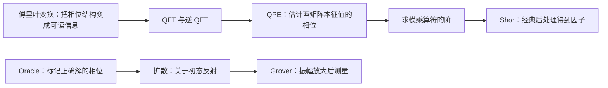

# 03 量子算法

> 这一讲完整推导 QFT、QPE、Shor 和 Grover。学习时沿着“解决什么问题 → 状态怎样变化 → 为什么有效 → 怎么手算 → 怎么画图”阅读；数论和复数工具在用到前解释，最后附五道综合练习的完整解答。

前置笔记：[[量子计算理论/01-量子比特与量子门|01-量子比特与量子门]]、[[量子计算理论/02-量子测量与量子图灵机|02-量子测量与量子图灵机]]。

## 0. 学习主线与符号约定

本讲有两条算法主线：



统一使用左侧为高位的态标签：$|j_1j_2\cdots j_n\rangle$，电路上从上到下依次为这些比特。数字与二进制小数分别为

$$j=\sum_{\ell=1}^{n}j_\ell2^{n-\ell},\qquad
0.j_1j_2\cdots j_n=\sum_{\ell=1}^{n}j_\ell2^{-\ell}.$$

例如 $(101)_2=5$，而 $(0.101)_2=5/8$。电路时间从左到右，串行矩阵乘积中右侧先执行。软件可能反向显示比特标签，核对时必须先核对位序与末端 SWAP。

| 符号 | 含义 |
| --- | --- |
| $n$ | QFT 或搜索寄存器的比特数 |
| $N=2^n$ | 该寄存器的空间维度；Shor 部分另用 L 表示待分解整数 |
| $t,Q=2^t$ | QPE 的相位比特数与相位网格分母 |
| $\phi$ | 相位门 $P(\phi)$ 中以弧度表示的角度 |
| $\varphi$ | QPE 估计的归一化相位，$\lambda=e^{2\pi i\varphi}$ |
| $M$ | Grover 的正确解数量 |
| $\theta$ | 一次 Grover 迭代的旋转角 |

**相位门角度与 QPE 相位相差 $2\pi$：** $\varphi=\phi/(2\pi)\pmod1$。QPE 估计的是酉算符本征值的相位，不是任意输入态的不可观测全局相位。

### 开始运算前：本讲反复使用的三个工具

**工具一：单位圆上的相位。** $e^{i\phi}=\cos\phi+i\sin\phi$，因此 $1,i,-1,-i$ 是单位圆上每隔四分之一周的四个点。所有点模长相同，但相加时可能抵消。QFT 不是“凭空生成答案”，它利用这些正负与复相位让错误方向相消、所需方向相长。

**工具二：等比级数。** 当 z≠1 时，$1+z+\cdots+z^{m-1}=(1-z^m)/(1-z)$。若 z 是非平凡 m 次单位根，$z^m=1$，所以这 m 项和为 0。例如 $1+i-1-i=0$。它将用于证明 QFT 酉性、QPE 概率分布和 Shor 本征态性质。

**工具三：量子态中的系数与结果。** 若末态为 $\sum_ya_y|y\rangle$，测到 y 的概率为 $|a_y|^2$，不是 $a_y$。各算法最后都必须从“振幅怎么算”走到“实际能读出什么”，才算完成推导。

## 1. 傅里叶变换：从频率分析到量子振幅


傅里叶分析把信号分解成不同频率分量，可用于通信、声音处理、地震信号等。时域曲线显示随时间变化的信号，频域曲线显示各频率的幅度和相位；“只画幅度谱”会丢失相位信息。

### 1.1 DFT、逆变换与符号习惯

一种常见的经典 DFT 约定为

$$X_k=\sum_{j=0}^{N-1}x_je^{-2\pi ijk/N},\qquad
x_j=\frac1N\sum_{k=0}^{N-1}X_ke^{2\pi ijk/N}.$$

也可以把归一化平均分配为 $1/\sqrt N$。本讲 QFT 使用**正指数、酉归一化**，因此与部分经典库默认 FFT 的正负号不同；这只是约定，必须与逆变换保持一致。

直接 DFT 计算所有 N 个输出一般需 $O(N^2)$ 次算术，FFT 可降至 $O(N\log N)$。傅里叶变换是数学变换，FFT 是快速计算 DFT 的算法，两者必须区分。是否加速要比较相同输入输出任务所需的实际计算量。

### 1.2 QFT 的定义

$$F_N|j\rangle=\frac1{\sqrt N}\sum_{k=0}^{N-1}e^{2\pi ijk/N}|k\rangle.$$

对一般输入 $|\psi\rangle=\sum_jx_j|j\rangle$：

$$F_N|\psi\rangle=\sum_ky_k|k\rangle,\qquad
y_k=\frac1{\sqrt N}\sum_jx_je^{2\pi ijk/N}.$$

注意：基态 $|j\rangle$ 变成由所有 $|k\rangle$ 构成的叠加态，并非简单映射到某一个确定的 $|k\rangle$。QFT 变换的是**振幅序列**，不是读取 N 个经典数并立即输出 N 个经典傅里叶系数。

矩阵形式：

$$[F_N]_{kj}=\frac1{\sqrt N}\omega_N^{jk},\qquad \omega_N=e^{2\pi i/N}.$$

### 1.3 酉性的直接证明

矩阵第 j 列与第 $j'$ 列内积为

$$\frac1N\sum_{k=0}^{N-1}e^{2\pi i(j'-j)k/N}.
$$

若 $j=j'$，和为 N，内积为 1；否则令 $z=e^{2\pi i(j'-j)/N}\ne1$，几何级数为 $(1-z^N)/(1-z)=0$。因此 $F_N^\dagger F_N=I$，逆 QFT 为 $F_N^\dagger$，将指数符号改成负号即可。

### 把四个数字真的变换一次

用正指数、$1/\sqrt N$ 归一化约定，输入 $x=(1,0,-1,0)^T$，N=4。对每个输出 k，公式变成 $y_k=(1-e^{\pi ik})/2$：

- k=0：两个非零输入相消，$y_0=(1-1)/2=0$。
- k=1：第二项带相位 −1，$y_1=(1-(-1))/2=1$。
- k=2：相位又回到 1，$y_2=0$。
- k=3：相位为 −1，$y_3=1$。

因此输出 $(0,1,0,1)^T$。输入模长平方为 2，输出也是 2，符合酉变换保持范数。如果把输入解释为量子态，先除以 $\sqrt2$；这便得到下面的量子例子。

### 1.4 补充手算：把振幅干涉成非均匀输出

取 $|\psi\rangle=(|0\rangle-|2\rangle)/\sqrt2$，N=4：

$$y_k=\frac{1-(-1)^k}{2\sqrt2}.$$

偶数 k 的振幅为 0，奇数为 $1/\sqrt2$，故

$$F_4|\psi\rangle=\frac{|1\rangle+|3\rangle}{\sqrt2}.$$

这展示了相消与相长干涉。相反，对单个基态 $|j\rangle$ 直接做 QFT 后，计算基测量在所有 k 上均匀分布；单次读出不能恢复其全部相位结构。

## 2. QFT 的张量积推导与电路


### 2.1 从求和到张量积：补全五步推导

令 $k=\sum_{\ell=1}^nk_\ell2^{n-\ell}$，$|k\rangle=\bigotimes_{\ell=1}^n|k_\ell\rangle$。

**第一步：展开基态标签。**

$$F_{2^n}|j\rangle=\frac1{2^{n/2}}\sum_{k_1,\ldots,k_n\in\{0,1\}}
e^{2\pi ij\sum_\ell k_\ell/2^\ell}\bigotimes_{\ell=1}^n|k_\ell\rangle.$$

**第二步：指数中的和转成乘积。**

$$e^{2\pi ij\sum_\ell k_\ell/2^\ell}
=\prod_{\ell=1}^ne^{2\pi ijk_\ell/2^\ell}.$$

**第三步：分离独立的比特求和。**

$$F_{2^n}|j\rangle=\frac1{2^{n/2}}\bigotimes_{\ell=1}^n
\left(\sum_{k_\ell=0}^{1}e^{2\pi ijk_\ell/2^\ell}|k_\ell\rangle\right).$$

**第四步：每一项只有 $k_\ell=0,1$ 两项。**

$$F_{2^n}|j\rangle=\bigotimes_{\ell=1}^n\frac{|0\rangle+e^{2\pi ij/2^\ell}|1\rangle}{\sqrt2}.$$

**第五步：去掉整数部分。** 因 $e^{2\pi im}=1$，$j/2^\ell$ 的整数部分不影响相位，其小数部分是 $0.j_{n-\ell+1}\cdots j_n$，得到

$$F_{2^n}|j_1\cdots j_n\rangle=
\frac{|0\rangle+e^{2\pi i0.j_n}|1\rangle}{\sqrt2}
\otimes\frac{|0\rangle+e^{2\pi i0.j_{n-1}j_n}|1\rangle}{\sqrt2}
\otimes\cdots\otimes
\frac{|0\rangle+e^{2\pi i0.j_1\cdots j_n}|1\rangle}{\sqrt2}.$$

这个乘积形式针对**计算基输入**。一般输入是不同 j 输出的线性组合，不保证仍是乘积态。

### 2.2 单比特与双比特矩阵

$$F_2=\frac1{\sqrt2}\begin{bmatrix}1&1\\1&-1\end{bmatrix}=H.$$

因此 $F_2(\alpha|0\rangle+\beta|1\rangle)=\big[(\alpha+\beta)|0\rangle+(\alpha-\beta)|1\rangle\big]/\sqrt2$。

$$F_4=\frac12\begin{bmatrix}
1&1&1&1\\1&i&-1&-i\\1&-1&1&-1\\1&-i&-1&i
\end{bmatrix}.$$

例：

$$F_4|10\rangle=\frac12(|00\rangle-|01\rangle+|10\rangle-|11\rangle)
=|+\rangle\otimes|-\rangle.$$

补充例：

$$F_4|01\rangle=\frac12(|00\rangle+i|01\rangle-|10\rangle-i|11\rangle)
=|-\rangle\otimes\frac{|0\rangle+i|1\rangle}{\sqrt2}.$$

三比特例：$j=5=(101)_2$，三个输出因子的相位依次由 0.1、0.01、0.101 决定：

$$F_8|101\rangle=|-\rangle\otimes
\frac{|0\rangle+i|1\rangle}{\sqrt2}\otimes
\frac{|0\rangle+e^{5\pi i/4}|1\rangle}{\sqrt2}.$$

### 2.3 受控相位门与电路构造

定义相位门

$$R_m=\operatorname{diag}(1,e^{2\pi i/2^m}),\quad m\ge2.$$

$R_2=S,R_3=T$；注意它不是 $R_z(2\pi/2^m)$ 的严格相同矩阵，而是差全局相位。给门加控制后，这个相位可能变成分支间相对相位，不能无条件互换。双比特受控门为

$$CR_m=\operatorname{diag}(1,1,1,e^{2\pi i/2^m}).$$

电路按以下顺序生成：

1. 对第一个高位 $j_1$ 加 H，振幅相对相位成为 $(-1)^{j_1}=e^{2\pi i0.j_1}$。
2. 用 $j_2$ 控制 $R_2$，目标是第一个比特，增加相位 $e^{2\pi ij_2/4}$，得到 $0.j_1j_2$。
3. 用后续比特分别控制 $R_3,R_4,\ldots$，逐渐积累完整 $0.j_1\cdots j_n$。
4. 在第二、第三等比特重复同样过程。未交换时，各因子的相位长度依次递减，与上面目标乘积顺序相反。
5. 最后交换首尾比特、次首与次尾等，反转输出顺序。


### 2.4 双比特电路逐步验算

输入 $|10\rangle$：

$$|10\rangle\xrightarrow{H\otimes I}\frac{|00\rangle-|10\rangle}{\sqrt2}.$$

受控 $R_2$ 只对 11 项加 i；当前没有 11 项，因此不变。再对下方比特加 H：

$$\frac12(|00\rangle+|01\rangle-|10\rangle-|11\rangle).$$

最后 SWAP 得

$$\frac12(|00\rangle-|01\rangle+|10\rangle-|11\rangle),$$

与 $F_4$ 的第三列一致。只验证一个输入不足以证明整个电路正确，还可依次检查 00、01、11 或比较完整矩阵。

### 2.5 逆 QFT、门数量与实际加速条件

逆电路要把**全部门顺序反转**，再把每个门取逆：H、SWAP 自逆，$R_m$ 的角度变为负数。不能只改受控相位角度而保持原门顺序。

精确 n 比特 QFT 的常见计数：n 个 H、$n(n-1)/2$ 个受控相位门、$\lfloor n/2\rfloor$ 个末端 SWAP，理想全连接下门数 $O(n^2)$。若只关心最终测量标签，可用经典位反转处理末端交换，但不能在后面还接量子操作时不加说明地省略。

QFT 的输入是已经编码的量子态，输出仍为量子态。它的 $O(n^2)$ 不能直接与 FFT 计算全部 $N=2^n$ 个**经典输出**的成本做同任务比较；状态制备、输出读取、精度和连接拓扑也有成本。QFT 的主要用途是作为 QPE、Shor 等算法的子程序。参见 [IBM 的相位估计与 QFT 讲解](https://quantum.cloud.ibm.com/learning/en/courses/fundamentals-of-quantum-algorithms/phase-estimation-and-factoring/phase-estimation-procedure)。

## 3. QPE：把本征值相位变成二进制数


### 3.1 问题、资源与相位回踢

给定酉算符 U 以及归一化本征态 $|u\rangle$，满足

$$U|u\rangle=e^{2\pi i\varphi}|u\rangle,\qquad0\le\varphi<1.$$

准备 t 个相位比特与向量寄存器，输入 $|0^t\rangle|u\rangle$。相位寄存器施加 H，随后对各位施加不同幂次的受控 U。

对单个控制位 $|+\rangle$，

$$C(U^m)|+\rangle|u\rangle
=\frac{|0\rangle+e^{2\pi im\varphi}|1\rangle}{\sqrt2}\otimes|u\rangle.$$

相位成为控制寄存器的相对相位，这就是相位回踢。算法需要实现**受控** $U^{2^k}$，只知道非受控 U 的黑盒并不自动提供无代价的受控版本。

### 3.2 按时间逐步推导

令 Q=$2^t$。H 后为

$$|\Psi_1\rangle=\frac1{\sqrt Q}\sum_{j=0}^{Q-1}|j\rangle|u\rangle.$$

按本笔记高位在上的顺序，最上位控制 $U^{2^{t-1}}$，最下位控制 U。合起来执行 $|j\rangle|u\rangle\mapsto|j\rangle U^j|u\rangle$：

$$|\Psi_2\rangle=\frac1{\sqrt Q}\sum_{j=0}^{Q-1}e^{2\pi ij\varphi}|j\rangle|u\rangle.$$

最后施加 $F_Q^\dagger$，测量相位寄存器得到整数 y，估计 $\widehat\varphi=y/Q$。

若 $\varphi=m/Q$ 恰能用 t 位表示，则 $|\Psi_2\rangle=F_Q|m\rangle|u\rangle$，逆 QFT 后必得 $|m\rangle|u\rangle$。


### 3.3 精确例：$P(\pi/4)$ 与输入 $|1\rangle$

$$P(\pi/4)|1\rangle=e^{i\pi/4}|1\rangle=e^{2\pi i(1/8)}|1\rangle.$$

所以 $\varphi=1/8=(0.001)_2$，不是 $\pi/4$。取 t=3：

$$|\Psi_2\rangle=\frac1{\sqrt8}\sum_{j=0}^{7}e^{2\pi ij/8}|j\rangle|1\rangle,$$

逆 QFT 后得到 $|001\rangle|1\rangle$，理想测量必得整数 1。按相位寄存器高位至低位，其三个因子分别带相位 $e^{i\pi},e^{i\pi/2},e^{i\pi/4}$，对应受控 $U^4,U^2,U$。

如果软件把最上方比特视为最低位，受控幂次与显示字符串就要相应调整；正确性取决于幂次、逆 QFT 与位序三者一致。

### 为什么逆 QFT 会把相位解码为整数？

对三位、$\varphi=1/8$，若想问“最后得到 y=1 的振幅是多少”，就计算

$$A_1=\frac18\sum_{j=0}^{7}e^{2\pi ij(1/8-1/8)}=\frac18\sum_{j=0}^{7}1=1.$$

如果问 y=0，则 $A_0=(1/8)\sum_je^{2\pi ij/8}=0$：八个单位圆方向均匀分布，相互抵消。其他错误标签同理为 0。**逆 QFT 对正确标签让所有分量同相叠加，对错误标签让它们绕圆周相消。** 这比只记“做完逆 QFT 就得到相位”更能解释算法为什么有效。

若 $\varphi=1/3$，没有任何整数 y 能让 $1/3-y/8$ 恰好为 0，各项不能在某一个标签上完全同相，因此概率分散在附近标签上，这就是下一节分布的来源。

### 3.4 非精确相位的概率分布：完整公式

对一般 $\varphi$，逆 QFT 后 y 的振幅为

$$A_y=\frac1Q\sum_{j=0}^{Q-1}e^{2\pi ij(\varphi-y/Q)}.$$

令 $\Delta=\varphi-y/Q$，使用等比级数：

$$p_y=|A_y|^2=\frac1{Q^2}\frac{\sin^2(\pi Q\Delta)}{\sin^2(\pi\Delta)}.$$

若 $\Delta$ 为整数，按极限得到 1，避免数值除零。相位按模 1 理解，靠近 0 和 1 的距离应使用圆周距离。这个分布说明 t 比特只给出间隔 $1/Q$ 的网格，**不保证每一次都输出最近点**。

例：$P(2\pi/3)$，$\varphi=1/3$。t=3，$Q\varphi=8/3\approx2.667$，最近整数为 3，故最可能读出 011，即 $3/8$。

| y | 二进制 | 估计 y/8 | 理论概率（约） |
| --- | --- | --- | --- |
| 0 | 000 | 0 | 0.015625 |
| 1 | 001 | 1/8 | 0.031622 |
| 2 | 010 | 1/4 | 0.174940 |
| 3 | 011 | 3/8 | 0.687838 |
| 4 | 100 | 1/2 | 0.046875 |
| 5 | 101 | 5/8 | 0.018619 |
| 6 | 110 | 3/4 | 0.012560 |
| 7 | 111 | 7/8 | 0.011922 |


例如输出 3 的估计误差为 $|3/8-1/3|=1/24$，输出 2 的误差为 $1/12$。跑 1000 次的次数会围绕理论概率波动，不会严格等于这些数乘 1000。

补充：最近网格点的理想输出概率至少 $4/\pi^2\approx0.405$；需要高置信度或更多有效位时，必须额外增加相位比特、重复运行并采用合适后处理，不能把“分辨率 $2^{-t}$”理解为确定性误差保证。若把 $U^{2^k}$ 实现为重复 U，所有受控 U 的总使用量为 $2^t-1$；有结构的算符可能可以更有效地直接合成高次幂。

### 3.5 输入不是本征态时会怎样？

酉矩阵可谱分解为 $U=\sum_s e^{2\pi i\varphi_s}|u_s\rangle\langle u_s|$。若

$$|b\rangle=\sum_s\beta_s|u_s\rangle,$$

在各相位恰可精确表示且互不相同的情况下，QPE 输出

$$\sum_s\beta_s|Q\varphi_s\rangle|u_s\rangle.$$

测得相位 $\varphi_s$ 的概率为 $|\beta_s|^2$，向量寄存器对应投影到该本征态。不是测“平均相位”。有限精度相位峰重叠时，后态不能直接说成唯一精确本征态；简并相位也只区分对应本征子空间。

例：$U=P(\pi/4),|b\rangle=(3|0\rangle+4|1\rangle)/5$，三位相位寄存器得到

$$\frac35|000\rangle|0\rangle+\frac45|001\rangle|1\rangle.$$

相位 0、1/8 的概率分别 $9/25,16/25$。补充：这是利用 QPE 实现谱分析的核心机制，也解释了 Shor 算法为什么不必先挑出一个特殊的本征态。

## 4. Shor 的数论准备：同余、逆元、阶与 RSA


### 4.1 同余、模逆元与阶

$$a\equiv b\pmod L\iff L\mid(a-b).$$

模 L 的逆元 $a^{-1}$ 满足 $aa^{-1}\equiv1\pmod L$，存在当且仅当 $\gcd(a,L)=1$。使用扩展欧几里得算法可求系数 $sa+tL=1$，s 即逆元。

互质时，a 模 L 的阶定义为

$$r=\operatorname{ord}_L(a)=\min\{r\ge1:a^r\equiv1\pmod L\}.$$

欧拉函数 $\Phi(L)$ 是 $1\le x<L$ 中与 L 互质的整数数量（这里用大写 $\Phi$，避免和 QPE 相位混淆）。

$$\Phi(p)=p-1\quad(p\text{ 为质数}),$$
$$\Phi(ab)=\Phi(a)\Phi(b)\quad(\gcd(a,b)=1),$$
$$a^{\Phi(L)}\equiv1\pmod L\quad(\gcd(a,L)=1).$$

因此 $r\mid\Phi(L)$。注意阶是**最小正指数**；发现 $a^d\equiv1$ 只能说明 r 整除 d，不自动证明 d 就是阶。

### 4.2 例：$a=7,L=15$

$$7^0\equiv1,\quad7^1\equiv7,\quad7^2\equiv4,\quad7^3\equiv13,\quad7^4\equiv1\pmod{15}.$$

首次回到 1 的正指数为 4，所以 r=4。画周期图时横轴是指数 k，纵轴是 $a^k\bmod L$，会看到 1→7→4→13→1 的循环。

### 4.3 RSA 的数学流程

对称加密要求双方先共享同一把密钥，公钥密码则让接收方公开加密所需的信息、保留解密秘密。以下是解释数论用的简化 textbook RSA，并非完整实际协议。

1. 选两个不同质数 p、q，令 $L=pq$、$\Phi(L)=(p-1)(q-1)$。
2. 选 $1<e<\Phi(L)$ 且 $\gcd(e,\Phi(L))=1$。
3. 求 $d=e^{-1}\bmod\Phi(L)$，即 $ed=1+k\Phi(L)$。
4. 公钥为 $(L,e)$，私钥包含 d；明文整数 $0\le m<L$。
5. 加密 $C=m^e\bmod L$，解密 $m=C^d\bmod L$。

代数正确性的关键条件是 e 与 $\Phi(L)$ 互质，不必额外要求 $e\ne p,q$。公钥用于加密、私钥用于解密；“非对称加密是单向的”应理解为所用陷门问题的求解难易差异，不代表解密不存在。

### 4.4 数值例：p=5、q=11

$$L=55,\quad\Phi(L)=40,\quad e=7.$$

用欧几里得回代求逆元：

$$40=5\cdot7+5,\quad7=5+2,\quad5=2\cdot2+1,$$
$$1=3\cdot40-17\cdot7.$$

所以 $d\equiv-17\equiv23\pmod{40}$，$7\cdot23=161=1+4\cdot40$。

明文 m=33。重复平方：$33^2\equiv44,33^4\equiv11\pmod{55}$，因此

$$33^7\equiv33^4\cdot33^2\cdot33\equiv11\cdot44\cdot33\equiv22\pmod{55}.$$

对 C=22：$22^2\equiv44,22^4\equiv11,22^8\equiv11,22^{16}\equiv11$，$23=16+4+2+1$，故

$$22^{23}\equiv11\cdot11\cdot44\cdot22\equiv33\pmod{55}.$$

注意 33 与 55 不互质，证明解密正确性不能只对 m 直接套欧拉定理，完整证明见作业选做 1。

### 4.5 分解整数为什么有用？复杂度按输入位数看

若已知 L=pq 的因子，就能计算 $\Phi(L)$，再求 d。分解是恢复私钥的一条途径，不应把“RSA 求逆”和“整数分解”声称为已证明完全等价的两个计算问题。

试除到 $\sqrt L$ 需要 $O(\sqrt L)$ 次整除检查；若真的枚举到 L，便是更大的开销。循环上界到 L 还是到 $\sqrt L$，会改变这个粗略操作次数。设整数位数为 $\ell=\lceil\log_2L\rceil$，$\sqrt L\approx2^{\ell/2}$，所以试除对位数是指数级。**经典分解也有远优于试除的算法**；Shor 的理论特点是在标准量子计算模型下对输入位数有多项式时间算法，而不是只比一个低效试除程序。原始依据见 [Shor 的论文](https://arxiv.org/abs/quant-ph/9508027)。

## 5. Shor：从分解归约到量子求阶


### 5.1 经典外层：从阶得到因子

对已处理掉偶数、素数、素数幂等简单情况的奇合数 L：

1. 随机取 $1<a<L$，先算 $g=\gcd(a,L)$。若 $1<g<L$，已得到因子。
2. 若互质，运行求阶得到 r，并验证候选结果。
3. 若 r 是奇数，换 a 重试。
4. 若 r 是偶数，计算 $x=a^{r/2}\bmod L$。
5. 若 $x\equiv-1\pmod L$，本次不能提取非平凡因子，重试。
6. 否则计算 $g_-=\gcd(x-1,L)$ 与 $g_+=\gcd(x+1,L)$，得到非平凡因子；若 L 不是两个质数之积，可继续递归分解。

若 r 真的是阶且为偶数，$x\not\equiv1$，否则 r/2 会是更小的回到 1 的正指数。因

$$x^2\equiv1\pmod L\implies L\mid(x-1)(x+1),$$

当 x 不是平凡的 $\pm1$ 时，两个最大公约数就分离出因子。这些计算是经典的，量子核心是求阶。


例：L=15，a=7，r=4，$x=7^2\bmod15=4$：

$$\gcd(4-1,15)=3,\qquad\gcd(4+1,15)=5.$$

失败例（补充）：a=14，L=15，r=2，但 $x=14\equiv-1$，两个 gcd 为 1 和 15，没有得到非平凡因子。

### 5.2 正确的酉算符：模乘，而非直接模指数

对 $\gcd(a,L)=1$，定义

$$U_a|y\rangle=|ay\bmod L\rangle\quad(0\le y<L).$$

乘 a 是余数集合上的置换，逆映射为乘 $a^{-1}\bmod L$，因此对应酉矩阵。用 $\ell=\lceil\log_2L\rceil$ 个比特编码时还需定义剩余标签：可对 $L\le y<2^\ell$ 令 $U_a|y\rangle=|y\rangle$，得到整个 $2^\ell$ 维空间上的酉延拓。

$$U_a^m|y\rangle=|a^my\bmod L\rangle\quad(y<L).$$

受控 $U_a^{2^k}$ 可以利用经典重复平方先求 $a^{2^k}\bmod L$，再实现相应可逆模乘；不能真的用指数次数重复基础 U，才能保留算法效率。

一个容易犯的错误是令 $f(x)=a^x\bmod L$，直接把 $\sum_x|f(x)\rangle\langle x|$ 当成酉矩阵。模指数通常有周期，多个 x 映射到同一个结果，这个矩阵一般不是酉矩阵。例如 $7^0\equiv7^4\equiv1\pmod{15}$，第 0 和第 4 列相同，破坏正交性。

两种正确表达需区分：

- 求阶 QPE 使用上述模乘 $U_a$。
- 若计算模指数函数，可保留输入，用可逆嵌入 $|x,z\rangle\mapsto|x,z\oplus f(x)\rangle$，或通过受控模乘得到 $|x,1\rangle\mapsto|x,a^x\bmod L\rangle$。

对于置换 f，$\sum_x|f(x)\rangle\langle x|$ 确实是酉矩阵；但显式枚举全部状态构造指数维矩阵只适合小规模教学，不能当作 Shor 的高效实现。相关算符与资源条件参见 [IBM 的 Shor 算法教程](https://quantum.cloud.ibm.com/docs/en/tutorials/shors-algorithm)。

### 5.3 周期轨道与本征态

令 r 是 a 模 L 的阶，则 $1,a,a^2,\ldots,a^{r-1}$ 模 L 互不相同。定义

$$|u_s\rangle=\frac1{\sqrt r}\sum_{k=0}^{r-1}e^{-2\pi isk/r}|a^k\bmod L\rangle,\qquad s=0,\ldots,r-1.$$

这 r 个态是轨道子空间的一组正交归一本征态，满足

$$U_a|u_s\rangle=e^{2\pi is/r}|u_s\rangle,\qquad
|1\rangle=\frac1{\sqrt r}\sum_{s=0}^{r-1}|u_s\rangle.$$

两条性质的证明见作业选做 2。关键是：准备 $|1\rangle$ 很容易，它已经包含均匀的本征态分量；运行 QPE 就可随机获得接近 $s/r$ 的相位，不必提前知道 r 并制备某个 $|u_s\rangle$。有限相位寄存器下是各峰附近的估计，并非总能精确读出 $s/r$。

### 5.4 从测量值恢复阶：连分数不可省略

QPE 输出整数 y，给出 $y/Q\approx s/r$。经典后处理用连分数寻找小分母有理近似，再检查候选分母。常用充分条件是

$$\left|\frac yQ-\frac sr\right|<\frac1{2r^2},$$

此时约分后的 $s/r$ 是连分数收敛分数之一。因 r<L，可取 Q 为大于约 $L^2$ 的合适二次幂，再用重复实验取得合适样本；分辨率只是分析的一部分，仍有失败和误采样概率。

如果 $\gcd(s,r)>1$，约分分母只得到 r 的因子。必须验证 $a^d\bmod L$、考虑候选倍数或合并多次分母的最小公倍数；通过 $a^d=1$ 验证的 d 也可能只是阶的倍数，需要进一步缩小。**s=0 提供不了阶的信息。**

例如 a=7，L=15，真实 r=4：

| 相位 | 约分结果 | 能直接知道什么 |
| --- | --- | --- |
| 0 | 0/1 | 没有足够信息，重试 |
| 0.25 | 1/4 | 分母候选 4，验证 $7^4\equiv1$ |
| 0.5 | 1/2 | 候选 2，但 $7^2\equiv4\ne1$，不能接受 |
| 0.75 | 3/4 | 分母候选 4 |

可以对若干可靠分母取最小公倍数来合并信息，但不必收齐全部相位，有限采样也不保证一次成功。候选阶始终要通过模幂检验。

补充连分数例：L=21，a=2 的阶为 6。取 Q=512，某次采样 y=85：

$$\frac{85}{512}=[0;6,42,2],\qquad\frac16\text{ 是一个收敛分数}.$$

误差 $|85/512-1/6|=1/1536<1/(2\cdot6^2)$。验证 $2^6\bmod21=1$，而 2、3 次幂不回到 1，可确认阶 6。随后 $x=2^3=8$，$\gcd(7,21)=7,\gcd(9,21)=3$。

### 连分数怎样手算？不要把“求有理近似”当黑盒

对上面的 $85/512$，反复做带余除法：

$$512=6\cdot85+2,\qquad85=42\cdot2+1,\qquad2=2\cdot1.$$

所以 $85/512=1/(6+1/(42+1/2))=[0;6,42,2]$。依次截断得到收敛分数：

$$0,\qquad\frac16,\qquad\frac{42}{253},\qquad\frac{85}{512}.$$

Shor 要找的是分母小于 L 的候选。在 L=21 的例子中，分母 253、512 都太大，1/6 则值得检验。用重复平方求 $2^6\bmod21$：$2^2=4$、$2^4\equiv16$，再 $2^6\equiv16\cdot4=64\equiv1$，说明 6 是周期的候选。

还要确认没有更小周期：6 的真因子 1、2、3 对应模幂为 2、4、8，都不等于 1，所以阶确实为 6。若第一次得到的分数分母不是阶，不能硬把它写进最终答案，应换样本或继续验证倍数。

### 5.5 画出模乘循环


画法：以模剩余标签作为节点，箭头表示乘 a。只研究从 1 出发的环就得到周期 r；其他模剩余可能属于不同周期，整个 U 不是只有这一个环。QPE 本征相位来自这个环上的离散傅里叶模式。

## 6. Grover：相位标记、两次反射与旋转


### 6.1 搜索任务与 Oracle

搜索空间含 N 个候选，M 个正确解。用布尔函数 $f(x)=1$ 标记正确解。可逆布尔 Oracle 为

$$U_f|x,z\rangle=|x,z\oplus f(x)\rangle.$$

辅助位置为 $|-\rangle$ 后，得到相位 Oracle

$$O|x\rangle=(-1)^{f(x)}|x\rangle.$$

正确解振幅反号、错误解不变。O 不直接告诉我们正确解在哪里；若立即测量，概率还没变，必须接扩散操作实现干涉。查询模型中把 Oracle 当黑盒，但实际总门数还要乘上标记电路的成本，并清理计算过程中产生的辅助垃圾态。

用找 24 的因子作直观例子：若包含 1 和 24，正确解是 $1,2,3,4,6,8,12,24$，M=8；若只找非平凡因子，M=6。该问题有数论结构，Grover 在此用作演示，不能据此声称是最优分解算法。

### 6.2 初态、正确与错误子空间

对 $N=2^n$：

$$|s\rangle=H^{\otimes n}|0^n\rangle=\frac1{\sqrt N}\sum_x|x\rangle.$$

定义均匀错误态与均匀正确态：

$$|\alpha\rangle=\frac1{\sqrt{N-M}}\sum_{f(x)=0}|x\rangle,\quad
|\beta\rangle=\frac1{\sqrt M}\sum_{f(x)=1}|x\rangle.$$

二者正交且归一，$0<M<N$ 时

$$|s\rangle=\sqrt{1-\gamma}|\alpha\rangle+\sqrt\gamma|\beta\rangle,
\qquad\gamma=M/N.$$

令 $\eta=\arcsin\sqrt\gamma$，则 $|s\rangle=\cos\eta|\alpha\rangle+\sin\eta|\beta\rangle$。本笔记规定**一次迭代角为 $\theta=2\eta$**。一些教材把初始角叫 $\theta$，会写每次转 $2\theta$，比较公式时要先对齐定义。

### 6.3 扩散算子与电路实现

定义

$$D=2|s\rangle\langle s|-I,\qquad G=DO.$$

对任意 $|v\rangle=c|s\rangle+|v_\perp\rangle$，$D|v\rangle=c|s\rangle-|v_\perp\rangle$，因此 D 是关于 $|s\rangle$ 方向的反射。

扩散电路由“Hadamard → 零态相位反射 → Hadamard”组成：

$$D=H^{\otimes n}\big(2|0^n\rangle\langle0^n|-I\big)H^{\otimes n}.$$

中间对全零态保留符号、其余态反号，结合前后 H 就得到关于初态的反射。常见多控制 Z 实现的是整体相反号的矩阵，作为整个 Grover 迭代时只差全局相位，搜索统计相同；但做受控 G 或相位估计时要保留这个区别。

补充一般初态：若 $|s\rangle=A|0^n\rangle$，扩散应改成 $A(2|0^n\rangle\langle0^n|-I)A^\dagger$。因此 N=24 的均匀子空间并非简单五个 H 就能得到，不能把 24 直接当作 $2^n$。

### 6.4 反演平均值：逐个振幅计算

若 $|v\rangle=\sum_xa_x|x\rangle$，令 $\bar a=N^{-1}\sum_xa_x$，则

$$D|v\rangle=\sum_x(2\bar a-a_x)|x\rangle.$$

因此做一次 Grover 的手算流程：列所有振幅 → 正确解反号 → 计算反号后的振幅均值 → 每个振幅变成 $2\bar a-a_x$ → 取模平方得概率。均值是**振幅平均**，不是概率平均。

### 6.5 二维矩阵推导与旋转角

在有序基 $\{|\alpha\rangle,|\beta\rangle\}$ 中：

$$O=\begin{bmatrix}1&0\\0&-1\end{bmatrix},\quad
D=\begin{bmatrix}1-2\gamma&2\sqrt{\gamma(1-\gamma)}\\2\sqrt{\gamma(1-\gamma)}&2\gamma-1\end{bmatrix}.$$

所以

$$G=DO=\begin{bmatrix}
1-2\gamma&-2\sqrt{\gamma-\gamma^2}\\
2\sqrt{\gamma-\gamma^2}&1-2\gamma
\end{bmatrix}.$$

令

$$\cos\theta=1-2\gamma,\quad\sin\theta=2\sqrt{\gamma(1-\gamma)},\quad
\theta=2\arcsin\sqrt\gamma=2\arccos\sqrt{1-\gamma},$$

便得到标准旋转矩阵

$$G=\begin{bmatrix}\cos\theta&-\sin\theta\\\sin\theta&\cos\theta\end{bmatrix}.$$

由此严格证明：**每次 G 使二维平面中的态旋转固定角 $\theta$**。其方向在首次接近正确解轴时提高成功率，超过最佳角度后仍会继续旋转，因此不能无限迭代。

$$G^k|s\rangle=\cos\big((2k+1)\eta\big)|\alpha\rangle
+\sin\big((2k+1)\eta\big)|\beta\rangle,$$
$$p_{\mathrm{success}}(k)=\sin^2\big((2k+1)\eta\big)
=\sin^2\big((k+1/2)\theta\big).$$


图中横轴是**整个错误解子空间的均匀态**，纵轴是正确解均匀态，不是单比特 Bloch 球。Oracle 把初态角 $+\eta$ 反射到 $-\eta$；D 再关于 $+\eta$ 方向反射到 $3\eta$，所以相对初态共转过 $2\eta=\theta$。

### 6.6 迭代次数与查询复杂度

首次最接近正确解轴时令

$$ (2k+1)\eta\approx\frac\pi2,\qquad
k_*\approx\frac\pi{4\eta}-\frac12.$$

实际取相邻非负整数比较成功率。若 $M\ll N$，$\eta\approx\sqrt{M/N}$，从而

$$k\approx\frac\pi4\sqrt{\frac NM}-\frac12,\qquad
\text{查询复杂度 }O\!\left(\sqrt{N/M}\right).$$

只有单解 M=1 才常简写 $O(\sqrt N)$；经典随机抽样找一个解的量级为 $O(N/M)$。该二次加速指无结构黑盒搜索，不意味着把所有解一次输出。若 M 未知，不能直接代公式，需要变迭代次数策略或先估计解比例。M=0 时不存在可找的解；M=N 时初态已必成功。

### 6.7 完整例题一：N=4，唯一正确解 11

初态振幅 $(1/2,1/2,1/2,1/2)$。

Oracle 后：

$$a'=\left(\frac12,\frac12,\frac12,-\frac12\right),\quad\bar a'=\frac14.$$

扩散后各振幅 $2\bar a'-a_x'$ 得 $(0,0,0,1)$，一次迭代必得 11。

几何验证：$\gamma=1/4,\eta=\pi/6,\theta=\pi/3$，$p_1=\sin^2(3\pi/6)=1$。若再做一次，$p_2=\sin^2(5\pi/6)=1/4$，成功率反而下降。

11 的相位 Oracle 就是 $CZ=\operatorname{diag}(1,1,1,-1)$。若标记 01，可先对上方高位加 X，把 01 变为 11，再 CZ，再撤销 X。


### 6.8 完整例题二：N=8，M=1

设正确解为 101，每个初始振幅 $1/\sqrt8$。Oracle 后总振幅为 $6/\sqrt8$，均值 $3/(4\sqrt8)$。扩散后：

$$a_{\mathrm{wrong}}=\frac1{2\sqrt8},\qquad a_{\mathrm{good}}=\frac5{2\sqrt8}.$$

所以一次成功率 $25/32$，其余七个错误解各 $1/32$。第二次迭代成功率 $121/128\approx0.9453125$，第三次为 $169/512\approx0.330078$，已过度旋转。

### 6.9 找 24 因子时怎样编码搜索空间

若能准备恰好 24 个候选的均匀态，N=24、M=8，$\gamma=1/3$，一次迭代成功率

$$\sin^2\big(3\arcsin(1/\sqrt3)\big)=25/27.$$

若用 5 个比特的 H 初始化，则 N=32，标签为 0–31。明确令 $f(x)=1$ 当且仅当 $1\le x\le24$ 且 $24\bmod x=0$，其余包括 0 都为错误解。这时 M=8、$\gamma=1/4$，一次迭代即可在理想情况下输出一个因子。**两个编码的 N 不同，迭代公式不能混用。**

### 6.10 画图方法：几何、振幅与成功概率

1. 几何图：画正交的 $\alpha,\beta$ 轴；初态角 $\eta$；Oracle 后角 $-\eta$；再画 D 反射后 $3\eta$，标出相差 $2\eta$。
2. 振幅图：横轴计算基标签，纵轴是可正可负的振幅；依次画初始化、Oracle、扩散三个面板。不要把负振幅画成负概率。
3. 成功率图：横轴 k，纵轴 $\sin^2((2k+1)\eta)$，用整数采样点标出迭代次数和第一个峰附近的最优点。


更多算法说明见 [IBM 的 Grover 算法课程](https://quantum.cloud.ibm.com/learning/en/courses/fundamentals-of-quantum-algorithms/grover-algorithm/grover-algorithm-description)。

## 7. 五道综合练习与完整解答


### 必做 1：向量寄存器为 $|1\rangle$，QPE 使用 H、T、S、X 的测量结果

这里按本讲上下文理解为对这些**酉算符执行 QPE**，不是把门作用于 $|1\rangle$ 后直接做 Z 测量。相位比特足够时，出现以下结果：

| U | 涉及的本征值 | QPE 相位与概率 |
| --- | --- | --- |
| T | $e^{i\pi/4}$，$\vert 1\rangle$ 已是本征态 | 1/8，即 0.001；概率 1 |
| S | i，$\vert 1\rangle$ 已是本征态 | 1/4，即 0.01；概率 1 |
| X | +1 对应 $\vert +\rangle$，−1 对应 $\vert -\rangle$ | 0 与 1/2，各 1/2 |
| H | +1 与 −1 | 0 的概率 $(2-\sqrt2)/4$；1/2 的概率 $(2+\sqrt2)/4$ |

X：$|1\rangle=(|+\rangle-|-\rangle)/\sqrt2$，故两个本征相位各一半。

H 的归一本征态可选

$$|h_+\rangle=\cos(\pi/8)|0\rangle+\sin(\pi/8)|1\rangle,$$
$$|h_-\rangle=\sin(\pi/8)|0\rangle-\cos(\pi/8)|1\rangle.$$

验证 $H|h_\pm\rangle=\pm|h_\pm\rangle$，再分解

$$|1\rangle=\sin(\pi/8)|h_+\rangle-\cos(\pi/8)|h_-\rangle.$$

因此 $p_0=\sin^2(\pi/8)=(2-\sqrt2)/4\approx0.146447$，$p_{1/2}=\cos^2(\pi/8)\approx0.853553$。这些相位均为有限二进制小数，T 需要至少 3 位，S 至少 2 位，H/X 至少 1 位，不真的需要无限位。

如果题目被理解为“门后直接 Z 测量”，答案则不同：H 后 0、1 各一半；T、S 后仍必测 1；X 后必测 0。此差异说明必须先写明测量的是哪一个寄存器、使用什么测量基。

### 必做 2：证明 G 每次旋转 $\theta$

由 $|s\rangle=\cos\eta|\alpha\rangle+\sin\eta|\beta\rangle$，O 关于 $\alpha$ 轴反射，角度 $\xi\mapsto-\xi$；D 关于角 $\eta$ 的初态轴反射，角度 $\xi\mapsto2\eta-\xi$。复合得

$$\xi\xrightarrow O-\xi\xrightarrow D2\eta+\xi,$$

所以每次增量为 $2\eta=\theta$。矩阵推导也给出 $G=R(\theta)$，从而 $G^k=R(k\theta)$。当态越过正确解轴后，继续增角不再提高成功率，因此“每次都更接近正确解”只适用于首次峰值以前。

### 必做 3：证明二维 G 矩阵

$$|s\rangle\leftrightarrow\begin{bmatrix}\sqrt{1-\gamma}\\\sqrt\gamma\end{bmatrix},\quad
|s\rangle\langle s|=\begin{bmatrix}1-\gamma&\sqrt{\gamma(1-\gamma)}\\\sqrt{\gamma(1-\gamma)}&\gamma\end{bmatrix}.$$

乘 2、减 I 得 D，再右乘 $O=\operatorname{diag}(1,-1)$，第二列反号，得到

$$G=\begin{bmatrix}1-2\gamma&-2\sqrt{\gamma-\gamma^2}\\2\sqrt{\gamma-\gamma^2}&1-2\gamma\end{bmatrix}.$$

检查每列范数：$(1-2\gamma)^2+4\gamma(1-\gamma)=1$；两列内积为 0，行列式为 1，确为二维旋转。

### 选做 1：证明 RSA 解密正确，包括不互质明文

设 L=pq，p、q 为不同质数，$ed=1+k(p-1)(q-1)$。需要证明 $m^{ed}\equiv m\pmod{pq}$。

先模 p：若 $p\mid m$，两边均为 0。若 $p\nmid m$，由费马小定理 $m^{p-1}\equiv1\pmod p$，所以

$$m^{ed}=m\big(m^{p-1}\big)^{k(q-1)}\equiv m\pmod p.$$

同理模 q 也相等。因 p、q 互质，$m^{ed}-m$ 同时被 p、q 整除，于是被 pq 整除，故 $C^d\equiv m\pmod L$。只要原明文在 $0\le m<L$，就恢复其唯一代表。这个证明也覆盖 m=33 与 L=55 不互质的情况。

### 选做 2：证明 Shor 本征态的两条性质

**性质 1：$U_a|u_s\rangle=e^{2\pi is/r}|u_s\rangle$。**

$$U_a|u_s\rangle=\frac1{\sqrt r}\sum_{k=0}^{r-1}e^{-2\pi isk/r}|a^{k+1}\bmod L\rangle.$$

令 $\ell=k+1\pmod r$，利用 $a^r\equiv1$ 和指数周期性：

$$U_a|u_s\rangle=\frac{e^{2\pi is/r}}{\sqrt r}\sum_{\ell=0}^{r-1}e^{-2\pi is\ell/r}|a^\ell\bmod L\rangle
=e^{2\pi is/r}|u_s\rangle.$$

**性质 2：$r^{-1/2}\sum_s|u_s\rangle=|1\rangle$。**

$$\frac1{\sqrt r}\sum_{s=0}^{r-1}|u_s\rangle
=\frac1r\sum_{k=0}^{r-1}\left(\sum_{s=0}^{r-1}e^{-2\pi isk/r}\right)|a^k\bmod L\rangle.$$

内层和在 k=0 时为 r，在 $1\le k<r$ 时为 0，因此只剩 $|a^0\bmod L\rangle=|1\rangle$。

补充正交性：$\langle u_s|u_{s'}\rangle=r^{-1}\sum_ke^{2\pi i(s-s')k/r}=\delta_{ss'}$，所以它们确为正交本征态。图像上，这就是沿周期轨道的离散傅里叶基。

## 8. 可复现计算与画图代码（补充）

以下代码使用 NumPy、Matplotlib，采用本文正指数 QFT 与高位在左的标签，不依赖具体量子 SDK。显式全矩阵只用于小规模教学。

```python
import numpy as np
import matplotlib.pyplot as plt

def qft_matrix(n):
    N = 2**n
    k = np.arange(N)
    return np.exp(2j*np.pi*np.outer(k, k)/N) / np.sqrt(N)

F = qft_matrix(2)
print(F @ np.array([0,0,1,0]))  # |10> 输出 [1,-1,1,-1]/2
print(np.allclose(F.conj().T @ F, np.eye(4)))

def qpe_probabilities(phase, t):
    Q = 2**t
    j = np.arange(Q)
    state = np.exp(2j*np.pi*j*phase) / np.sqrt(Q)
    output = qft_matrix(t).conj().T @ state
    return np.abs(output)**2

p = qpe_probabilities(1/3, 3)
plt.bar([format(y, '03b') for y in range(8)], p)
plt.xlabel('phase register'); plt.ylabel('probability')
plt.title('QPE: phase=1/3, t=3'); plt.show()

def grover_step(state, marked):
    state = state.copy()
    state[marked] *= -1       # Oracle
    return 2*state.mean() - state  # diffusion

state = np.ones(8, complex) / np.sqrt(8)
for k in range(4):
    print(k, abs(state[5])**2, np.vdot(state, state).real)
    state = grover_step(state, [5])
# 101 是索引 5，成功率依次约 0.125、0.78125、0.9453125、0.330078125

N, M = 16, 1
eta = np.arcsin(np.sqrt(M/N))
k = np.arange(9)
plt.plot(k, np.sin((2*k+1)*eta)**2, 'o-')
plt.xlabel('iterations'); plt.ylabel('success probability')
plt.ylim(0, 1.05); plt.grid(); plt.show()
```

## 9. 独立解题时，先写清输入输出

拿到一个题，先写“已知什么、最终读出什么”，再选择工具：

- 输入是振幅序列，要计算变换后的振幅：用 QFT。结果先是一个量子态，不是直接给频率数值。
- 输入是 U 与本征态，要读出本征值相位：用 QPE。先把本征值写成 $e^{2\pi i\varphi}$。
- 输入是整数 L，要找非平凡因子：用 Shor 的求阶归约。最终答案必须能整除 L，不能停在一个测得相位上。
- 输入是能检验候选的 Oracle，要找到一个合格候选：用 Grover。先明确 N、M、编码，再决定迭代次数。

每个算法的最低复核要求：初态范数为 1；每个中间态的维度正确；末态概率总和为 1；输出结果确实解决最初问题。代码运行只是辅助，能手算出一个小例子才说明把符号和含义连起来了。

## 10. 运算速查与考试检查

| 任务 | 必用公式或步骤 |
| --- | --- |
| QFT 某个基态 | $F_N\vert j\rangle=N^{-1/2}\sum_ke^{2\pi ijk/N}\vert k\rangle$ |
| QFT 任意输入 | 先列振幅，做矩阵乘法；保留复相位 |
| QFT 画电路 | H、受控 $R_m$、输出位反转；逆电路反序并取逆 |
| QPE 精确相位 | $\varphi=m/2^t$ 则输出 m |
| QPE 一般相位 | $A_y=Q^{-1}\sum_je^{2\pi ij(\varphi-y/Q)}$ |
| QPE 非本征输入 | 分解本征态，按系数模平方求各相位概率 |
| RSA 计算 | 求 $\Phi$、扩展欧几里得求逆元、重复平方取模 |
| Shor 提因子 | 检查 gcd、阶奇偶、$a^{r/2}\ne-1$，再算两次 gcd |
| Shor 恢复阶 | 相位有理逼近、连分数、验证并重试 |
| Grover 手算 | 标记反号 → 算振幅均值 → 关于均值反演 |
| Grover 几何 | $\eta=\arcsin\sqrt{M/N},\theta=2\eta$ |
| Grover 成功率 | $p_k=\sin^2((2k+1)\eta)$，比较相邻整数迭代数 |

常见失分点：把弧度当归一化相位；把 QFT 当作单个频率标签输出；忘记逆电路反序或末端位反转；把相位采样分母直接当阶；忽略 s=0 与约分；把模指数多对一映射写成酉矩阵；把概率当振幅求均值；混用 Grover 半角与整角；迭代超过第一个峰；用不含清理辅助位成本的 Oracle 估算实际总复杂度。
