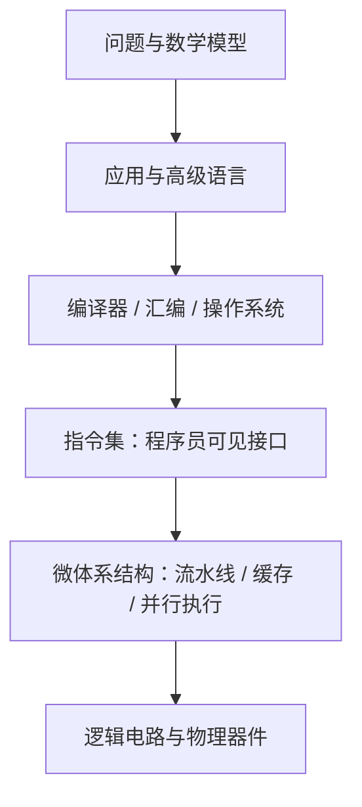
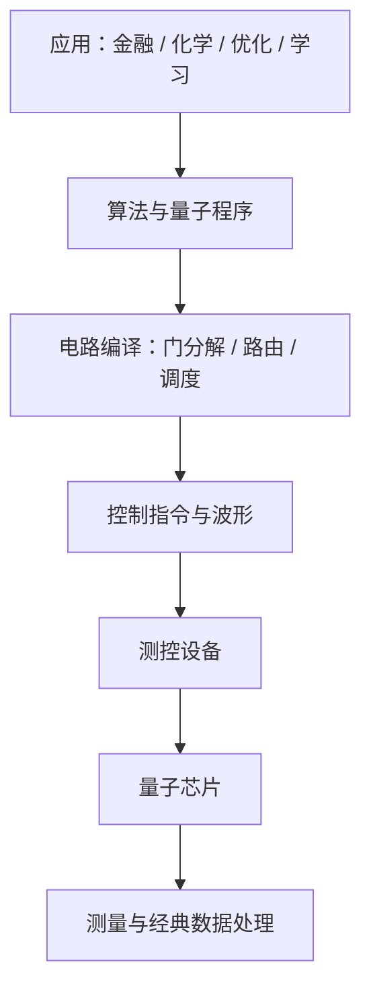

# 00 计算机简史与先进计算

> 本文按知识体系整合课件，并增加运算例题、公式解释和画图方法。文末逐页对照保留全部课件页面及可提取文字，包含历史、团队、课程信息。页码均指 PDF 的实际页面序号，原幻灯片印刷页码可能不同。产业、硬件参数、会议时间及考核方式均为**课件当时的记录**，不代表当前情况。补充内容单独标注。

## 1. 计算的本质：信息、编码、规则、物理实现

对应 PDF 第 2–11 页。

广义计算是利用信息解决问题的过程；狭义计算指计数、算术等数值处理。输入和输出是信息，经验、算法及技术是处理方法，完成处理的能力称为算力。计算不局限于电子计算机：结绳、算筹、算盘、人列计算机都将抽象信息编码为物理状态，再按规则改变状态。

| 层次 | 要回答的问题 | 经典计算 | 量子计算 |
| --- | --- | --- | --- |
| 计算理论 | 什么可以计算？ | 经典图灵机 | 量子图灵机、量子电路 |
| 编码 | 怎样表示信息？ | 二进制位 0、1 | 量子态与复振幅 |
| 操作规则 | 如何处理信息？ | 布尔逻辑、算术指令 | 酉变换、测量 |
| 物理实现 | 用什么承载？ | CMOS 电路等 | 超导电路、离子、光子等 |

文字和数字也是编码。算筹以位置和纵横形式表示数位；算盘同时保存中间状态并实现加减规则。《三体》中的人列计算机用旗帜颜色表示二进制，并以人的协作实现逻辑门。三体问题的轨道计算属于经典力学数值求解。

课件以“信息组织复杂系统”和 GPT 的语言表达引入计算。这里要区分：信息熵与热力学熵不是同一个量；局部系统可以在交换能量、物质的条件下有序化，不能由“信息使熵减”推导出违反热力学第二定律。课件的 AI 发展预测属于背景观点。

### 补充：二进制和逻辑计算

十进制数 13 的编码：

$$13=1\cdot2^3+1\cdot2^2+0\cdot2^1+1\cdot2^0=(1101)_2.$$

模 2 加法就是异或：$0\oplus0=0$、$0\oplus1=1$、$1\oplus0=1$、$1\oplus1=0$。半加器为

$$s=a\oplus b,\qquad c=a\land b.$$

例如 $1+1$ 的和位为 0，进位为 1，得到二进制 $10$。画逻辑图时先标输入 $a,b$，分别连接 XOR 和 AND，最后标和位与进位。

## 2. 计算机发展：专用、通用、网络化与异构化

对应 PDF 第 13–21 页。

| 阶段 | 课件案例 | 核心变化 |
| --- | --- | --- |
| 早期专用电子计算 | ABC（1939）、ENIAC（1946）、TRADIC（1954） | 线性方程、轨道及科学计算；真空管向晶体管发展 |
| 集成电路 | Kilby（1958） | 元件与互连集成在半导体上 |
| 兼容通用计算 | IBM System/360（1964） | 不同机器实现共享程序员可见的体系结构 |
| 大规模集成电路与 PC | 1970 年代起，随后 PC 普及 | 体积与成本下降，个人计算发展 |
| 互联网与移动互联网 | TCP/IP、移动通信 | 计算设备互联，数据规模增长 |
| 云计算 | 课件以 2006 年云服务商业化为例 | 通过网络按需获取共享计算资源 |
| 天计算 | Sky Computing | 跨云资源组合、互操作及统一使用 |
| 边缘与 HPC | 靠近用户处理；高性能系统 | 分别关注实时性和大规模计算能力 |
| 先进计算 | AI、量子、光子、类脑、DNA | 面向任务选择不同硬件与计算范式 |

课件的“第一台”说法依赖专用、可编程、电子、通用等口径，学习时优先记技术变化，不把不同口径的纪录混为一谈。A17 等芯片案例用于说明集成规模；其具体参数保留在逐页对照中，不能作为通用计算规律。

云计算常见特性：资源池化、虚拟化、按需服务、弹性、高可靠性、较低使用门槛。天计算要解决不同云厂商接口、资源、数据及服务难以互通的问题，并考虑数据所在地的约束。边缘计算在靠近数据源处提供计算、存储和网络服务，减少传输、延迟并改善数据本地性。HPC 依靠并行计算与高带宽互连、内存及存储支持复杂任务。

### 补充：云与边缘延迟例题

上传数据量 $D$，链路带宽 $B$，网络往返延迟 $L$，计算时间 $T_c$：

$$T_{\mathrm{cloud}}\approx D/B+L+T_c.$$

若 $D=80\,\mathrm{Mb}$、$B=20\,\mathrm{Mb/s}$、$L=0.05\,\mathrm{s}$、$T_c=0.2\,\mathrm{s}$，则 $T=4.25\,\mathrm{s}$。边缘处理若耗时 $0.4\,\mathrm{s}$ 且只上传结果，可能明显降低响应时间。计算前统一 bit/byte 和时间单位；$1\,\mathrm{byte}=8\,\mathrm{bit}$。

### 画图：发展时间线


画法：横轴按年代排列，纵向用不同层次区分器件、机器、网络、计算范式。年代线表示发展脉络，不表示前一种技术消失。

## 3. 体系结构：软件与硬件的约定

对应 PDF 第 23–29 页。

体系结构的经典定义是机器语言程序员必须了解的机器概念性结构与功能特性，主要表现为程序员可见的指令集、寄存器、数据表示、寻址及异常行为。**同一指令集可以有不同的微体系结构实现**。冯诺依曼结构包括运算器、控制器、存储器、输入、输出，基本思想是存储程序。

课件涉及九类课程内容：数据表示、寻址方式、寄存器组织、指令系统、存储系统、中断机构、状态机定义与切换、机器级 I/O、信息保护。分层机器从硬联逻辑、微程序、机器语言、操作系统、汇编、高级语言、应用程序到系统分析，各层通过解释或编译与下层连接。



### 三堵墙

| 瓶颈 | 原因与表现 | 常见改善方向 |
| --- | --- | --- |
| 计算墙 | 计算需求增长、频率与通用处理能力受限 | 并行、专用加速器、算法优化 |
| 存储墙 | 运算速度与数据访问速度不匹配 | 缓存、数据复用、近存/存内计算 |
| 功耗墙 | 功率、散热约束限制性能增长 | 降低数据搬移、低功耗器件、能效设计 |

### 补充：Amdahl 定律，算清并行加速上限

可并行部分比例 $p$，该部分加速 $s$ 倍，原总时间归一化为 1：

$$T'=1-p+\frac p s,\qquad S=\frac{1}{1-p+p/s}.$$

例：$p=0.9,s=10$，$S=1/(0.1+0.09)\approx5.26$。即使 $s\to\infty$，总加速比也不超过 $1/(1-p)=10$。画图时横轴取 $s$，纵轴取 $S$，画水平渐近线 10。

### 补充：内存与功率的计算

算术强度 $I=F/D$（FLOP/byte），峰值算力 $P_{\max}$，带宽 $B$：

$$P\le\min(P_{\max},BI).$$

例如 $P_{\max}=1000\,\mathrm{GFLOP/s}$、$B=100\,\mathrm{GB/s}$、$I=2\,\mathrm{FLOP/byte}$，则带宽上限只有 $200\,\mathrm{GFLOP/s}$。增加计算单元未必解决数据供给问题。动态功耗的常用近似是 $P_{\mathrm{dyn}}\propto CV^2f$，电压翻倍会带来约四倍动态功耗（其他条件相同）。

体系结构研究也涵盖多核、多处理器、指令/线程/数据并行、推测执行、内存层次、云与数据中心、互连、AI 加速器、安全隐私、虚拟化、非易失存储、近似计算、量子计算、建模仿真和真实系统评估。课件介绍 ISCA、ASPLOS、HPCA、MICRO，以及 DAC、ATC、PPoPP、FAST；会议截止时间是历史信息。

## 4. 先进计算范式

| 范式 | 表示与操作 | 适合关注的任务 | 关键限制 |
| --- | --- | --- | --- |
| 量子 | 复振幅、酉演化、测量 | 特定量子模拟、搜索、代数问题 | 噪声、读出、纠错、连接性 |
| 光子 | 光传播、干涉等 | 通信、光学线性运算 | 精度、非线性、光电接口 |
| 类脑 | 神经元状态、脉冲与突触 | 稀疏事件处理等 | 编程、训练与评估方法 |
| DNA | 分子编码与生化操作 | 组合问题与分子信息处理 | 制备、筛选、读出成本 |

这些范式不是“所有任务都更快”。比较时必须把编码、初始化、数据传输、计算、读出及误差处理一起计入。

## 5. 从经典力学到量子力学

对应 PDF 第 31–41 页。

量子信息技术可按用途分为通信（传输）、计算（处理）和测量（读出/精密探测）。电影中的 MOSS 和科幻量子计算机用于引入主题，不能作为硬件能力证据。课件强调设备复杂、比特规模有限、噪声以及任务特定的量子优势。

经典轨道模型常用：

$$\mathbf F=m\mathbf a,\qquad F=G\frac{m_1m_2}{r^2}.$$

已知力与初始位置、速度，可以求解运动方程。量子态则由概率幅描述，演化和测量分别采用不同的规则。

课件以迈克尔逊–莫雷实验、黑体辐射解释经典物理的困难。量子力学发展脉络：普朗克的能量量子化（1900）、爱因斯坦的光量子（1905）、波尔原子模型（1913）、德布罗意物质波（1924）、海森堡矩阵力学（1925）、薛定谔波动力学（1926）、冯诺依曼数学形式化（1932）。不同诠释是理解理论的背景，不改变本课程的线性代数计算规则。

### 补充：光子能量与物质波

$$E=hf=\frac{hc}{\lambda},\qquad \lambda_{\mathrm{matter}}=\frac hp.$$

光子波长 $\lambda=500\,\mathrm{nm}$，取 $h\approx6.626\times10^{-34}\,\mathrm{J\,s}$、$c\approx3.00\times10^8\,\mathrm{m/s}$：

$$E\approx3.98\times10^{-19}\,\mathrm J\approx2.48\,\mathrm{eV}.$$

步骤：先把 nm 换成 m，再计算焦耳；用 $1\,\mathrm{eV}\approx1.602\times10^{-19}\,\mathrm J$ 换算。这里 $E=hf$ 是单个光子能量关系，不是完整的黑体光谱公式。

### 贝尔实验与局域隐变量

课件介绍 Bell、Clauser、Aspect、Zeilinger 的工作。CHSH 形式的局域隐变量界为 $|S|\le2$，量子理论上限为 $2\sqrt2$。原课件提取文字中的根号丢失不能照抄为 2。违反贝尔不等式排除了满足相应假设的局域隐变量模型，不能笼统说成“证明所有量子诠释”或允许超光速通信。 相关实验背景见 [诺贝尔奖官方介绍](https://www.nobelprize.org/prizes/physics/2022/summary/)。

补充定义：

$$S=E(a,b)+E(a,b')+E(a',b)-E(a',b').$$

在适当的贝尔态和测量方向下，四项可以取 $1/\sqrt2,1/\sqrt2,1/\sqrt2,-1/\sqrt2$，因此 $S=2\sqrt2$。画图时画两端各两个测量方向，并把每组相关函数标在连线上。

## 6. 量子计算的线性代数入口

对应 PDF 第 42–47 页；详细运算见 [[01-量子比特与量子门]]。

$$|0\rangle=\begin{bmatrix}1\\0\end{bmatrix},\quad
|1\rangle=\begin{bmatrix}0\\1\end{bmatrix},\quad
|\psi\rangle=\alpha|0\rangle+\beta|1\rangle,
\quad|\alpha|^2+|\beta|^2=1.$$

态矢量是列向量；ket 是 $|\psi\rangle$，bra 是共轭转置 $\langle\psi|$。本征态/本征值对应特征向量/特征值；算符在有限维中对应矩阵；酉算符满足 $U^\dagger U=I$；厄米算符满足 $A^\dagger=A$。

量子非门：

$$X=\begin{bmatrix}0&1\\1&0\end{bmatrix},\quad
X\begin{bmatrix}\alpha\\\beta\end{bmatrix}=\begin{bmatrix}\beta\\\alpha\end{bmatrix}.$$

例：$(\sqrt3|0\rangle+i|1\rangle)/2$ 经 X 后变为 $(i|0\rangle+\sqrt3|1\rangle)/2$。测量 0 的概率由 $3/4$ 变为 $1/4$。

双比特一般态为

$$|\psi\rangle=\alpha_{00}|00\rangle+\alpha_{01}|01\rangle+\alpha_{10}|10\rangle+\alpha_{11}|11\rangle,\quad\sum_x|\alpha_x|^2=1.$$

重复实验的概率估计为 $\hat p_x=N_x/N$。例如 100 次独立制备、运行和测量得到 01 共 48 次，只能估计 $p_{01}\approx0.48$，不能由一次测量读取全部振幅。抽样标准差约为 $\sqrt{p(1-p)/N}$。

电路图的横轴是操作顺序，水平线是比特，方框是门，控制点和目标符号共同表示受控门，仪表表示测量，测量后结果写入经典比特。相继门对应矩阵乘法，同时作用在不同子系统的门对应张量积。

## 7. 量子计算系统、产业链与技术路线

对应 PDF 第 48–56 页。

经典与量子系统都包含应用、语言、编译器、指令与底层硬件。量子系统还需要态初始化、脉冲控制、校准、读出与误差处理。计算机专业可研究语言、编译、运行系统、调度、模拟、验证和软硬件协同。



产业链涵盖应用、软件与算法、云服务、芯片设计、制造封装和测控设备。课件中的公司数量、产品与能力均按历史背景理解。

| 路线 | 编码或计算思路 | 课件关注点 |
| --- | --- | --- |
| 超导 | 人工电路能级、微波操控 | 相干时间、门与读出保真度、集成测控、干扰与扩展 |
| 离子阱 | 囚禁离子的内部态 | 高质量操控、相干性、扩展与控制 |
| 光量子 | 光子的自由度 | 传输优势、纠缠与门实现 |
| 中性原子 | 冷原子及相互作用 | 真空、光场与精密操控 |
| 半导体 | 自旋等自由度 | 器件制造经验、耦合与集成 |
| 拓扑 | 拓扑保护的编码设想 | 容错潜力及实现验证 |
| 金刚石 NV | 缺陷中心相关自由度 | 探测、光学操控与扩展 |
| 量子退火 | 优化哈密顿量 | 与门模型不同的求解方式 |
| 相干伊辛机 CIM | 光学网络等实现伊辛优化 | 建模、控制与性能评估 |

原课件将 Ion Trap 写为“量子阱”，此处统一为“离子阱”。CIM 的光学振荡器/耦合网络不能简单理解成“可编程磁铁”；光学方案也不意味着所有部件都无需特殊实验条件。

### 补充：伊辛优化如何算

$$E(\mathbf s)=\sum_i h_is_i+\sum_{i<j}J_{ij}s_is_j,\qquad s_i\in\{-1,+1\}.$$

若只有 $E=-s_1s_2$，四个赋值的能量依次为 $-1,+1,+1,-1$，同向自旋最优。二进制变量可通过 $s_i=1-2x_i$ 转換。计算时先确认耦合项的正负号约定，再枚举或优化；物理求解器并非自动保证一次找到任意问题的全局最优。

量子软件包括操作系统、云平台、测控软件、模拟器；测控软件涵盖 UI、I/O、校准、线程/通信控制、存储管理。课件概括趋势为模拟器“真、全、智”，OS“强、高、融”，云平台“广、多、熟”。应用包括金融预测与组合优化、生物分析、药物研发、化学分子及反应模拟。这些是应用方向，是否实现实用加速必须单独验证。

## 8. 实验室、平台与课程安排（按原课件记录）

对应 PDF 第 58–69 页。

课件介绍浙江大学 ACES 实验室、尹建伟、卢丽强、陈明帅、赵新奎等团队骨干，本科生科研项目和太元（JanusQ）平台发展。平台功能包括量子程序与电路展示、态可视化、频率控制、真机/模拟等执行模式、分布式调度。太元二号介绍门数、噪声、编译时间等优化选项，读出校准、程序修正与 bug 定位。研究案例包括 QuCT 电路特征分析、QuFEM 读出校准、MorphQPV 程序验证、HyQSAT 混合 SAT 求解，以及 TENET、AMOS、Sanger 等体系结构工作。完整名单、论文标题、统计图和平台截图见逐页对照。

课件记录理论 32 学时、实验 32 学时。教学覆盖：

1. 计算起源、线性代数、量子态、泡利矩阵、特征值、张量积、演化、测量。
2. 通用门、图灵机、电路模型、QFT、Shor、Grover、VQE。
3. 物理实现、超导测控、标定、指令集、编程语言与软件/硬件编译。
4. Qiskit、太元平台、编程实践、量子与深度学习框架比较。
5. 比特/门拆分的分布式计算、金融、机器学习与可解释性。
6. 纠错与表面码、信息论、隐形传态和量子通信网络。

考核记录：平时 30%（矩阵计算、算法推导和编程），期中 30%（线代与量子算法笔试），期末 40%（单人项目、代码与报告，可选机器学习、金融、化学模拟、编译优化）。参考包括施郁相关视频和 CMU 15-859BB 课程。实际考核以授课教师通知为准。

## 9. 复习运算与画图清单

- 会解释信息编码、计算规则、物理实现的区别。
- 会区分 ISA、微体系结构与物理器件，画系统分层图。
- 会统一单位，计算带宽/延迟、Amdahl 加速比和算术强度。
- 会计算 $E=hf$、写量子态归一化和 X 门矩阵乘法。
- 会从双比特振幅求测量概率，解释抽样与量子优势的边界。
- 会画计算发展时间线、量子系统栈、电路图与技术路线比较图。

后续笔记：[[01-量子比特与量子门]]、[[02-量子测量与量子图灵机]]。


## 附录：逐页知识点与原图完整对照

> 此部分用于检查覆盖范围和查看所有原始图、公式、截图及课件细节。自动提取文字按原页保留，可能缺失图像公式或保留原文笔误；正文给出了重写的运算公式与纠正。PDF 实际页码和原幻灯片页脚页码有时不同。

| PDF 页 | 原页主题 |
| --- | --- |
| 1 | [计算机体系结构简史](#pdf-第-1-页) |
| 2 | [IT人的世界观](#pdf-第-2-页) |
| 3 | [信息的本质效能](#pdf-第-3-页) |
| 4 | [GPT的底层逻辑](#pdf-第-4-页) |
| 5 | [目录](#pdf-第-5-页) |
| 6 | [广义的计算](#pdf-第-6-页) |
| 7 | [从文字发展理解【信息与编码】](#pdf-第-7-页) |
| 8 | [算力的物理形态](#pdf-第-8-页) |
| 9 | [计算的本质：信息编码与处理](#pdf-第-9-页) |
| 10 | [经典与量子计算体系](#pdf-第-10-页) |
| 11 | [《三体》小说：人列计算机](#pdf-第-11-页) |
| 12 | [目录](#pdf-第-12-页) |
| 13 | [计算发展历史规模](#pdf-第-13-页) |
| 14 | [计算发展简史：专用计算](#pdf-第-14-页) |
| 15 | [计算机发展历史 – 集成电路](#pdf-第-15-页) |
| 16 | [计算机发展历史 – 集成电路](#pdf-第-16-页) |
| 17 | [计算机发展历史 – PC与互联网](#pdf-第-17-页) |
| 18 | [计算机发展历史 - 云计算](#pdf-第-18-页) |
| 19 | [计算机发展历史 – 天计算](#pdf-第-19-页) |
| 20 | [计算机发展历史 – 天计算](#pdf-第-20-页) |
| 21 | [计算机发展历史 – 边缘计算，高性能计算](#pdf-第-21-页) |
| 22 | [目录](#pdf-第-22-页) |
| 23 | [计算机体系结构由来](#pdf-第-23-页) |
| 24 | [计算机体系结构由来](#pdf-第-24-页) |
| 25 | [主流计算机体系结构课程大纲](#pdf-第-25-页) |
| 26 | [冯诺依曼体系算力瓶颈](#pdf-第-26-页) |
| 27 | [先进计算体系结构](#pdf-第-27-页) |
| 28 | [体系结构领域的会议](#pdf-第-28-页) |
| 29 | [MICRO接收的topic](#pdf-第-29-页) |
| 30 | [目录](#pdf-第-30-页) |
| 31 | [量子信息技术简介](#pdf-第-31-页) |
| 32 | [流浪地球2](#pdf-第-32-页) |
| 33 | [想象 vs 现实](#pdf-第-33-页) |
| 34 | [牛顿力学与万有引力](#pdf-第-34-页) |
| 35 | [经典物理学上空的两朵“乌云”](#pdf-第-35-页) |
| 36 | [量子概念的提出](#pdf-第-36-页) |
| 37 | [量子力学发展](#pdf-第-37-页) |
| 38 | [上帝掷骰子吗？](#pdf-第-38-页) |
| 39 | [量子门派](#pdf-第-39-页) |
| 40 | [2022诺贝尔奖](#pdf-第-40-页) |
| 41 | [量子计算机的发展](#pdf-第-41-页) |
| 42 | [量子计算操作](#pdf-第-42-页) |
| 43 | [案例：量子非门](#pdf-第-43-页) |
| 44 | [线性代数：YES！ 量子力学：NO！](#pdf-第-44-页) |
| 45 | [线性代数：YES！ 量子力学：NO！](#pdf-第-45-页) |
| 46 | [量子线路模型](#pdf-第-46-页) |
| 47 | [量子线路模型](#pdf-第-47-页) |
| 48 | [量子计算机体系结构](#pdf-第-48-页) |
| 49 | [量子计算产业链](#pdf-第-49-页) |
| 50 | [量子芯片](#pdf-第-50-页) |
| 51 | [量子芯片：超导量子](#pdf-第-51-页) |
| 52 | [量子软件](#pdf-第-52-页) |
| 53 | [浙大自主研发的超导量子软硬件](#pdf-第-53-页) |
| 54 | [量子软件的发展趋势](#pdf-第-54-页) |
| 55 | [量子计算应用](#pdf-第-55-页) |
| 56 | [工业界现状](#pdf-第-56-页) |
| 57 | [目录](#pdf-第-57-页) |
| 58 | [计算机学院ACES实验室](#pdf-第-58-页) |
| 59 | [课题组本科生科研成果](#pdf-第-59-页) |
| 60 | [太元量子体系结构发展历程](#pdf-第-60-页) |
| 61 | [太元一号：JanusQ-1.0 Cloud Platform](#pdf-第-61-页) |
| 62 | [太元二号量子软件核心组件](#pdf-第-62-页) |
| 63 | [太元量子开源项目：github.com/JanusQ](#pdf-第-63-页) |
| 64 | [课题组体系结构研究成果](#pdf-第-64-页) |
| 65 | [课题组优势](#pdf-第-65-页) |
| 66 | [课程教师团队介绍](#pdf-第-66-页) |
| 67 | [教学大纲（暂定）](#pdf-第-67-页) |
| 68 | [考核方式](#pdf-第-68-页) |
| 69 | [参考资料](#pdf-第-69-页) |

### PDF 第 1 页

**原页主题：计算机体系结构简史**


<details>
<summary>本页可提取文字（原文对照）</summary>


```text
1


计算机体系结构简史
 与先进计算介绍

     卢丽强
  浙江大学 计算机学院
```

</details>


### PDF 第 2 页

**原页主题：IT人的世界观**


<details>
<summary>本页可提取文字（原文对照）</summary>


```text
IT人的世界观


量子计算理论基础与软件系统   卢丽强：liqianglu@.zju.edu.cn   2
```

</details>


### PDF 第 3 页

**原页主题：信息的本质效能**


<details>
<summary>本页可提取文字（原文对照）</summary>


```text
信息的本质效能

◼ 将数字中国建设工作情况作为对有关党政领导干部考核评价的参考。
◼ 增强领导干部和公务员数字思维、数字认知、数字技能。
                             ---2023年2月27中办国办《数字中国建设整体布局规划》


◼ 物理学和辩证法告诉我们，世界是运动的。宏观的天体星辰、微观的粒子世界、自然的
  生态体系、人类的社会系统，这些复杂系统均呈现“熵增”的趋势，最后归于消亡。
◼ 信息是物体间相互作用的信号，是世界的本质要素之一，是熵变的“驱动力”。
◼ 信息技术可使得复杂生态系统在一定时间内向“熵减”发展，在一定时间内保持稳态。
                                ---2022年8月19日尹建伟《中国服务型制造大会报告》


量子计算理论基础与软件系统    卢丽强：liqianglu@.zju.edu.cn                  3
```

</details>


### PDF 第 4 页

**原页主题：GPT的底层逻辑**


<details>
<summary>本页可提取文字（原文对照）</summary>


```text
GPT的底层逻辑


          语 言
                                        •    文本：Language of Humans


            ChatGPT
                大语言模型
         语言就是逻辑，就是知识
      人类、计算机与自然界的“语言”
    GPT是人类知识的一种表达和存储形式                  •    蛋白质：Language of Amino Acids
      （其他形式：文字与书、神经网络、程序）


 ◼ 变革没这么快，但也没那么远！过去20年是互联网的20年，未来20年必将是人工智能的20年；
 ◼ GPT的几个发展阶段“小学生、大学生、研究生、专业人士”；
量子计算理论基础与软件系统               卢丽强：liqianglu@.zju.edu.cn                      4
```

</details>


### PDF 第 5 页

**原页主题：目录**


<details>
<summary>本页可提取文字（原文对照）</summary>


```text
目录

                 01 计算的本质

                         02 计算机发展历史


                           03 计算机体系结构发展


                     04 量子计算背景介绍

                05 实验室团队与课程介绍

量子计算理论基础与软件系统    卢丽强：liqianglu@.zju.edu.cn   5
```

</details>


### PDF 第 6 页

**原页主题：广义的计算**


<details>
<summary>本页可提取文字（原文对照）</summary>


```text
广义的计算
   所谓“计算”，其实就是利用信息解决问题的过程；通过计算解决问题，就实现了进步和发展。
   “知之在人者谓之知，知有所合谓之智”--《荀子. 正名》


   ◼ 在整个过程中，人类是主体，信息是输入和输出物。经验和技术，则是方法。而完成整个计算过程的
     能力，就是算力（Computing Power）。
   ◼ 在人类早期阶段，之所以需要算力，是为了生存。主要的计算内容，是如何狩猎，如何防范袭击，如
     何繁衍后代。
   ◼ 后来，有了基本的生存保障，人类就开始将更多的算力用于改善生存质量，例如搭建房屋、交易物品、
     制造工具等。

量子计算理论基础与软件系统              卢丽强：liqianglu@.zju.edu.cn   6
```

</details>


### PDF 第 7 页

**原页主题：从文字发展理解【信息与编码】**


<details>
<summary>本页可提取文字（原文对照）</summary>


```text
从文字发展理解【信息与编码】
   计算是对信息进行处理的过程；如何表达和记录信息，是计算的第一步。
   信息是世界的本质之一，是复杂系统（宏观、微观、社会、人类、CPS）中单元相互沟通的信令。

     原始人的壁画      早期象形文字                文字中的特殊符号：数字   巴比伦文明的六十进制


   ◼ 文字本身就是用表意符号对信息进行“编码”，这也是为什么NLP大模型能够泛化到各类下游应用场景。
   ◼ 数字出现后，人们将计数和算数的过程，称为计算（可以理解为狭义的计算）。
   ◼ 毕达哥拉斯学派的主张：万物皆是数！

量子计算理论基础与软件系统            卢丽强：liqianglu@.zju.edu.cn                7
```

</details>


### PDF 第 8 页

**原页主题：算力的物理形态**


<details>
<summary>本页可提取文字（原文对照）</summary>


```text
算力的物理形态
   在古时候，很多事情，即便是用上手指、脚趾，也不算不明白。所以我们开始借助外部算力工具

                结绳纪事                           算筹（运筹帷幄、技高一筹）


    • 易经：上古结绳而治,后世圣人易之以书契                • 算筹诞生于春秋战国时期，用于计算的小棍子
    • 中国结也源于“结绳记事”。                      • 个位用纵式，十位用横式，百位用纵式
    • 本质就是将信息编码为一个个绳结！                   • 运筹帷幄、一筹莫展、技高一筹，都源于此


量子计算理论基础与软件系统            卢丽强：liqianglu@.zju.edu.cn                8
```

</details>


### PDF 第 9 页

**原页主题：计算的本质：信息编码与处理**


<details>
<summary>本页可提取文字（原文对照）</summary>


```text
计算的本质：信息编码与处理

       计算的编码规则                           编码规则的物理实现


    加法口诀：                  • 算盘：“三下五除二”编码规则的物理实现
    加法运算法则在算盘中的体现          • 集存储与计算一体，是真正意义上的计算机


量子计算理论基础与软件系统       卢丽强：liqianglu@.zju.edu.cn        9
```

</details>


### PDF 第 10 页

**原页主题：经典与量子计算体系**


<details>
<summary>本页可提取文字（原文对照）</summary>


```text
经典与量子计算体系
                计算理论              编码规则                  物理实现
                通用经典图灵机       二进制的编码规则                  0/1 的物理实现


  经典
  计算

            打孔带模拟纸笔计算       基于二进制的打孔带                 CMOS电流的开闭表示0/1

                通用量子图灵机     量子比特的编码规则                  量子比特的物理实现


  量子                                                            电
  计算                                                            容


            量子力学模拟复杂过程    基于量子比特的量子电路                  超导量子、光量子等


量子计算理论基础与软件系统             卢丽强：liqianglu@.zju.edu.cn                    10
```

</details>


### PDF 第 11 页

**原页主题：《三体》小说：人列计算机**


<details>
<summary>本页可提取文字（原文对照）</summary>


```text
《三体》小说：人列计算机

      求解三体问题                           人        列   计   算   机


   在虚拟游戏《三体》中，玩家需
   要揭示三体世界中三个太阳的运
   行规律，以此来躲避太阳运动导         “冯·诺伊曼”说服“秦始皇”，用三千万秦兵组成一种
   致的极端气候。本质是基于牛顿         计算机器，来计算三体问题，通过秦兵手中的旗帜颜色来
   力学计算三个太阳的运动轨迹          对计算编码，即“人列计算机”。


量子计算理论基础与软件系统       卢丽强：liqianglu@.zju.edu.cn                   11
```

</details>


### PDF 第 12 页

**原页主题：目录**


<details>
<summary>本页可提取文字（原文对照）</summary>


```text
目录

                 01 计算的本质

                         02 计算机发展历史


                           03 计算机体系结构发展


                     04 量子计算背景介绍

                05 实验室团队与课程介绍

量子计算理论基础与软件系统    卢丽强：liqianglu@.zju.edu.cn   12
```

</details>


### PDF 第 13 页

**原页主题：计算发展历史规模**


<details>
<summary>本页可提取文字（原文对照）</summary>


```text
计算发展历史规模
                                        PC通用计算时代                               云计算时代             新型先进计算时代
     特定领域专用计算时代
                                            互联网时代                              移动互联网                 人工智能

                                                     TCP/IP协议                 云服务        人工智能        云边端泛在计算
     专用计算         兼容计算                PC机
      机诞生          机诞生                诞生
                                                     移动通信1G              移动通信2G          互联网+        融合计算体系


   1939-1954      1964              1970s             1980s                  2000-2007   2010-2021        至今
  • ABC用于求解线性    • IBM360开创了计   ⚫   大规模集成电路         • 计算机的大规模联          • WAP(无线应用协 • 移动通信4G, 5G      •   超级计算
    方程组            算机兼容性时代          出现                结催生了互联网             议)的应用模式   • 基于深度学习的人        •   智能计算
  • ENIAC用于导弹轨                  ⚫   Kenbak-1的出      • 1G：美国的            • 移动通信2G      工智能模型崛起         •   量子计算
    道计算                             现标志着个人计           AMPS                          • 智能计算、智能芯        •   光子计算
  • TARDIC用于科学                      算机开始发展          • 1G：欧洲的TACS                      片业务迅速扩展         •   生物计算
    计算


                 分久必合                                           合久必分                                      融合计算
     自ABC、ENIAC、TRADIC等专用计                           自通用计算架构到智能计算、量子
 分   算机到IBM 360融合通用计算架构                      合       计算、光子计算等异构计算架构                          分            系统是必
                                                                                                          然趋势！

量子计算理论基础与软件系统                                    卢丽强：liqianglu@.zju.edu.cn                                       13
```

</details>


### PDF 第 14 页

**原页主题：计算发展简史：专用计算**


<details>
<summary>本页可提取文字（原文对照）</summary>


```text
计算发展简史：专用计算

        专用计算机                大型专用计算机                          大型专用计算机

    ABC 计算机（1939）         ENIAC 计算机（1946）                  TRADIC 计算机（1954）


•   世界第一台专用电子计算机      •   世界第一台可编程计算机                  •   世界第一台晶体管计算机
•   300个电子真空管         •   17,468个电子真空管                 •   800个电子晶体管
•   专用于求解线性方程组        •   专用于军方备战需求计算                  •   专用于科学计算
•   能够求解29个变量的线性方程组   •   能够求解导弹轨迹等计算                  •   计算速度达到每秒几十万次

量子计算理论基础与软件系统              卢丽强：liqianglu@.zju.edu.cn                          14
```

</details>


### PDF 第 15 页

**原页主题：计算机发展历史 – 集成电路**


<details>
<summary>本页可提取文字（原文对照）</summary>


```text
计算机发展历史 – 集成电路
                J. Kilby
                ⚫ 集成电路之父
                ⚫ 2000 Nobel 物理奖
                ⚫ 1958.9.12发明了第1个
                    IC“Solid Circuit”
                有极少数人凭借他们的智慧和专业领域的成就改变了这个世界，杰克·基尔比就是其中之一
                                                 ——德州仪器公司


                             集成电路：把一个电路中所需的晶体管、电阻、电容和电感等元件及
                             布线互连一起，制作在一小块或几小块半导体晶片

                             第一个集成电路
                             ⚫ 锗衬底，台式结构
                             ⚫ 2个晶体管、2个电容、8个电阻
                             ⚫ 黑蜡保护刻蚀，打线结合


量子计算理论基础与软件系统                           卢丽强：liqianglu@.zju.edu.cn   15
```

</details>


### PDF 第 16 页

**原页主题：计算机发展历史 – 集成电路**


<details>
<summary>本页可提取文字（原文对照）</summary>


```text
计算机发展历史 – 集成电路

       小型通用计算机            大规模集成电路时代                         巨大规模集成电路时代

      IBM360（1964）       大规模集成电路（1970s）                   iphone 15 A17 PRO 芯片


•   360：360度大转弯      •   第四代大规模集成电路计算机                •    台积电3nm工艺
•   第三代集成电路计算机       •   第一台个人计算机诞生，满足个               •    190亿个晶体管
•   开创了计算机兼容性的时代         人使用需求                        •    8CPU核心、2性能核、4能效核
•   6个处理器型号          •   计算机体积和价格不断下降                 •    GPU：16核神经网络引擎

量子计算理论基础与软件系统             卢丽强：liqianglu@.zju.edu.cn                              16
```

</details>


### PDF 第 17 页

**原页主题：计算机发展历史 – PC与互联网**


<details>
<summary>本页可提取文字（原文对照）</summary>


```text
计算机发展历史 – PC与互联网

         个人计算机                       互联网时代                         移动互联网时代

    PC（1980s-1990s）             TCP/IP（1980s）                   移动互联网（2000-2015）


•   个人计算机开始大量普及            •   计算机大规模联结催生了互联网               •   无线应用新协议的应用模式：2G
•   Windows操作系统、intel处理器   •   全球化发展带来了爆发式增长的               •   移动终端丰富的应用软件：3G
•   高性能计算开始用于科学研究和             信息                           •   智能手机规模化应用：4G
    商业领域                   •   大量的数据需要新的计算范式                •   移动互联网流量爆炸式增长：5G

量子计算理论基础与软件系统                   卢丽强：liqianglu@.zju.edu.cn                          17
```

</details>


### PDF 第 18 页

**原页主题：计算机发展历史 - 云计算**


<details>
<summary>本页可提取文字（原文对照）</summary>


```text
计算机发展历史 - 云计算
 随着规模扩大，应用场景增多，为了满足数据运算需求，公司就要购置运算能力更强的服务器，甚至是具有多台服
 务器的数据中心，导致初期建设成本、电费、运营和网络维护成了很多企业的心头病。


                 2006年，当亚马逊第一次            •   计算机技术与网络技术融合发展

                 将其计算能力作为云服务去             •   通过互联网提供计算资源

                 售卖时，标志着云计算这种             •   具有超大规模、虚拟化、高可靠性、高通用

                 新的商业模式诞生。                    性、按需服务、高性价比等优势


 ◼ 90年代，Salesforce.com 看到了机会，通过租赁式网页CRM软件服务，开创了SaaS模式（软件即服务）的
   时代。(此时的亚马逊也不知道什么叫云)
 ◼ 2002年，出版商建议亚马逊开发一个API接口，第三方公司可以通过这个接口获取其产品、价格和销售排名。
   在贝佐斯的推动下，更丰富的接口被陆续推出，这些服务器的运作能力，能够当成虚拟货品卖给开发者和初
   创企业，这和当时毛利率百分之二的主业务电子商务比起来，简直就是一笔“横财”。

量子计算理论基础与软件系统            卢丽强：liqianglu@.zju.edu.cn                  18
```

</details>


### PDF 第 19 页

**原页主题：计算机发展历史 – 天计算**


<details>
<summary>本页可提取文字（原文对照）</summary>


```text
计算机发展历史 – 天计算
 天计算希望解决的问题：
 每一家云计算都在提供自己定制的服务, 相互之间差别较大无法转换。


                                                        Scott Shenker
                                                        UC Berkeley教授，授Scott Shenker，计算机历史上论文被
                                                        引用次数最高的人，同时也是知名SDN公司Nicira的联合创始
                                                        人及前CEO，Spark原作者


                                                        Ion Stoica
                                                        UC Berkeley教授，有人说：整个大数据时代基本是追着
                                                        Google和UC Berkeley RISELab跑。Ion Stoica便是RISELab
               天计算的体系架构                                 背后的那个男人，从早期的Chord，到后来的Mesos、Spark
               注：图片取自其相关论文


Ion Stoica, Scott Shenker. From cloud computing to sky computing. Workshop on Hot Topics in Operating Systems (UC Berkeley) 2021.


量子计算理论基础与软件系统                                       卢丽强：liqianglu@.zju.edu.cn                                                  19
```

</details>


### PDF 第 20 页

**原页主题：计算机发展历史 – 天计算**


<details>
<summary>本页可提取文字（原文对照）</summary>


```text
计算机发展历史 – 天计算
 不同于我们都熟知的Cloud Computing(“云计算”)，Sky Computing (“天空计算”)，是云计算的未来，是
 指天空中有很多的云，如何解决跨云的问题，打破不同云之间的隔阂，最大化地利用跨云数据！


                                                        天计算的优势
                                                        • 可以让使用云服务更加简单，从而扩大云服务的市场
                                                        • 可以促进更加专门的云服务
                                                        • 允许整合不同的计算资源
                                                        • 合规性的考虑，例如对于数据存放位置在不同国家地区
                                                           可能有不同的要求。

             多云时代的分布式计算

             注：图片取自其相关论文

  Sarah Chasins, Scott Shenker, Ion Stoica. The Sky Above The Clouds. A Berkeley View on the Future of Cloud Computing. 2022

量子计算理论基础与软件系统                                      卢丽强：liqianglu@.zju.edu.cn                                                   20
```

</details>


### PDF 第 21 页

**原页主题：计算机发展历史 – 边缘计算，高性能计算**


<details>
<summary>本页可提取文字（原文对照）</summary>


```text
计算机发展历史 – 边缘计算，高性能计算
                边缘计算（EC）                                高性能计算（HPC）


     •   海量数据对云计算提出了苛刻要求                        •   复杂的计算任务需要HPC的支持
     •   在网络的边缘侧，靠近用户的地方提供计算、                   •   HPC系统具有高带宽的存储和内存，以支持
         存储和网络带宽                                    海量数据的快速读写和访问
     •   着眼于实时、短周期数据的分析，确保低延                    •   HPC系统能大幅降低计算延迟，在尽可能短
         时、低带宽与隐私保护                                 的时间内完成更多的计算任务


量子计算理论基础与软件系统              卢丽强：liqianglu@.zju.edu.cn                       21
```

</details>


### PDF 第 22 页

**原页主题：目录**


<details>
<summary>本页可提取文字（原文对照）</summary>


```text
目录

                 01 计算的本质

                         02 计算机发展历史


                           03 计算机体系结构发展


                     04 量子计算背景介绍

                05 实验室团队与课程介绍

量子计算理论基础与软件系统    卢丽强：liqianglu@.zju.edu.cn   24
```

</details>


### PDF 第 23 页

**原页主题：计算机体系结构由来**


<details>
<summary>本页可提取文字（原文对照）</summary>


```text
计算机体系结构由来
 从IBM 360讲起 (1964)

                                     G.M.Amdahl(阿姆达尔) 是 IBM360的首席架构师，他提出：


                                     • 计算机体系结构是程序员看到的计算机属性
                                     • 不同级程序员所看到的计算机属性显然不同
                                     • Amdahl等人提出的程序员是指机器语言程序员
   IBM在1960年代初创造了 computer           • 计算机属性是硬件的概念结构及其功能特性，是计算机硬
   architecture 一词。 1964年， Amdahl，
   Blaauw，Brooks 论文使用该术语指代             件的外特性。
   IBM 360指令集中程序员可见部分。


   因此完整的计算机体系结构的定义是：
   机器语言程序员所必须了解的机器概念性结构和功能特性

量子计算理论基础与软件系统                         卢丽强：liqianglu@.zju.edu.cn             25
```

</details>


### PDF 第 24 页

**原页主题：计算机体系结构由来**


<details>
<summary>本页可提取文字（原文对照）</summary>


```text
计算机体系结构由来

                传统定义                                   指令集设计


    冯诺依曼体系结构                                  IBM 360论文，首次提出体系结构概念
    • 基本结构：运算单元、控制单元、存储单元、                    • 指令集开始成为计算机设计的出发点
      输入设备、输出设备                               • 软件和硬件的研究自此相对独立
    • 基本特点：存储程序结构，符合图灵机模型                     • 指令集占据着核心地位 ，也是目前体
    • 可存储程序的机器提供了灵活的编程能力                           系结构课程的主要内容


量子计算理论基础与软件系统          卢丽强：liqianglu@.zju.edu.cn                     26
```

</details>


### PDF 第 25 页

**原页主题：主流计算机体系结构课程大纲**


<details>
<summary>本页可提取文字（原文对照）</summary>


```text
主流计算机体系结构课程大纲
                                       问题规范
                                                      M7系统分析
                问题
   ①数据表示        分析
                                       数学模型                          系统分析员
                                      应用语言
                应用
   ②寻址方式        软件
                                                   M6应用程序机器

                                      应用程序                         用户
                                   高级语言
   ③寄存器组织                                          M5高级语言机器

                                   编译解释                            高级语言程序员

   ④指令系统        系统
                                  汇编语言
                                                  M4汇编语言机器
                软件
                                  汇编程序
   ⑤存储系统                       键盘命令和OS原语
                                                               低级语言程序员
                                             M3操作系统机器


   ⑥中断机构                       操作系统
                            指令系统
                                                             操作员
                                          M2机器语言机器
                计算机
   ⑦状态机的定义和切换   组成与
                 结构
                            CPU
                                                         机器语言程序员
                           机器指令时序
                                          M1微程序控制

   ⑧机器级的I/O结构              微程序控制
                                                       逻辑设计员
                        硬操作时序
                                         M0硬联逻辑
   ⑨信息保护                硬联逻辑
                                                     硬件设计员


量子计算理论基础与软件系统         卢丽强：liqianglu@.zju.edu.cn                              27
```

</details>


### PDF 第 26 页

**原页主题：冯诺依曼体系算力瓶颈**


<details>
<summary>本页可提取文字（原文对照）</summary>


```text
冯诺依曼体系算力瓶颈
       信息量集聚爆炸            系统规模空前复杂                      传统冯诺依曼体系已达到算力瓶颈


         CHAT
          GPT


 • 当前经典超级计算机的发展面临“计算墙”、“存储墙”、“功耗墙”的瓶颈问题
 • 图灵奖得主、计算机体系结构领域杰出人物John L. Hennessy和David A. Patterson也指出“随着摩尔定律
   走向极限，设计新的计算硬件架构及其编程软件系统将成为提升计算机效能的核心技术”


量子计算理论基础与软件系统               卢丽强：liqianglu@.zju.edu.cn                     29
```

</details>


### PDF 第 27 页

**原页主题：先进计算体系结构**


<details>
<summary>本页可提取文字（原文对照）</summary>


```text
先进计算体系结构
     量 子计 算       光 子 计 算                   类 脑 计 算     DNA计算


 量子计算是基于量子力学    基于光子进行信息处理的            通过神经元模型模拟生物    基于大量DNA分子的并行
 的新型计算方式，理论上    计算技术，信息是通过光            膜电压变化及传递过程脉    操作及生化处理技术，通
 具有经典计算无法比拟的    子传递的，具有速度快、            冲方式，神经元之间信息    过产生组合结果并对其进
 巨大信息携带和超强并行    能耗低等优点，可用于高            传递采用脉冲方式，更具    行抽取和检测来完成问题
 处理能力！          速通信、高性能计算！             生物真实性、功耗更低！    求解的过程！


量子计算理论基础与软件系统           卢丽强：liqianglu@.zju.edu.cn                    30
```

</details>


### PDF 第 28 页

**原页主题：体系结构领域的会议**


<details>
<summary>本页可提取文字（原文对照）</summary>


```text
体系结构领域的会议
  体系结构中较为重要的会议
   会议                                                              截稿时间                  开会时间   特点
   ISCA (International Symposium on Computer Architecture)         11月中                  6月中    体系中最难
   ASPLOS (International Conference on Architectural Support for                                系统软件，系统设计， 操作
                                                                   8月初                   2月底
   Programming Languages and Operating Systems)                                                 系统等方向比较多
   HPCA (High Performance Computer Architecture)
   MICRO (IEEE/ACM International Symposium on
                                                                   7月底
                                                                       他们有什么特点           2月底    偏向高性能计算

   Microarchitecture)
                                                                   5月初                   10月底   偏硬件

  其他会议：DAC、ATC、PPoPP、FAST等


                                                                           ISCA 论文投稿量和终稿率
                                                                           • 近年来接受率在逐步上升
                                                                           • 但仍然低于20%！

量子计算理论基础与软件系统                                                卢丽强：liqianglu@.zju.edu.cn                          31
```

</details>


### PDF 第 29 页

**原页主题：MICRO接收的topic**


<details>
<summary>本页可提取文字（原文对照）</summary>


```text
MICRO接收的topic
  以体系结构领域顶级会议MICRO为例（中国平均每年不到10篇）：
  MICRO对于体系结构的定义：用于改进系统性能、功率、能效、安全性、成本、复杂性、程序员生产力、可
  预测性、服务质量、可靠性、可靠性、可扩展性、可持续性的微架构、架构、编译器和混合技术

          传统体系结构                       先进计算与近似计算
          •   处理器、内存和存储架构               • 新兴技术和应用的体系结构
          •   多核和多处理器系统                 • 对非易失性/持久性内存的体系结构支持
              指令级、线程级和数据级并行性
          •
          •   预测与推测
                                        • 量子计算
                                        • 内/近内存或内/近存储处理
          •   内存层次结构
                                        • 近似计算和近似的体系结构支持
          云计算与互联
                                       工艺与仿真
          • 云和数据中心规模的计算
          • 物联网、移动和嵌入式架构                • 电路和工艺对架构的影响
          • 互连网络、路由器和网络接口架构             • 体系结构建模和仿真方法
                                        • 真实计算系统的评估和测量
          AI芯片、软件优化

          • 基于加速器的、特定于应用程序的、可重构的体系结构
          • 对编程语言、编译、软件开发、安全和隐私、虚拟化的架构支持
量子计算理论基础与软件系统              卢丽强：liqianglu@.zju.edu.cn           32
```

</details>


### PDF 第 30 页

**原页主题：目录**


<details>
<summary>本页可提取文字（原文对照）</summary>


```text
目录

                 01 计算的本质

                         02 计算机发展历史


                           03 计算机体系结构发展


                     04 量子计算背景介绍

                05 实验室团队与课程介绍

量子计算理论基础与软件系统    卢丽强：liqianglu@.zju.edu.cn   33
```

</details>


### PDF 第 31 页

**原页主题：量子信息技术简介**


<details>
<summary>本页可提取文字（原文对照）</summary>


```text
量子信息技术简介
 基本概念
    ◼   基于量子力学微观原理的技术，美国原子弹 -- 曼哈顿计划，量子计算机 -- 微曼哈顿计划
    ◼   量子通信 -- 数据传输，量子计算 -- 数据处理，量子测量 -- 数据读取
 量子优势

                经典比特相当               经典数据可以                     量子态的一次操作
                于球面上南北               复制，而量子                     可以理解为多个经
                极两个点，而               态不可复制，                     典数据同时计算
                量子比特为球               测量会使量子                     （得益于量子叠加
                面上任意点！               态坍缩！                       与量子纠缠的特
                                                                性）！

    高信息载体                高安全通信                          高并行计算

 量子信息技术开始受到普遍关注
    ◼   2022诺贝尔物理学奖：通过实验进一步证明了量子信息相关理论的正确性
    ◼   2023春节档电影《流浪地球2》：550W量子计算机，人工智能与量子计算的结合
    ◼   GTC 2023大会：ChatGPT巨大的GPU算力需求推动英伟达打造GPU+QPU量子混合计算

量子计算理论基础与软件系统               卢丽强：liqianglu@.zju.edu.cn                      34
```

</details>


### PDF 第 32 页

**原页主题：流浪地球2**


<details>
<summary>本页可提取文字（原文对照）</summary>


```text
流浪地球2


                                            太空电梯


                                            量子计算机
                                            MOSS 550W

量子计算理论基础与软件系统   卢丽强：liqianglu@.zju.edu.cn               35
```

</details>


### PDF 第 33 页

**原页主题：想象 vs 现实**


<details>
<summary>本页可提取文字（原文对照）</summary>


```text
想象 vs 现实

 大家以为的量子计算机     当前的实际情况…
                                             当前的局限性：


                                             • 比特数受限


                                             • 设备繁杂


                                             • 计算存在噪声


                                             • 只能在特定任务上
                                              取得量子计算优势

量子计算理论基础与软件系统    卢丽强：liqianglu@.zju.edu.cn                36
```

</details>


### PDF 第 34 页

**原页主题：牛顿力学与万有引力**


<details>
<summary>本页可提取文字（原文对照）</summary>


```text
牛顿力学与万有引力

    经典力学                       运动方程：牛顿力学
    物体的状态：确定性


量子计算理论基础与软件系统   卢丽强：liqianglu@.zju.edu.cn   37
```

</details>


### PDF 第 35 页

**原页主题：经典物理学上空的两朵“乌云”**


<details>
<summary>本页可提取文字（原文对照）</summary>


```text
经典物理学上空的两朵“乌云”
       Lord Kelvin   迈克尔逊——莫雷实验                        黑体辐射问题


                                                     普朗克黑体公式——E=hf

   • 热力学之父，发明了热      “电动力学乌云”，用于检测                  “热力学乌云”，1859年德国
                     地球在以太中的运动，对干涉                  海德堡大学的古斯塔夫·基尔霍
     力学温标（绝对温标）
                     仪垂直方向上的光速造成的差                  夫，为了弄清楚一个物体的温
   • 提出温度的下限（即绝      异，最后却发现光速没有变化，                 度，和它在光谱各个频率下辐
                     证明了以太并不存在。                     射强度之间的关系。
     对零度）


量子计算理论基础与软件系统           卢丽强：liqianglu@.zju.edu.cn                     38
```

</details>


### PDF 第 36 页

**原页主题：量子概念的提出**


<details>
<summary>本页可提取文字（原文对照）</summary>


```text
量子概念的提出


量子计算理论基础与软件系统   卢丽强：liqianglu@.zju.edu.cn   39
```

</details>


### PDF 第 37 页

**原页主题：量子力学发展**


<details>
<summary>本页可提取文字（原文对照）</summary>


```text
量子力学发展

1900年           1905年   1913年         1924年                 1925年   1926年   1932年


普朗克     爱因斯坦            波尔          德布罗意                    海森堡     薛定谔     冯诺依曼
解决黑体辐射、 假设光量子、          提出原子轨       提出波粒二象性                 提出量子力学的 提出量子力   量子力学公
提出能量量子 解释光电效应           道、解释轨                               矩阵力学    学的波动表   式化、测量、
化                       道跃迁                                         示       统一矩阵力
                                                                            学和波动力
                                                                            学


量子计算理论基础与软件系统                   卢丽强：liqianglu@.zju.edu.cn                           40
```

</details>


### PDF 第 38 页

**原页主题：上帝掷骰子吗？**


<details>
<summary>本页可提取文字（原文对照）</summary>


```text
上帝掷骰子吗？
                                                          经典物理学困境：
                                                          ⚫ 一旦确定了初始状态，所有粒子未来
                                                            的运动状态都是可以精确预言的。
                                                          ⚫ 决定论? 一切事件包括今天的讲座都是
                                                            在宇宙大爆炸时就已经确定好的吗?

                                                          爱因斯坦
                                                          光子的路径是可以预先确定的。
                                                          ⚫ 可以有某种量子力学尚不掌握的机
                                                            制——隐变量，在控制光子。

                                                          波尔
                                                          光子的路径不是预先确定的，而是取决于
                                                          是否去看它。
                                                          ⚫ 看——光子确定地通过第一条路径
                                                          ⚫ 不看——光子处于“左缝”和“右缝”
                                                            两条路径相干叠加
           1927 年第五届索尔维国际研究会的主要参会者合照

量子计算理论基础与软件系统                 卢丽强：liqianglu@.zju.edu.cn                       41
```

</details>


### PDF 第 39 页

**原页主题：量子门派**


<details>
<summary>本页可提取文字（原文对照）</summary>


```text
量子门派


量子计算理论基础与软件系统   卢丽强：liqianglu@.zju.edu.cn   42
```

</details>


### PDF 第 40 页

**原页主题：2022诺贝尔奖**


<details>
<summary>本页可提取文字（原文对照）</summary>


```text
2022诺贝尔奖

                     量子力学理论正确且完备还是局域隐变量理论正确且完备 ？

                     贝尔定理的实验验证是一个物理实验，旨在测试哪个理论
                     正确。1964 年，John Bell 定义了一个可观测量，并基于
                     局域隐变量理论预言的测量值都不大于 2。而用量子力学
                     理论，可以得出其最大值可以到 2。

                     1972 年，John Clauser 和 Stuart Freedman 在加州大学
                     柏克莱分校完成第一次贝尔定理实验，因存在定域性漏洞，

                     1982年，Alan Aspect等人在巴黎第十一大学改进Clauser
                     和Freedman 贝尔定理实验，实验结果违反贝尔定理。

                     1998 年，安东·塞林格（Anton Zeilinger）等人在奥地利
                     因斯布鲁克大学完成贝尔定理实验，彻底排除定域性漏洞，
                     实验结果具有决定性。


量子计算理论基础与软件系统   卢丽强：liqianglu@.zju.edu.cn                          43
```

</details>


### PDF 第 41 页

**原页主题：量子计算机的发展**


<details>
<summary>本页可提取文字（原文对照）</summary>


```text
量子计算机的发展


                                      第三次量子革命，量子时代 ？
量子计算理论基础与软件系统   卢丽强：liqianglu@.zju.edu.cn              44
```

</details>


### PDF 第 42 页

**原页主题：量子计算操作**


<details>
<summary>本页可提取文字（原文对照）</summary>


```text
量子计算操作

     和    态作为一组单位正交基，可以表示为向量形式：


   在该式中，α 和 β 被称为复系数（有时被称为振幅），它们描述了量子比特的叠加状态。


量子计算理论基础与软件系统          卢丽强：liqianglu@.zju.edu.cn   45
```

</details>


### PDF 第 43 页

**原页主题：案例：量子非门**


<details>
<summary>本页可提取文字（原文对照）</summary>


```text
案例：量子非门
  在经典计算机中，X门（又称为NOT门）用于电平信号的翻转，即将0态和
  1态交换。在量子电路中，是否能够定义类似的量子非门？
  答案是肯定的，但与经典非门不同的是，量子非门不仅可以实现|0⟩ → |1⟩
  的转变，它的作用还是线性的，即可以把状态：


  经过X门后，互换两个复系数，即：


  易知X门是一个2×2矩阵，其矩阵表示为：
                                                  经典CMOS
                                                  电路X门


  因此，单量子比特的量子门可以由2×2的矩阵给出，其矩阵分量决定了量子门的行为。

量子计算理论基础与软件系统         卢丽强：liqianglu@.zju.edu.cn            46
```

</details>


### PDF 第 44 页

**原页主题：线性代数：YES！ 量子力学：NO！**


<details>
<summary>本页可提取文字（原文对照）</summary>


```text
线性代数：YES！ 量子力学：NO！
    预修要求：线性代数！线性代数！线性代数！Python！

                   量子力学术语                                           线性代数术语
                态矢量（State Vector）                                  向量（Vector）
                本征态（Eigenstate）                                 特征向量（Eigenvector）
                本征值（Eigenvalue）                                  特征值（Eigenvalue）
                   右矢（ket） 𝑎                                          列向量
                   左矢（bra）⟨𝑎|                                         行向量
                       𝑎𝑏                                 a和b向量的内积（Inner Product）
                      |𝑎⟩⟨𝑏|                                    a和b的张量积构成的投影矩阵
                                                        最小本征态（Eigenstate with Lowest
                基态（Ground State）
                                                             Eigenvalue）


量子计算理论基础与软件系统                       卢丽强：liqianglu@.zju.edu.cn                          47
```

</details>


### PDF 第 45 页

**原页主题：线性代数：YES！ 量子力学：NO！**


<details>
<summary>本页可提取文字（原文对照）</summary>


```text
线性代数：YES！ 量子力学：NO！

     预修要求：线性代数！线性代数！线性代数！Python！

                  量子力学术语                                          线性代数术语

                 算符（Operator)                                    矩阵（Matrix）
            线性算符（Linear Operator）                      线性变换（Linear Transformation）

         幺正（酉）算符（Unitary Operator）                       正交矩阵（Orthogonal Matrix）

            厄米矩阵（Hermitian Matrix）                       自伴矩阵（Self-adjoint Matrix）

       线性叠加原理（Principle of Superposition）                     线性组合性质（Linearity）

           投影算符（Projection Operator）                      投影矩阵（Projection Matrix）


量子计算理论基础与软件系统                     卢丽强：liqianglu@.zju.edu.cn                          48
```

</details>


### PDF 第 46 页

**原页主题：量子线路模型**


<details>
<summary>本页可提取文字（原文对照）</summary>


```text
量子线路模型
                                          时间线

                Qubits                                           量子读出


                    量子门(e.g. SWAP)


          H
                         =

量子计算理论基础与软件系统                        卢丽强：liqianglu@.zju.edu.cn          49
```

</details>


### PDF 第 47 页

**原页主题：量子线路模型**


<details>
<summary>本页可提取文字（原文对照）</summary>


```text
量子线路模型
量子程序通过测量将量子比特的信息读取到经典比特中

   以2量子比特为例测量

   |𝝋⟩ = 𝜶𝟎𝟎|𝟎𝟎⟩+𝜶𝟎𝟏 |𝟎𝟏⟩+𝜶𝟏𝟎 |𝟏𝟎⟩+ 𝜶𝟏𝟏 |𝟏𝟏⟩


                                             1    2   3         100

                                       𝑞1    0    1   1   ···    0
                                       𝑞2    1    0   1          1


            量子电路                              量子比特信息                    测量分布

                                   获得问题解的必须步骤！

量子计算理论基础与软件系统                               卢丽强：liqianglu@.zju.edu.cn          50
```

</details>


### PDF 第 48 页

**原页主题：量子计算机体系结构**


<details>
<summary>本页可提取文字（原文对照）</summary>


```text
量子计算机体系结构
  经典计算机体系结构     量子计算机体系结构

         应用        应用                          交叉领域

       编程语言       编程语言                         只有咱们计算机
        编译器        编译器                         人才能干的事情
        指令集        指令集

      微体系结构     量子态操纵与测控

       芯片电路       量子芯片                         物理系

    二进制与晶体管     量子力学与超导量子                      1989, David Deutsch
                                               比量子图灵机更有可操作性
      经典图灵机      量子线路模型
                                               1993年，姚期智
                                               量子线路模型与量子图灵机等价

量子计算理论基础与软件系统      卢丽强：liqianglu@.zju.edu.cn                         51
```

</details>


### PDF 第 49 页

**原页主题：量子计算产业链**


<details>
<summary>本页可提取文字（原文对照）</summary>


```text
量子计算产业链
 ➢ 量子应用：模拟计算（医药、电池设计、流体
   力学、金融等行业）；人工智能（自动驾驶、
   行为预测（反洗钱和欺诈）、优化）；密码学
   （保密通信、密钥生成与管理）；

 ➢ 量子软件/算法：国际上已经有 100 多家量子
   软件公司， 但中国的量子软件公司较少；

 ➢ 量子云服务：国外主要以大公司为主，如IBM-
   Q，D-Wave的Leap，国内为本源量子等；

 ➢ 量子芯片：目前主要有量子门和非量子门两种，
   量之门占主导地位；

 ➢ 芯片制作：主要是在实验室完成，如谷歌“悬
   铃木” 量子芯片是在加州大学圣芭芭拉分校
   （UCSB） 的一家工厂制造的；2022 年 1 月 ，
   本源量子自主建设的量子芯片制造封装实验室
   和组装测试实验室正式启用；

 ➢ 量子计算设备：设备主要国外为主，测控国内                                   REF：2022全球量子计算产业发展报告
   的本源量子、国盾量子、启科量子、图灵量子
   开始追赶国际。
量子计算理论基础与软件系统                 卢丽强：liqianglu@.zju.edu.cn                      52
```

</details>


### PDF 第 50 页

**原页主题：量子芯片**


<details>
<summary>本页可提取文字（原文对照）</summary>


```text
量子芯片
  ➢ 超导量子(Superconducting)：最受关注，问题是会受到宇宙射线和纳米氢化物影响；
  ➢ 量子阱(Ion Trap)：量子比特品质高、相干时间较长、制备和读出效率高等特点，但是扩展性较差；
  ➢ 光子（Photonic Quantum）：不需要特殊环境，但是量子纠缠比较困难；
  ➢ 中性原子（Neutral Atom）：在超高真空腔中捕获和囚禁超冷原子来实现，但是对控制要求较高（磁场、电场和光场）；
  ➢ 半导体量子（Semiconductor）：优势是半导体器件的制造经验，比超导量子比特更加稳定、且相干时间更长，但量子纠缠数量较少；
  ➢ 拓扑量子（Topological Quantum）：采用拓扑材料中具有非阿贝尔统计的准粒子构筑量子比特，容错能力，有望解决量子比特退相干与
    容错量子计算的关键问题，但是总体研究还处于初级阶段，也面临纳米线体系中的“马约拉纳态-安德烈夫态”等问题；
  ➢ 金刚石 NV 色心(Diamond NV Center)：最金刚石 NV 色心具有室温可观测到的零声子线、发光稳定、相干时间长等优秀的光学特性，尤
    其是具有非常特殊的精细能级结构，可实现高精度的物理量探测和量子调控，但扩展性较差；
  ➢ 量子退火(Quantum Annealer)：是不通过构建逻辑门，而采用伊辛模型（Ising Model）实现量子计算。但量子退火先驱D-Wave在2021年
    宣布将开发基于门的量子计算机，对量子退火打击较大；
  ➢ 相干伊辛机（CIM）：和量子退火类似采用伊辛模型（Ising Model），但用的是可编程磁铁实现量子计算。优势：底层器件是光学器件
    的设计与超导器件相比， 无需低温环境， 稳定性高、 可控性好；劣势：没有实际的应用来评测系统的效果。

                多量子 通过多量子比特构建，满足现实算法的
                比特 复杂性，服务以云服务为代表。
   发展趋势
                    通过新型的金刚石NV色心量子比特实
                小型化 现小型化。


量子计算理论基础与软件系统                      卢丽强：liqianglu@.zju.edu.cn                          53
```

</details>


### PDF 第 51 页

**原页主题：量子芯片：超导量子**


<details>
<summary>本页可提取文字（原文对照）</summary>


```text
量子芯片：超导量子
➢ 超导量子(Superconducting)：最受关注，是目前国际上发展相对迅速的一种固态量子计算的实现方法。随着基于超导量子
  电路的量子计算技术已经在退相干时间、量子态操控和读取、量子比特间可控耦合、中大规模扩展等关键技术上取得大量
  突破，成为构建通用量子计算机和量子模拟机最有前途的候选技术路线之一。
➢ 发展趋势：多量子位芯片设计、外部干扰、增加相干时间（浙大为约150微秒）、门保真度提高、精度及高集成度测控系统、
  多芯片技术等。
➢ 面临的问题：问题是会受到宇宙射线和纳米氢化物影响。
➢ 现状：2021年12月浙大发布“莫干1号”“天目1号”超导量子
  芯片。


  C. Song, K. Xu, H.K. Li, Y.-R. Zhang, X. Zhang, W.X. Liu, Q.J. Guo, Z. Wang, W.H. Ren, J. Hao, H. Feng,
  H. Fan, D.N. Zheng, D.-W. Wang, H. Wang, and S.-Y. Zhu, “Generation of multicomponent atomic
  Schrödinger cat states of up to 20 qubits”, Science 365, 574-577 (2019).


量子计算理论基础与软件系统                                                                       卢丽强：liqianglu@.zju.edu.cn   54
```

</details>


### PDF 第 52 页

**原页主题：量子软件**


<details>
<summary>本页可提取文字（原文对照）</summary>


```text
量子软件

   量子操作系统软件                                                            量子云平台

     经典计算机控件控制软
                       量子操作系统交互界面               量子计算应用服务                量子计算模拟服务       量子计算设计/培训服务
         件


   量子测                                                                                       量子模
                用户界面     I/O控制单元        校准单元        线程控制单元             通信控制单元      存储管理单元
   控软件                                                                                       拟软件
   量子测
   控系统                                                                                       量子芯片模
                                                                                              拟软件


   量子                                                                                        量子算法模

   芯片                                                                                         拟软件


           超导          量子阱         光子     中性原子 半导体 拓扑量子 金刚石                     退火     CIM


量子计算理论基础与软件系统                              卢丽强：liqianglu@.zju.edu.cn                                 55
```

</details>


### PDF 第 53 页

**原页主题：浙大自主研发的超导量子软硬件**


<details>
<summary>本页可提取文字（原文对照）</summary>


```text
浙大自主研发的超导量子软硬件

    硬件基础：全流程量子芯片加工测控设备                                            软件基础：太元量子云平台1.0版本
                                                                     ( janusq.zju.edu.cn)
                                                     包含多个功能模块
                                                     提供量子基础服务保障以及量子电路优化功能
量子芯片      双倾角镀膜      电子束曝光机       激光直写机              与服务产业关联紧密，提供丰富的量子交叉应用平台
加工设备


         倒扣焊键合    等离子刻蚀   涂胶烘烤机     切片机


量子芯片
测控设备


量子计算理论基础与软件系统                         卢丽强：liqianglu@.zju.edu.cn                             56
```

</details>


### PDF 第 54 页

**原页主题：量子软件的发展趋势**


<details>
<summary>本页可提取文字（原文对照）</summary>


```text
量子软件的发展趋势


                                                               量子云平台
                                                           1. “广”：应 用领 域 越来 越 广；
                               量 子计 算 机O S                 2. “多”：用 户和 应 用生 态 越
                             1. “强”：操 作系 统 逐渐 从 单          来 越健 全 ；
                             一 的控 制 向全 系 统控 制 发展 ，         3. “熟”：服 务、 算 法等 成 熟
        量子模拟器                能 力越 来 越强 ；                   度 越来 越 高。

     1. “真”：模 拟量 子 比特 越 来    2. “高”：系 统集 成 度越 来 越
     越 多， 向 模拟 实 际应 用 ；      高 ，逐 渐 有分 散 的系 统 向S OC
     2. “全”：量 子电 路 设计 功 能    等 高级 程 度方 向 发展 ；
     越 来越 完 善， 功 能越 来 越全 ；   3. “融”：系 统逐 渐 开始 从 单
     3. “智”：模 拟越 来 越智 能 化，   一 系统 向 多系 统 融合 。
     纠 错能 力 越来 越 强。

量子计算理论基础与软件系统                  卢丽强：liqianglu@.zju.edu.cn                           57
```

</details>


### PDF 第 55 页

**原页主题：量子计算应用**


<details>
<summary>本页可提取文字（原文对照）</summary>


```text
量子计算应用


                生物遗传研究分析               药物研发


    交易欺诈侦测                                                      模拟化学分子反应过程


                  金 融交 易           生 物学                化 学模 拟
                                                                    预测分子结构、
   投资组合优化
                                                                     分子反应等


量子计算理论基础与软件系统              卢丽强：liqianglu@.zju.edu.cn                          58
```

</details>


### PDF 第 56 页

**原页主题：工业界现状**


<details>
<summary>本页可提取文字（原文对照）</summary>


```text
工业界现状


   IBM Qiskit Metal EDA工     Tensorflow Quantum开        亚马逊 Braket 托管   量子芯片，Azure
   具，量子计算机，量子云               源框架，量子计算机                  AWS服务           Quantum 量子云平台
   平台


     HiQ 云服务平台             TensorCircuit开源框架，            量子芯片、系统、算      云原生量子集成开发
                           量子药物研发等                       法和应用           环境 YunIDE ，量桨

量子计算理论基础与软件系统                           卢丽强：liqianglu@.zju.edu.cn                       59
```

</details>


### PDF 第 57 页

**原页主题：目录**


<details>
<summary>本页可提取文字（原文对照）</summary>


```text
目录

                 01 计算的本质

                         02 计算机发展历史


                           03 计算机体系结构发展


                     04 量子计算背景介绍

                05 实验室团队与课程介绍

量子计算理论基础与软件系统    卢丽强：liqianglu@.zju.edu.cn   60
```

</details>


### PDF 第 58 页

**原页主题：计算机学院ACES实验室**


<details>
<summary>本页可提取文字（原文对照）</summary>


```text
计算机学院ACES实验室
                         团队共有29 位导师、39 名博士生和144 名硕士生。在2023年，形成国家高分卫星网格平台、
                         太元超导量子计算云平台、跨界服务融合与可信服务网络等7 项标志性成果；在研科研项目
                         31 项，新增项目33 项；在国际顶级期刊/ 会议发表论文70 篇；申请专利99 项，其中PCT
                         专利共9 项；相关成果获中国专利银奖、“CCF 科技成果奖”- 科技进步奖二等奖、 ACM
       顶天！立地！            SIGMOD 中国新星奖、QCon 全球软件大会“知识传播者”奖等12 项重要奖项。

  太元量子云平台负责人尹建伟院长接受采访                        量子计算课题组目前包含20余位研究生与5名本科生


             核心骨干PI：
                            技术骨干
     技术骨干        技术骨干
                            软件学院
     计算机学院       计算机学院
                            赵新奎
     卢丽强         陈明帅
                            研究员
     研究员         研究员

量子计算理论基础与软件系统                      卢丽强：liqianglu@.zju.edu.cn            61
```

</details>


### PDF 第 59 页

**原页主题：课题组本科生科研成果**


<details>
<summary>本页可提取文字（原文对照）</summary>


```text
课题组本科生科研成果
 20级图灵班：储天尧        20级物理学院：向德彬
                                                   22级图灵班：薛辰立         22级图灵班：陈亨睿
 （已保研至本课题组）        （已保研至本课题组）

    国自然基金委-本科生项目
                                               •   创新创业学院-启真问学-   •   ICCAD国际量子化学比
    面向在线纠缠请求的                                      国创项目（全校共25项）       赛前八名，共上百支队
    量子通信网络动态调度理论
                                               •   量子金融开源平台           伍，包括CMU、北大等
 项目经费：10 万                                     •   深度参与华为计算产品     •   竺院自然科学基金学生

 承担单位：浙江大学                                         线项目合作（暑期实习，        培育计划重点培育项目
                   基于同构近似的量子程序验证
                   通过官方的开源代码验证                     苏州封闭式保密研习），        （全校仅十人），项目
 研制周期：1年
                   获得ACM三枚勋章：                      包括AI芯片性能优化、        经费5万，是其中唯一的

•   基金委首次面向本科生开设   开源、功能正确、实验可复现                   未来芯片架构设计           大二学生以及唯一图灵

•   共八所高校          共同一作                        •   主管评价：学习速度非         班学生。

•   全国共100余个名额                                     常快，卷王          •   入选第二届国家自然科
                   •   浙江大学首篇本科生一
•   已投稿两篇CCF-A                                                        学基金委-本科生项目
                       作的体系结构四大顶会
                                                                      （量子+AI交叉方向）
量子计算理论基础与软件系统              卢丽强：liqianglu@.zju.edu.cn                             62
```

</details>


### PDF 第 60 页

**原页主题：太元量子体系结构发展历程**


<details>
<summary>本页可提取文字（原文对照）</summary>


```text
太元量子体系结构发展历程

先进计算与新兴服务实验室         太元量子多项成果发表于体系结构领域顶会                                成果发表于EDA顶会
                   ICCAD、MICRO会                                         探索量子
                   议长文、ICCAD量                                           计算中的
                   子化学前八名                                               稀疏性

                 2022年7月     2023年2月                          2024年4月


       2021年1月                              2023年10月                          2024年6月

 太元一号量子云平台正式发布              太元量子云平台亮相HPCA                     多篇ASPLOS论文+太元2.0Tutorial
                           这是中国大陆首次在                          中国大陆首次在体系结构
 首个计算可视化、支
                           体系结构领域顶会展                          顶会上组织量子tutorial
 持分布式调度平台
                           示量子云平台


        量子软件领域处于国内领先水平，为量子计算机在多行业的应用提供技术解决方案

量子计算理论基础与软件系统                     卢丽强：liqianglu@.zju.edu.cn                              63
```

</details>


### PDF 第 61 页

**原页主题：太元一号：JanusQ-1.0 Cloud Platform**


<details>
<summary>本页可提取文字（原文对照）</summary>


```text
太元一号：JanusQ-1.0 Cloud Platform
   太元云平台编程界面                                          多种执行模式
                                  量子电路可视化
 量子编程界面


                量子计算可视化
                                                      连接天目量子芯片


         电路封装


      量子频率控制
                              量子态可视化


搭载浙江大学自研的天目量子芯片，首个计算可视化、支持分布式并行调度的超导量子计算云平台

量子计算理论基础与软件系统             卢丽强：liqianglu@.zju.edu.cn              64
```

</details>


### PDF 第 62 页

**原页主题：太元二号量子软件核心组件**


<details>
<summary>本页可提取文字（原文对照）</summary>


```text
太元二号量子软件核心组件

  自优化量子编译技术                                                    自动校准与高精度读取


                                                                            保真度分布热力图


                                                               量子程序自动修正


                支持用户选择编译优化选项
                1. 噪声优化，降低计算误差率                                 程序bug定位
                2. 量子门优化，量子门数量减少
                3. 编译速度，降低编译时长


       配备高性能量子软件分析与优化工具，大幅度提升量子编程开发效率与量子程序性能

量子计算理论基础与软件系统                      卢丽强：liqianglu@.zju.edu.cn                           65
```

</details>


### PDF 第 63 页

**原页主题：太元量子开源项目：github.com/JanusQ**


<details>
<summary>本页可提取文字（原文对照）</summary>


```text
太元量子开源项目：github.com/JanusQ
     太元一号亮相计算机体系结构领域顶会HPCA 2023           太元二号亮相计算机体系结构领域顶会ASPLOS 2024


                                            Topic-1. Introduction of Janus quantum cloud platform                0.25 hour

                                            Topic-2. Janus-CT Details                                            (1.5 hour)
                                              (a) Vectorization model and code examples                          0.5 hour
                                              (b) Fidelity optimization using gate vectors                       0.25 hour
                                              (c) Unitary decomposition using gate vectors                       0.25 hour
                                              (d) Extending the framework by yourself: other downstream tasks!   0.5 hour

                                            Topic-3. Janus-FEM Details                                           (0.5 hour)
                                              (a) Characterization of readout error                              0.25 hour
                                              (b) Readout calibration using Janus-FEM                            0.25 hour

                                            Topic-4. Implementing quantum applications                           (1.25 hour)
                                              (a) Introduction of SAT problem and time crystal                   0.25 hour
                                              (b) End-to-end speedup in quantum SAT solver                       0.50 hour
                                              (c) Simulate time crystal on Janus quantum platform                0.5 hour

                                            Topic-5. Q & A                                                       0.5 hour

                                            Total                                                                4 hours
 •    中国大陆首次在体系四大会上展示量子云平台，中国大陆首次在体系四大会上组织量子 tutorial
 •    往期展示团队包括Google、IBM、MIT、Yale等量子软件知名机构
 •    标志着浙大量子软件领域已取得国外内同行的初步认可

量子计算理论基础与软件系统               卢丽强：liqianglu@.zju.edu.cn                                                                          66
```

</details>


### PDF 第 64 页

**原页主题：课题组体系结构研究成果**


<details>
<summary>本页可提取文字（原文对照）</summary>


```text
课题组体系结构研究成果
                                                                                                                                      量子相关论文
             计算机体系结构四大会                                     会议           学校       2018     2019     2020    2021     2022           在体系四大会上的统计
                                                                         清华         1        0       1        2        2
 ISCA                                                       ISCA                                                                        19   20   21   22   23   24
 (International Symposium on Computer Architecture)                      北大         0        0       0        3        1
                                                                                                                                  国外    15   11   15   25   23
 ASPLOS                                                                  清华         0        0       2        1        0
                                                            MICRO
 (Architectural Support for Programming Languages and
                                                                         北大         0        0       0        1        0          清华                   1
 Operating Systems)
                                                                         清华         0        0       0        1        2          腾讯              1
 HPCA                                                       HPCA
 (High Performance Computer Architecture)                                北大         0        1       0        0        1          计算所             1
 MICRO                                                                   清华         2        5       3        0        3
                                                            ASPLOS                                                                达摩院                            1
 (IEEE/ACM International Symposium on Microarchitecture)                 北大         0        0       1        0        0
 中国大陆年均接收率小于10篇                                                                                                                   浙大                        2    2
                                                           浙大近三年：ISCA 3篇，ASPLOS 3篇, MICRO 4，HPCA 5篇

体系结构相关成果：
[ASPLOS 2024] Siwei Tan, Debin Xiang, Liqiang Lu*, Junlin Lu, Qiuping Jiang, Mingshuai Chen, Jianwei Yin*. MorphQPV: Exploiting
Isomorphism in Quantum Programs to Facilitate Confident Verification. (通讯，CCF-A)
[ASPLOS 2024] Siwei Tan, Liqiang Lu*, Hanyu Zhang, Jia Yu, Jianwei Yin*. QuFEM: Fast and Accurate Quantum Readout
Calibration Using the Finite Element Method. (通讯，CCF-A)
                                                                                                                                        在体系结构
[MICRO 2023] Siwei Tan, Congliang Lang, Liqiang Lu*, Jianwei Yin*. QuCT: A Framework for Analyzing Quantum Circuit by

                                                                                                                                        领域属于国
Extracting Contextual and Topological Features. (通讯，CCF-A)
[HPCA 2023] Siwei Tan, Mingqian Yu, Tingting Li, Liqiang Lu*, Jianwei Yin*. HyQSAT: A Hybrid Approach for 3-SAT Problems by
Integrating Quantum Annealer with CDCL. (通讯，CCF-A)
[ISCA 2022] Size Zheng, Renze Chen, Liqiang Lu, Yun Liang. AMOS: Enabling Automatic Mapping for Tensor Computations On


                                                                                                                                        内领先团队
Spatial Accelerators with Hardware Abstraction.
[ISCA 2021] Liqiang Lu, Naiqing Guan, Jason Cong, Yun Liang, et al. TENET: A Framework for Modeling Tensor Dataflow Based on
Relation-centric Notation. (一作，CCF-A)
[MICRO 2021] Liqiang Lu, Yicheng Jin, Yun Liang, et al. Sanger: A Co-Design Framework for Enabling Sparse Attention using
Reconfigurable Architecture. (一作，CCF-A)

量子计算理论基础与软件系统                                                       卢丽强：liqianglu@.zju.edu.cn                                                                        67
```

</details>


### PDF 第 65 页

**原页主题：课题组优势**


<details>
<summary>本页可提取文字（原文对照）</summary>


```text
课题组优势
  1. 科研资源丰富，经费充足，平台、舞台都很大！


                        CCNT
                      1993年成立，吴朝晖校长为负责人，量子
2015年浙大成立量子信息交叉研究中心   课题组包含7名博士、8名硕士、6名本科生            与物理系紧密合作，有量子计算真机的实验平台

  2. 学术资源丰富，体系结构领域积累充足，有海内外多个名校的学术交流机会
  3. 科研氛围良好，管理体制完善，成熟的科研入门训练，定期组织团建、聚餐


          2022                      2023                               2024


量子计算理论基础与软件系统                     卢丽强：liqianglu@.zju.edu.cn                   68
```

</details>


### PDF 第 66 页

**原页主题：课程教师团队介绍**


<details>
<summary>本页可提取文字（原文对照）</summary>


```text
课程教师团队介绍

                尹建伟                                     卢丽强
                计算机学院/软件学院                              计算机学院
                浙江大学求是特聘教授                              百人计划研究员
                国家杰青、万人计划
                                         本科与博士毕业于北京大学计算机学院，研究方向为计算机体
 浙江大学软件学院 院长                             系结构、量子计算等。在体系结构领域、EDA领域知名会议及
 浙江大学发展规划处 处长                            期刊上发表论文30余篇，在体系结构领域30岁以下学者中，

 浙江大学宁波科创中心 主任                           发表顶级会议论文数排名亚洲第一、全球第三(CSRanking),
                                         获得全球可持续发展青年（30岁以下，共30名）、华为天才
 浙江大学滨江研究院 常务副院长
                                         少年第一档、CCF体系结构优博（全国共5名）、北京大学优
 浙江省现代服务业研究中心 主任                         博（北大信息学部共4名）


量子计算理论基础与软件系统               卢丽强：liqianglu@.zju.edu.cn                       69
```

</details>


### PDF 第 67 页

**原页主题：教学大纲（暂定）**


<details>
<summary>本页可提取文字（原文对照）</summary>


```text
教学大纲（暂定）
 •   理论32学时：线代基础，量子算法，体系结构，量子编译，量子编程，量子应用
 •   实验32学时（可远程）：代码环境，编程入门，算法编写，编译优化，应用案例
 •   助教：谭思危（2019级博士生，一作身份发表HPCA、MICRO）、储天尧（牵头青年学生国家基金）
 01 计算起源与课程引言          09 量子计算机物理实现与天目芯片（邀        17 量子计算编译器（三）：量子计算硬       25 量子应用（一）：量子金融
                       请物理系王震、宋超授课）               件层编译优化方法
 02 量子线性代数基础（一）：量子态与   10 经典计算机发展简史与经典计算机体        18 IBM Qiskit量子计算编程框架介绍   26 量子金融编程实践与算法优化方法
 量子门                   系结构
 03 量子线性代数基础（二）：泡利矩阵   11 量子计算机体系结构（一）超导量子        19 浙江大学太元量子云平台介绍          27 量子应用（二）：量子机器学习
 与算符                   芯片操控系统
 04 量子线性代数基础（三）：特征值求   12 量子计算机体系结构（二）超导量子        20 量子计算编程案例（一）            28 量子机器学习与经典机器学习的区别，
 解，张量积                 芯片性能标定与优化                                            计算可解释性
 05 量子线性代数基础（四）：状态空间   13 量子计算机体系结构（三）量子计算        21 量子计算编程案例（二）            29 量子计算纠错方法简介
 演化与量子测量               机指令集
 06 通用量子门，量子图灵机，量子电路   14 量子计算编程语言                22 探讨：量子编程框架与深度学习框架       30 Google表面码纠错，表面码代码实
 模型                                               设计理念的对比                   现
 07 常用量子算法：量子傅里叶变换，量   15 量子计算编译器（一）：量子计算编        23 分布式量子计算（一）：基于比特拆       31 量子信息论简介
 子质因数分解（Shor算法）        译概念                        分的分布式计算与基于量子门拆分的分
                                                  布式计算
 08 常用量子算法：量子搜索算法      16 量子计算编译器（二）：量子计算软        24 分布式量子计算（二）：分布式计算       32 量子隐形传态与量子通信网络
 （Grover算法），VQE算法      件层编译优化方法                   的可行性，分布式计算的优化方法


量子计算理论基础与软件系统                        卢丽强：liqianglu@.zju.edu.cn                                      70
```

</details>


### PDF 第 68 页

**原页主题：考核方式**


<details>
<summary>本页可提取文字（原文对照）</summary>


```text
考核方式

 • 平时分（30%）
    • 线性代数基础部分，笔头作业，主要是矩阵计算
    • 量子算法部分，笔头作业+ 编程作业
    • 量子编译与量子应用，编程作业
 • 期中考试（30%）
    • 笔试，线性代数基础 + 量子算法推导
 • 期末大作业（40%）
    • 单人作业，不允许组队
    • 任选一个方向：量子机器学习、量子金融、量子化学模拟、量子编译优化等等
    • 代码 + 实验报告


量子计算理论基础与软件系统          卢丽强：liqianglu@.zju.edu.cn   71
```

</details>


### PDF 第 69 页

**原页主题：参考资料**


<details>
<summary>本页可提取文字（原文对照）</summary>


```text
参考资料


  B站视频：                   CMU课程（15-859BB: Quantum Computation and
  施郁《量子力学、量子计算与量子信息》      Quantum Information 2018）
                          http://www.cs.cmu.edu/~odonnell/quantum18/

量子计算理论基础与软件系统          卢丽强：liqianglu@.zju.edu.cn                       72
```

</details>

